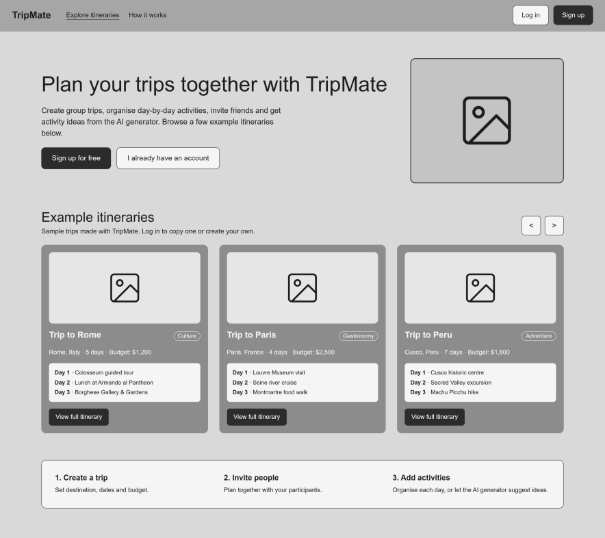
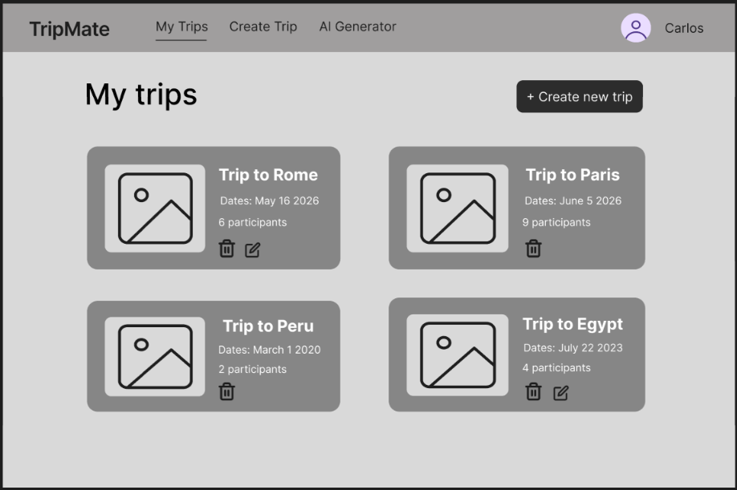
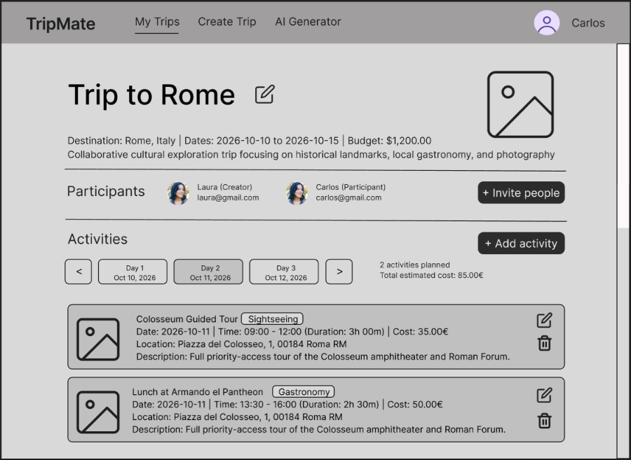
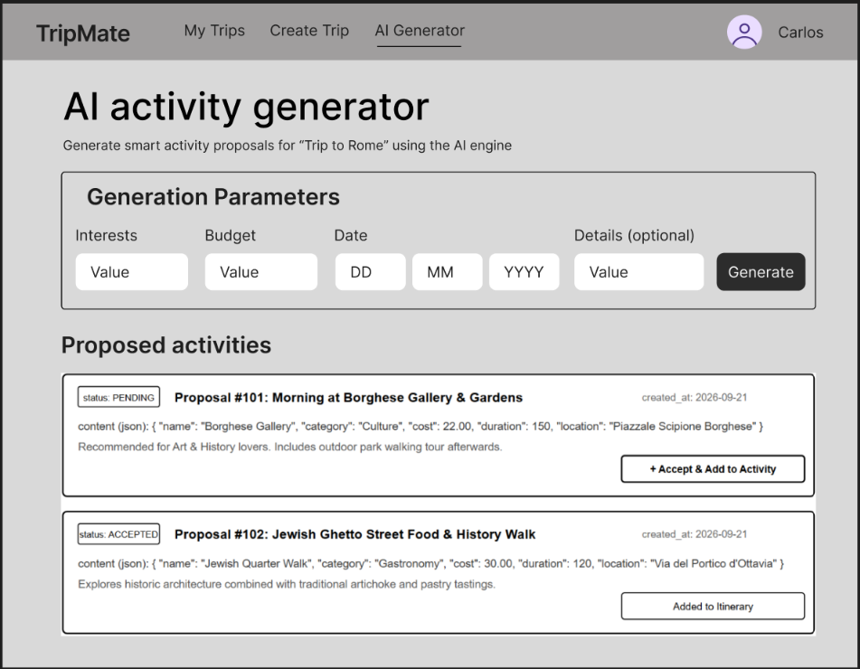

# TripMate: A web application for collaborative group trip planning with AI assistance

[](https://sonarcloud.io/summary/new_code?id=codeurjc-students_2026-ViajesRuben)

## Description

**TripMate** is a web application that lets a group of people plan a trip together: create the trip, build its day-by-day itinerary through activities, invite other participants, and collaborate on the plan. It includes an AI assistant able to generate itinerary proposals based on the destination, dates, budget, and preferences of the group, which the user can review and accept before adding them to the trip. Each trip can also have its own Telegram group, linked to the trip by a TripMate bot, so participants can talk about the trip in a messaging app they already use, receive their invitations there, and be notified when the plan changes. The project is initially developed as a monolithic application, designed to evolve in a second thesis project (TFG2) into a distributed services architecture.

<p>
  
  
</p>
<p>
  
  
</p>

> **Project status:** Only the functional and technical objectives of the application have been defined. Development has started (repository, minimum functionality, automated tests and continuous integration), but the implementation is **not functional yet**.

## Running the application

The only requirement is [Docker](https://docs.docker.com/get-docker/) with Docker Compose 2.34.0 or later, and port 443 free. Nothing needs to be cloned: the Compose file is published on DockerHub as an OCI artifact, and it starts the application (image `rubenruiz7/tripmate`) and MySQL:

```bash
docker compose -f oci://docker.io/rubenruiz7/tripmate-compose:latest up -d --yes
```

Compose lists the variables of the file and asks for confirmation before running an application downloaded from a registry; `--yes` answers yes to that question. Remove it to review the variables first. The tag selects the version: `latest` is the last release, `0.1.0` (or any other release number) a fixed one, and `dev` the last version of `main`.

Open https://localhost/ (the browser warns about the self-signed certificate) and log in as `admin@tripmate.com` with the password `admin`, or as one of the sample users, all with the password `Demo-2026`: `ana@tripmate.com` (12 trips), `carlos@tripmate.com` (3 trips) or `laura@tripmate.com` (2 trips). The sample users exist while `SAMPLE_DATA` is `true` (the default); set it to `false` for a deployment that must not have known accounts. To stop the application, run `docker compose -f oci://docker.io/rubenruiz7/tripmate-compose:latest down` (add `-v` to also delete the data). Without sample data: `SAMPLE_DATA=false docker compose -f oci://docker.io/rubenruiz7/tripmate-compose:latest up -d --yes`. From a clone of the repository, `docker compose -f docker/docker-compose.yml up -d` does the same with the file in `docker/`. To run it from the source code, see [Running and editing the code](docs/development-guide.md#running-and-editing-the-code).

## Documentation

- [Objectives](docs/objectives.md)
- [Methodology](docs/methodology.md)
- [Detailed features](docs/functionalities.md)
- [Analysis](docs/analysis.md)
- [Tracking](docs/tracking.md)
- [Authors](docs/authors.md)
- [Development guide](docs/development-guide.md)
  - [Introduction](docs/development-guide.md#introduction)
  - [Technologies](docs/development-guide.md#technologies)
  - [Tools](docs/development-guide.md#tools)
  - [Architecture](docs/development-guide.md#architecture)
  - [Quality control](docs/development-guide.md#quality-control)
  - [Development process](docs/development-guide.md#development-process)
  - [Running and editing the code](docs/development-guide.md#running-and-editing-the-code)
- [REST API documentation](https://raw.githack.com/codeurjc-students/2026-ViajesRuben/main/docs/api/api-docs.html)
- [AI tools usage (detailed)](docs/AI_USAGE.md)
- [Changelog](CHANGELOG.md)

## AI Tools Usage

- **Phase 1 (definition of features and screens):** Claude (Anthropic, Claude Opus 5.5, chat) was used to compare instant messaging platforms (WhatsApp and Telegram) for the optional instant messaging part, to design the Telegram integration and to review this README against the TFG guidelines.
- **Phase 2 (repository, tests and CI):** Claude (Anthropic, Claude Opus 5.5, chat) was used as a guide to set up the project structure, the automated tests, the CI workflows, static code analysis; and to restructure the documentation. All generated content was reviewed, understood and adapted before being added to the repository.

Detailed information about each use of AI tools is available in [AI_USAGE.md](docs/AI_USAGE.md).
