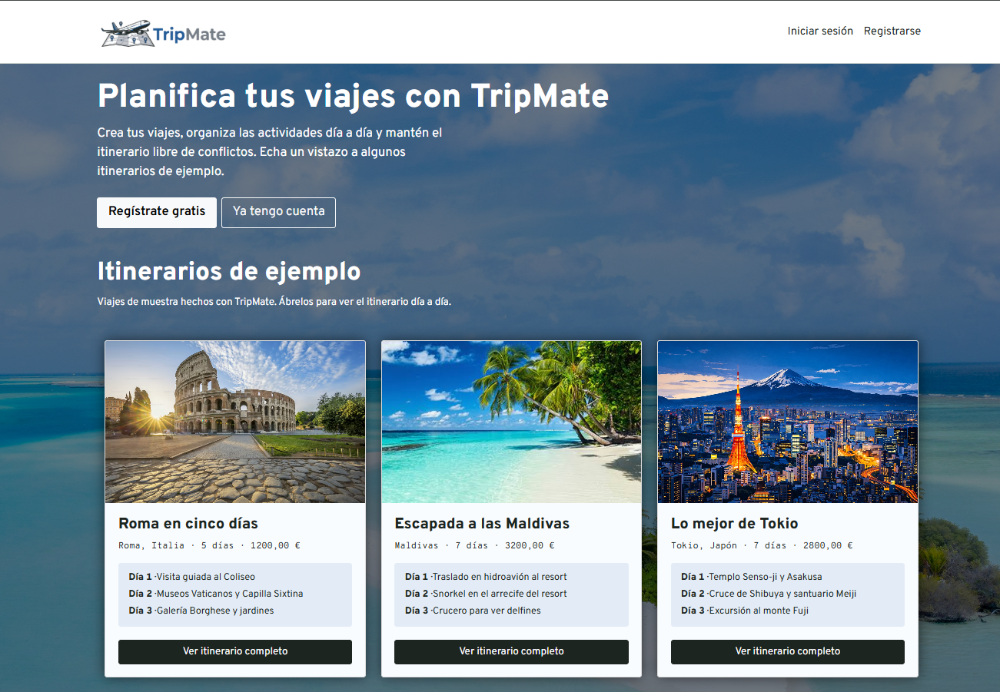
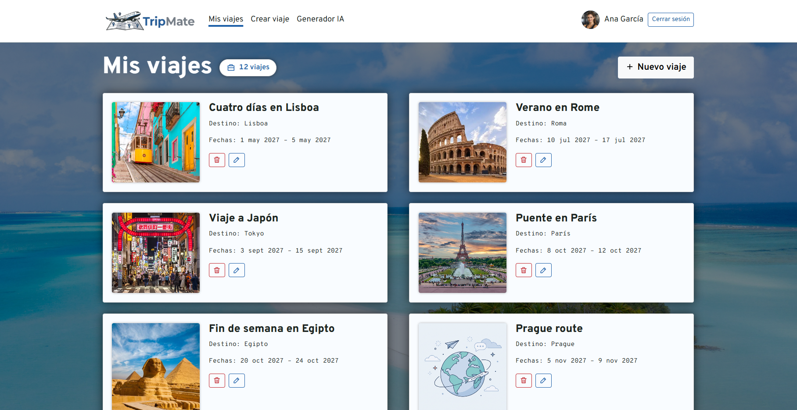
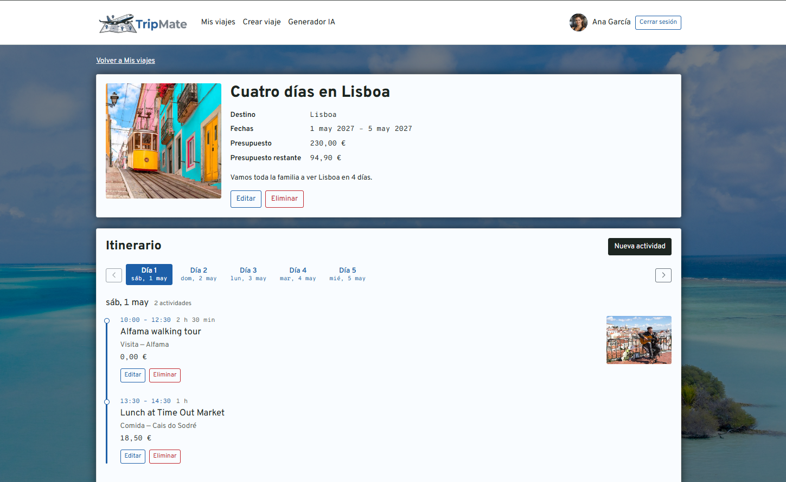
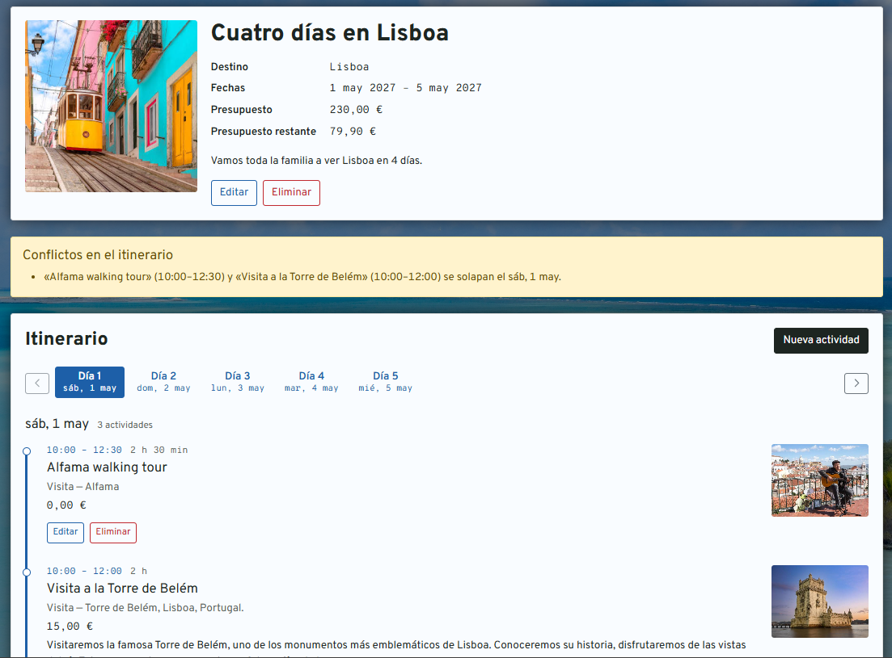

# TripMate: A web application for collaborative group trip planning with AI assistance

[](https://sonarcloud.io/summary/new_code?id=codeurjc-students_2026-ViajesRuben)

## Description

**TripMate** is a web application that lets a group of people plan a trip together: create the trip, build its day-by-day itinerary through activities, invite other participants, and collaborate on the plan. It includes an AI assistant able to generate itinerary proposals based on the destination, dates, budget, and preferences of the group, which the user can review and accept before adding them to the trip. Each trip can also have its own Telegram group, linked to the trip by a TripMate bot, so participants can talk about the trip in a messaging app they already use, receive their invitations there, and be notified when the plan changes. The project is initially developed as a monolithic application, designed to evolve in a second thesis project (TFG2) into a distributed services architecture.

## Version 0.1

Version 0.1 is the first working version of TripMate. A visitor can browse example itineraries on the public home page, register and log in. A registered user can edit their profile, create their own trips with a cover image, build the day-by-day itinerary of each trip with activities (with image, time, location, category and cost), follow the remaining budget and see warnings when activities overlap, fall outside the dates of the trip or exceed the budget. The administrator can search, edit, block and unblock users, and search, review and delete any trip. The application runs as a single Docker image with MySQL, published on DockerHub. These are the features B1–B8; see [Features](docs/functionalities.md) for each one with its screenshots.

<p>
  
  
</p>
<p>
  
  
</p>

> **Project status:** TripMate is still under development. Version 0.1 contains the basic functionality (B1–B8); the invitations and participants, the spending charts and the metrics (version 0.2), and the AI assistant and the Telegram integration (version 1.0) are not implemented yet.

### Video

One-minute video of version 0.1: [https://youtu.be/47QNyhBgbxg](https://youtu.be/47QNyhBgbxg)

### Next versions

- **Version 0.2 (intermediate functionality, I1–I6):** invite people to a trip by email and accept or reject invitations, manage the participants of a trip, build the itinerary collaboratively, spending charts on the trip page, a metrics dashboard for the administrator, and the deployment of the application on a server.
- **Version 1.0 (advanced functionality, A1–A6):** itinerary proposals and reorganization generated by AI with manual review, and the Telegram integration (account connection, trip group, invitations and notifications), plus the migration of the database schema.

## Running the application

The only requirement is [Docker](https://docs.docker.com/get-docker/) with Docker Compose 2.34.0 or later, and port 443 free. Nothing needs to be cloned: the Compose file is published on DockerHub as an OCI artifact, and it starts the application (image `rubenruiz7/tripmate`) and MySQL:

```bash
docker compose -f oci://docker.io/rubenruiz7/tripmate-compose:latest up -d --yes
```

Compose lists the variables of the file and asks for confirmation before running an application downloaded from a registry; `--yes` answers yes to that question. Remove it to review the variables first. The tag selects the version: `latest` is the last release, `0.1` (or any other release, written `MAJOR.MINOR`) a fixed one, and `dev` the last version of `main`.

Open https://localhost/ (the browser warns about the self-signed certificate) and log in as `admin@tripmate.com` with the password `admin`, or as one of the sample users, all with the password `Demo-2026`: `ana@tripmate.com`, `carlos@tripmate.com` or `laura@tripmate.com`. `SAMPLE_DATA=false` starts the application without the sample users and trips. The complete instructions (Windows, Mac and Linux, versions, sample data, stopping, and deployment on an external server) are in [Execution](docs/execution.md). To run it from the source code, see [Running and editing the code](docs/development-guide.md#running-and-editing-the-code).

## Documentation

- [Objectives](docs/objectives.md)
- [Methodology](docs/methodology.md)
- [Features](docs/functionalities.md)
  - [Features of version 0.1](docs/functionalities.md#features-of-version-01)
  - [Detailed features](docs/functionalities.md#detailed-features)
- [Analysis](docs/analysis.md)
- [Execution](docs/execution.md)
  - [Requirements](docs/execution.md#requirements)
  - [Running the application](docs/execution.md#running-the-application)
  - [Accessing the application](docs/execution.md#accessing-the-application)
  - [Sample data](docs/execution.md#sample-data)
  - [Running with and without sample data](docs/execution.md#running-with-and-without-sample-data)
  - [Deploying on an external server](docs/execution.md#deploying-on-an-external-server)
- [Development guide](docs/development-guide.md)
  - [Introduction](docs/development-guide.md#introduction)
  - [Technologies](docs/development-guide.md#technologies)
  - [Tools](docs/development-guide.md#tools)
  - [Architecture](docs/development-guide.md#architecture)
    - [Deployment](docs/development-guide.md#deployment)
    - [Security](docs/development-guide.md#security)
    - [REST API](docs/development-guide.md#rest-api)
  - [Quality control](docs/development-guide.md#quality-control)
    - [Types of tests](docs/development-guide.md#types-of-tests)
    - [Traceability between tests and features](docs/development-guide.md#traceability-between-tests-and-features)
    - [Test statistics](docs/development-guide.md#test-statistics)
    - [Static code analysis](docs/development-guide.md#static-code-analysis)
    - [Code size](docs/development-guide.md#code-size)
  - [Development process](docs/development-guide.md#development-process)
    - [Versioning](docs/development-guide.md#versioning)
  - [Running and editing the code](docs/development-guide.md#running-and-editing-the-code)
  - [Design decisions](docs/development-guide.md#design-decisions)
- [REST API documentation](https://raw.githack.com/codeurjc-students/2026-ViajesRuben/main/docs/api/api-docs.html)
- [Tracking](docs/tracking.md)
- [Authors](docs/authors.md)
- [AI tools usage (detailed)](docs/AI_USAGE.md)
- [Changelog](CHANGELOG.md)

## AI Tools Usage

- **Phase 1 (definition of features and screens):** Claude (Anthropic, Claude Opus 5.5, chat) was used to compare instant messaging platforms (WhatsApp and Telegram) for the optional instant messaging part, to design the Telegram integration and to review this README against the TFG guidelines.
- **Phase 2 (repository, tests and CI):** Claude (Anthropic, Claude Opus 5.5, chat) was used as a guide to set up the project structure, the automated tests, the CI workflows, static code analysis; and to restructure the documentation. All generated content was reviewed, understood and adapted before being added to the repository.
- **Phase 3 (basic functionality, B1–B8):** Claude Code (Anthropic, Opus 5.5 for planning and Sonnet 5.5 for implementation) was used as a support agent to plan, write some parts of the code and tests, and help document each feature; the student approved each plan, reviewed and changed the generated code, and verified every stage before committing.

Detailed information about each use of AI tools is available in [AI_USAGE.md](docs/AI_USAGE.md).
