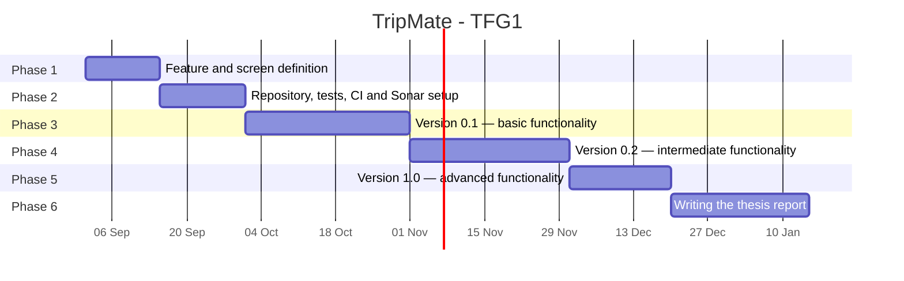
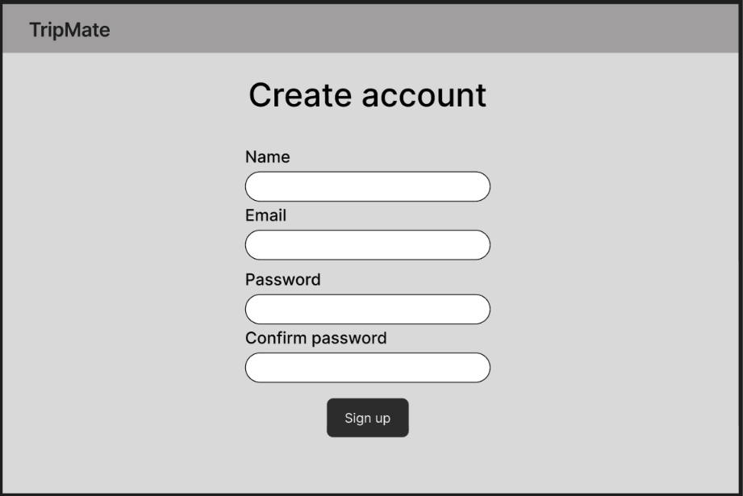
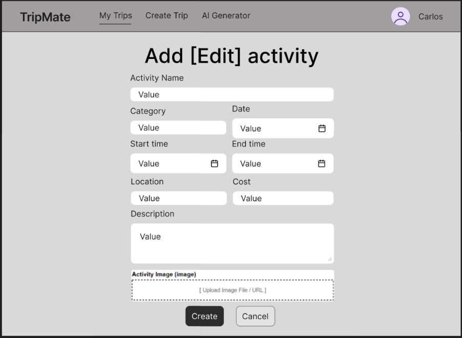
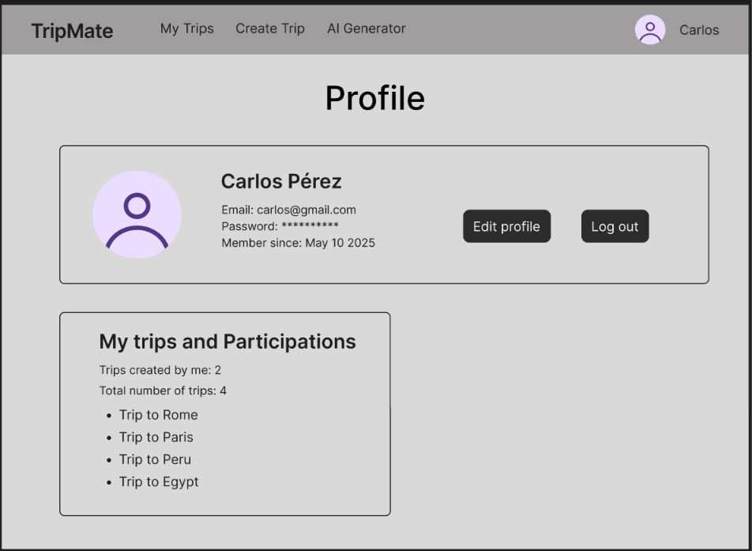
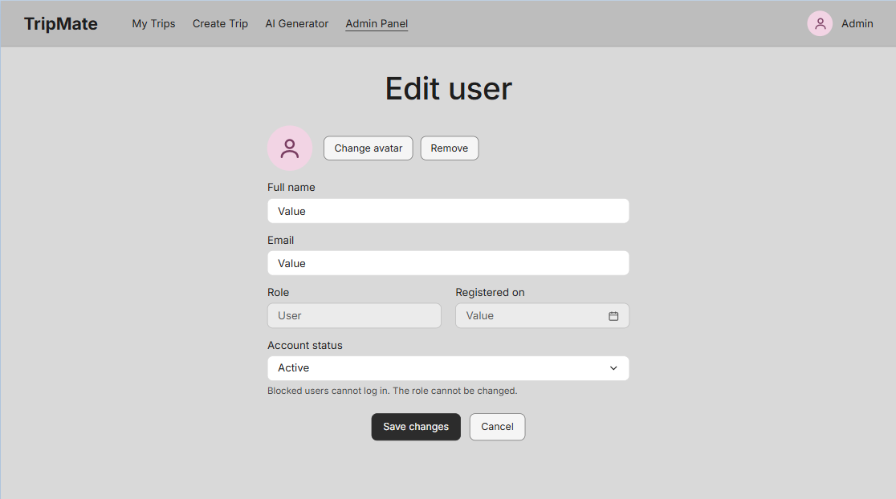

# TripMate: A web application for collaborative group trip planning with AI assistance

## Description

**TripMate** is a web application that lets a group of people plan a trip together: create the trip, build its day-by-day itinerary through activities, invite other participants, and collaborate on the plan. It includes an AI assistant able to generate itinerary proposals based on the destination, dates, budget, and preferences of the group, which the user can review and accept before adding them to the trip. Each trip can also have its own Telegram group, linked to the trip by a TripMate bot, so participants can talk about the trip in a messaging app they already use, receive their invitations there, and be notified when the plan changes. The project is initially developed as a monolithic application, designed to evolve in a second thesis project (TFG2) into a distributed services architecture.

  
  

> **Note:** At this stage (Phase 2), only the functional and technical objectives of the application have been defined. Development has started, but the implementation is not functional yet.

## Objectives

### Functional objectives

The main functional objective is to provide a tool that lets a group of users organize a trip from start to finish without relying on spreadsheets or scattered chats, covering everything from registration and trip creation to collaborative itinerary building, AI-generated proposals, and a group chat per trip connected to the plan.

- Registration, login, and user profile management.
- Creation, viewing, editing, and deletion of trips (name, destination, dates, budget, description, cover image).
- Building a day-by-day itinerary through activities (location, date, schedule, cost, category, image).
- Inviting other users to a trip by email, with acceptance or rejection of the invitation.
- Collaboration between several participants on the same itinerary, with differentiated creator and participant roles.
- Automatic detection of conflicts in the plan (schedule overlaps, activities outside the trip dates, spending over budget).
- Generation of itinerary proposals via AI based on the group's preferences, budget, and characteristics, with manual review and acceptance before they are added.
- Visualization of trip spending through charts.
- A Telegram group for each trip, with invitations and notifications sent by a bot and access restricted to the trip's invited users.
- Administration panel for managing users, moderating trips, and viewing platform metrics.

### Technical objectives

From a technical standpoint, the application follows a Single Page Application (SPA) architecture: a frontend built with React and TypeScript that communicates through a REST API with a Spring Boot (Java) backend designed as a modular monolith, backed by a MySQL database, and packaged with Docker. It integrates external services (a language model for proposals, an email service, and the Telegram Bot API) and is built so it can later be split into independent services in TFG2. The selected optional parts are **static code analysis**, **AI integration**, and **integration with an instant messaging system**.

- SPA architecture: modular monolithic backend in Java with Spring Boot, organized by domain, exposing a REST API documented with OpenAPI, and a responsive SPA frontend in React with TypeScript that consumes it; designed for a future decomposition into services.
- Relational data model in MySQL with the entities User, Trip, Participation, Invitation, Activity, and AIProposal.
- Role-based authentication and authorization (anonymous, registered, administrator; creator/participant within each trip).
- Integration with a language model (LLM) via API to generate and reorganize itinerary proposals.
- Integration with the Telegram Bot API: account linking through deep links, one group per trip, invite links whose join requests are approved according to TripMate's permissions, and notifications about trip changes.
- Uploading and management of images associated with users, trips, and activities, stored in the database.
- Data visualization using a charting library on the frontend.
- Integration with an email-sending service to deliver invitations to trip participants.
- Implementation of a conflict-detection algorithm over the itinerary.
- Quality and delivery: automated tests at every level, continuous integration and delivery, static code analysis with Sonar, packaging with Docker and Docker Compose, and deployment.

## Methodology

The project follows an iterative and incremental process based on the principles of the Agile Manifesto, applying some Extreme Programming (XP) and Kanban practices. Tasks are managed as GitHub Issues on a GitHub Project Kanban board. The code is managed with Git following GitHub Flow: each feature or fix is developed in its own branch and merged into `main` through a pull request. A new version (release) is published at the end of each development phase.

- **Phase 1:** Definition of the application's features and screens, described in the [Detailed features](#detailed-features) and [Analysis](#analysis) sections.
- **Phase 2:** Setup of the development technologies and tools, with quality controls that run periodically (automated tests, continuous integration, and static code analysis).
- **Phases 3, 4, and 5:** Iterative and incremental development of the application. A release is published at the end of each phase (versions 0.1, 0.2, and 1.0).
- **Phase 6:** Writing the thesis report.
- **Phase 7:** Preparing and delivering the defense.

| Phase   | Content                                                                                        | Start        | End              |
| ------- | ---------------------------------------------------------------------------------------------- | ------------ | ---------------- |
| Phase 1 | Definition of features, screens, and analysis (this document)                                  | Sep 1, 2026  | **Sep 15, 2026** |
| Phase 2 | Repository setup, minimum functionality, automated tests, continuous integration, and Sonar    | Sep 15, 2026 | **Oct 1, 2026**  |
| Phase 3 | Version 0.1 — basic functionality (B1–B8) + Docker and continuous delivery                     | Oct 1, 2026  | **Nov 1, 2026**  |
| Phase 4 | Version 0.2 — intermediate functionality (I1–I6) + deployment                                  | Nov 1, 2026  | **Dec 1, 2026**  |
| Phase 5 | Version 1.0 — advanced functionality (A1–A6: AI and Telegram integration) + database migration | Dec 1, 2026  | **Dec 20, 2026** |
| Phase 6 | Writing the thesis report                                                                      | Dec 20, 2026 | **Jan 15, 2027** |
| Phase 7 | Defense                                                                                        | TBD          | **TBD**          |

## Detailed features

Each feature has an identifier so that it can be traced to its automated tests.

### Basic functionality (version 0.1)

| ID  | Feature                                                                                                                                                  | User type                 |
| --- | -------------------------------------------------------------------------------------------------------------------------------------------------------- | ------------------------- |
| B1  | Browse the public home page with example itineraries (preview only; sample trips created by the administrator).                                          | Anonymous                 |
| B2  | Register a new account and log in.                                                                                                                       | Anonymous                 |
| B3  | Log out, and view and edit one's own profile (name, email, password, avatar).                                                                            | Registered                |
| B4  | Create, view, edit, and delete one's own trips, including a cover image.                                                                                 | Registered (trip creator) |
| B5  | Create, view, edit, and delete activities in a trip's itinerary, including an image, and browse the itinerary day by day.                                | Registered (trip creator) |
| B6  | Conflict detection: overlapping activities on the same day, activities outside the trip's date range, and total activity cost exceeding the trip budget. | Registered (trip members) |
| B7  | User management: list and search users, edit their account details, and block or unblock accounts.                                                       | Administrator             |
| B8  | Trip moderation: list and search all trips, view any trip's details, and delete inappropriate trips.                                                     | Administrator             |

### Intermediate functionality (version 0.2)

| ID  | Feature                                                                                                                                        | User type                      |
| --- | ---------------------------------------------------------------------------------------------------------------------------------------------- | ------------------------------ |
| I1  | Invite users to a trip by email; the invited person receives an email with a link to respond.                                                  | Trip creator                   |
| I2  | Accept or reject an invitation, from the email link or from the pending invitations section in "My Trips".                                     | Registered (invited user)      |
| I3  | Manage participants: the creator can view and remove participants; a participant can leave the trip.                                           | Trip creator, trip participant |
| I4  | Collaborative itinerary: participants create activities and edit or delete their own; the creator can edit or delete any activity of the trip. | Trip creator, trip participant |
| I5  | Spending charts on the trip page (spending by category against the budget, cumulative spending per day).                                       | Trip creator, trip participant |
| I6  | Platform metrics dashboard (total users, trips, activities, and, from version 1.0, AI requests).                                               | Administrator                  |

### Advanced functionality (version 1.0)

| ID  | Feature                                                                                                                                                                                                                                                                      | User type                      |
| --- | ---------------------------------------------------------------------------------------------------------------------------------------------------------------------------------------------------------------------------------------------------------------------------- | ------------------------------ |
| A1  | Generation of itinerary proposals via AI, based on destination, dates, budget, and the group's preferences, with manual review and acceptance before the proposed activities are added.                                                                                      | Trip creator, trip participant |
| A2  | Reorganization of an existing itinerary via AI, taking already-detected conflicts into account, with manual review and acceptance.                                                                                                                                           | Trip creator                   |
| A3  | Connect a Telegram account from the user profile (through a one-time link to the TripMate bot) and disconnect it.                                                                                                                                                            | Registered                     |
| A4  | Create the trip's Telegram group with a single button: Telegram opens to create the group with the TripMate bot as administrator, and the bot links the group to the trip.                                                                                                   | Trip creator                   |
| A5  | Invitations through Telegram: invited users with a connected account receive a private message from the bot with the group invite link and a link to the trip. The bot approves join requests only from invited users or participants, and removes users who leave the trip. | Trip creator, invited user     |
| A6  | Notifications in the trip's Telegram group when the dates, the itinerary, or the participants change.                                                                                                                                                                        | Trip participants              |

The Telegram integration is optional for users: every feature of the trip works without a Telegram account.

## Analysis

### Screens and navigation

| Screen                          | Description                                                                              | Leads to                                                                         |
| :------------------------------ | :--------------------------------------------------------------------------------------- | :------------------------------------------------------------------------------- |
| **Public Home**                 | Landing page with example itineraries                                                    | Log In, Create Account                                                           |
| **Log In**                      | Public authentication form                                                               | Create Account, My Trips                                                         |
| **Create Account**              | User registration form                                                                   | Log In, My Trips                                                                 |
| **My Trips**                    | Main dashboard with the user's trips and pending invitations                             | Trip Details, Create/Edit Trip, User Profile                                     |
| **Create / Edit Trip**          | Form to initialize or update a trip                                                      | My Trips, Trip Details                                                           |
| **Trip Details & Itinerary**    | Core trip hub: summary, participants, day-by-day plan, conflicts, charts, Telegram group | Add/Edit Activity, AI Generator, Create/Edit Trip, My Trips, Telegram (external) |
| **Add / Edit Activity**         | Form/Modal for itinerary activities                                                      | Trip Details                                                                     |
| **AI Activity Generator**       | AI proposal generator and acceptance                                                     | Trip Details                                                                     |
| **User Profile**                | User account settings, personal trip list, and Telegram connection                       | My Trips, Public Home (log out), Admin Panel (if admin), Telegram (external)     |
| **System Administration Panel** | Global platform metrics, user management, and trip moderation                            | Edit User, Trip Details, User Profile                                            |
| **Edit User**                   | Administrator form to edit a user's account details and status                           | System Administration Panel                                                      |

### Navigation Flow Diagram

The following diagram illustrates the overall user experience and navigation flow across all screens of the application. It details the transition paths between public views, core trip management features, AI tools, user profile settings, and the administrative dashboard:

#### 1. Public Home

The public landing page shown to visitors who are not logged in. It introduces **TripMate** with a short pitch and a header with "Log In" and "Sign Up" buttons, displays a set of example itineraries (destination, duration, budget and a day-by-day preview) to illustrate how the app works, and includes a brief "how it works" section. Any attempt to open a full itinerary redirects the visitor to log in or create an account.

#### 2. Log In

The initial public screen for user authentication. It features a simple, centered interface displaying the **TripMate** brand logo, fields for email and password input, a primary "Sign In" button, and a quick-navigation link allowing unauthenticated users to switch to the account registration page.

#### 3. Create Account

The public user onboarding page. It provides a clean registration form containing fields for full name, email, password, and password confirmation, along with a "Sign Up" action button. It enables anonymous visitors to create a personal account and access the application.

#### 4. My Trips

The primary dashboard for authenticated users after logging in. It includes the global application header and displays a grid of existing trip cards (showing destination, dates, and participant count), each with quick actions to view or manage the trip, alongside a prominent "+ Create new trip" button. A "Pending invitations" section lists the trips the user has been invited to, with "Accept" and "Reject" buttons.

#### 5. Create / Edit Trip

A structured form interface used to initialize a new trip or update an existing one. It collects essential trip attributes including the trip name, destination, start and end dates, total budget, description, cover image, and, from version 0.2, an input field to invite initial collaborators by email.

#### 6. Trip Details & Itinerary

The main control hub for a specific trip. The top section summarizes core trip details (destination, dates, budget) and displays participant avatars with an invite button. The middle section features an interactive day-by-day tab selector to filter and view the chronological list of scheduled activities for the selected date, with warnings for any detected conflicts. A spending section shows the trip's charts. From version 1.0, a Telegram button lets the creator create the trip's Telegram group and lets participants open it.

#### 7. Add / Edit Activity

A modal or dedicated form interface for managing individual activities within a trip. It captures granular attributes such as activity name, category, date, start/end times, estimated cost, location, description, and an optional image upload. The duration is calculated automatically from the start and end times.

#### 8. AI Activity Generator

An intelligent planning module that leverages an AI engine to generate custom activity proposals. Users specify preferences (category, budget range, target date), and the system returns structured proposal cards (`AIProposal`) that can be reviewed and added directly to the trip itinerary with a single click.

#### 9. User Profile

The account management view displaying the user's personal details (avatar, name, email, account creation date). It includes action buttons to edit profile information or log out, as well as an organized overview of the user's created trips and active group participations. From version 1.0, it also shows the Telegram connection status, with a "Connect Telegram" or "Disconnect" button.

#### 10. System Administration Panel

A high-level oversight dashboard accessible exclusively to the system administrator. It displays global platform metrics (total users, trips, activities, and AI requests) and provides searchable data tables to manage registered users and moderate platform-wide trips. In the users table, the "Edit" button redirects the administrator to the Edit User screen. In the trips table, the "View" button redirects to the Trip Details & Itinerary page of the selected trip, where the administrator can review its full information and activities, and a "Delete" button removes inappropriate trips.

#### 11. Edit User

A form accessible only to the administrator, where a user's account details (name, email, avatar) and status (active or blocked) can be updated. Blocked users cannot log in. The administrator role cannot be assigned from this form, since the application has a single administrator defined in the configuration.

### Entities

| Entity        | Main attributes                                                                                                                                                          | Relationship                                                                                                                          | Cardinality                                                                                                                                                                                     |
| ------------- | ------------------------------------------------------------------------------------------------------------------------------------------------------------------------ | ------------------------------------------------------------------------------------------------------------------------------------- | ----------------------------------------------------------------------------------------------------------------------------------------------------------------------------------------------- |
| User          | id, name, email, password (hash), avatar, role (USER/ADMIN), status (ACTIVE/BLOCKED), registration_date, telegram_user_id, telegram_link_token, telegram_link_expires_at | creator of Trips; participates in Trips via Participation; author of Activities; sends and receives Invitations; requests AIProposals | 1:N with Trip (creator) · N:M with Trip (via Participation) · 1:N with Activity (author) · 1:N with Invitation (inviter) · 1:N with Invitation (invited user) · 1:N with AIProposal (requester) |
| Trip          | id, creator_id, name, destination, start_date, end_date, budget, description, cover_image, created_at, telegram_group_id, telegram_invite_link                           | created by a User; has Participations, Invitations, Activities, and AIProposals                                                       | N:1 with User (creator) · N:M with User (via Participation) · 1:N with Invitation · 1:N with Activity · 1:N with AIProposal                                                                     |
| Participation | id, trip_id, user_id, joined_at                                                                                                                                          | relates a Trip with each User who joined it by accepting an invitation (the creator is identified by Trip.creator_id)                 | N:1 with User · N:1 with Trip                                                                                                                                                                   |
| Invitation    | id, trip_id, inviter_id, invited_email, invited_user_id, token, status (PENDING/ACCEPTED/REJECTED), sent_at, responded_at                                                | belongs to a Trip; sent by a User; addressed to an email, linked to a User when that email is registered                              | N:1 with Trip · N:1 with User (inviter) · N:1 with User (invited, optional)                                                                                                                     |
| Activity      | id, trip_id, author_id, name, description, location, date, start_time, end_time, cost, category, image                                                                   | belongs to a Trip; created by a User                                                                                                  | N:1 with Trip · N:1 with User (author)                                                                                                                                                          |
| AIProposal    | id, trip_id, requested_by, type (GENERATION/REORGANIZATION), content (json), status (PENDING/ACCEPTED/REJECTED), created_at                                              | belongs to a Trip; requested by a User                                                                                                | N:1 with Trip · N:1 with User (requester)                                                                                                                                                       |

Notes:

- The activity duration is not stored; it is calculated from `start_time` and `end_time`.
- The Telegram attributes are optional (empty until the user connects Telegram or the creator creates the trip's group) and are used from version 1.0.
- `telegram_link_token` is a one-time code with an expiration date, used to link a TripMate account with a Telegram account through the bot.

### User permissions

- **Anonymous**: browsing the public home page and its example itineraries (preview only), registration, and login.
- **Registered (any user)**: managing their own profile, creating trips, accepting or rejecting the invitations they receive, and connecting or disconnecting their Telegram account.
- **Registered — trip creator** (owner of the trip): full CRUD on the trip; inviting and removing participants; creating, editing, and deleting any activity of the trip; requesting and accepting AI generation and reorganization proposals; creating the trip's Telegram group.
- **Registered — trip participant**: viewing the trip and its charts; creating activities and editing or deleting only the activities they created; requesting and accepting AI generation proposals; leaving the trip; joining the trip's Telegram group.
- **Administrator**: a single administrator whose credentials (with an encrypted password) are defined in a configuration file. Can manage user accounts (edit details, block or unblock), moderate trips (view and delete any trip), and access platform-wide metrics.
- **Telegram group access**: only the trip creator can link a Telegram group to the trip. The bot approves join requests only from users who are participants of the trip or have been invited to it, and removes from the group users who leave or are removed from the trip.

### Images

- User → profile avatar.
- Trip → cover/destination image.
- Activity → photo associated with the place or activity.

### Charts

- Bar chart: spending by activity category against the trip's total budget.
- Line chart: cumulative spending over the days of the trip.

### Complementary technology

Email sending, used for trip invitations: when the creator invites a user, the system sends an email with a link to accept or reject the invitation.

### Advanced algorithm or query

Automatic conflict detection in a trip's itinerary. When an activity is created or modified, or when the trip's dates or budget change, the system checks:

- Schedule overlaps between activities on the same day.
- Activity dates outside the trip's date range (for example, after the trip dates are edited).
- Total cost of the activities exceeding the trip's budget.

Detected conflicts are shown to participants and are also taken into account when the AI generates or reorganizes an itinerary proposal.

## Tracking

- GitHub Project: [https://github.com/orgs/codeurjc-students/projects/46](https://github.com/orgs/codeurjc-students/projects/46)

## AI Tools Usage

- **Phase 1:** Claude (Anthropic, Claude Opus 5.5, chat) was used to compare instant messaging platforms (WhatsApp and Telegram) for the optional instant messaging part, to design the Telegram integration and to review this README against the TFG guidelines.

Detailed information about each use of AI tools is available in [AI_USAGE.md](AI_USAGE.md).

## Author

This project is developed as part of the undergraduate thesis (TFG1) for the dual Bachelor's Degree in Computer Engineering and Software Engineering at the Escuela Técnica Superior de Ingeniería Informática (ETSII), Universidad Rey Juan Carlos (URJC).

- **Student:** Rubén Ruiz Martín
- **Tutor:** Iván Chicano Capelo
