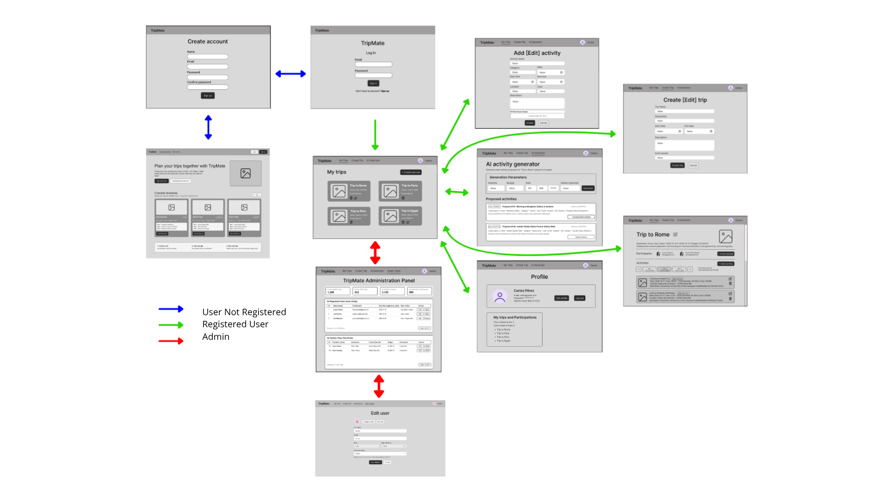
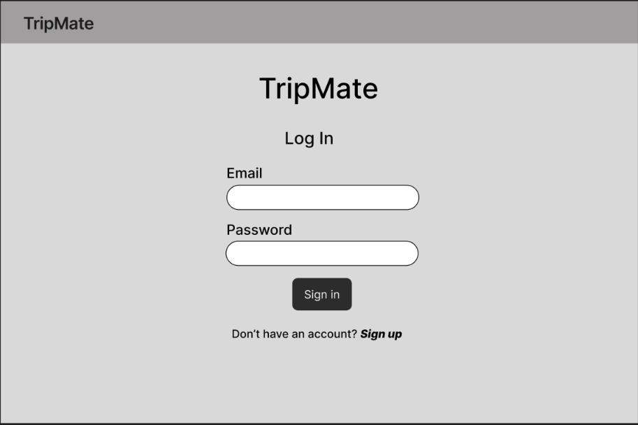
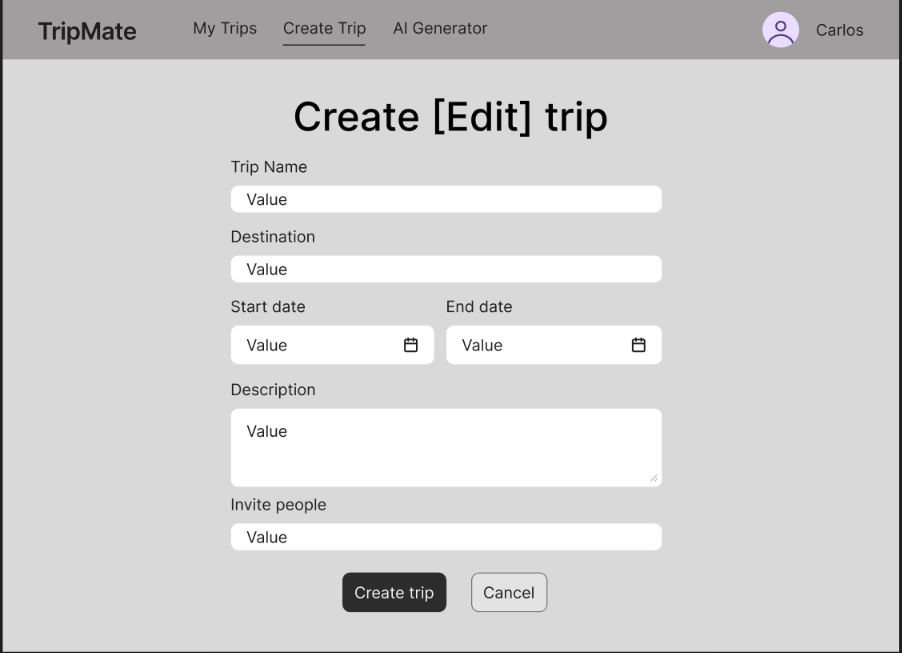
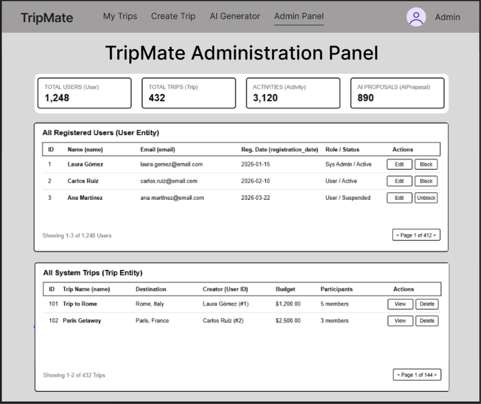

[← Back to README](../README.md)

# Analysis

## Index

- [Screens and navigation](#screens-and-navigation)
- [Entities](#entities)
- [User permissions](#user-permissions)
- [Images](#images)
- [Charts](#charts)
- [Complementary technology](#complementary-technology)
- [Advanced algorithm or query](#advanced-algorithm-or-query)

## Screens and navigation

| Screen                          | Description                                                                              | Leads to                                                                         |
| :------------------------------ | :--------------------------------------------------------------------------------------- | :------------------------------------------------------------------------------- |
| **Public Home**                 | Landing page with example itineraries                                                    | Log In, Create Account                                                           |
| **Log In**                      | Public authentication form                                                               | Create Account, My Trips                                                         |
| **Create Account**              | User registration form                                                                   | Log In, My Trips                                                                 |
| **My Trips**                    | Main dashboard with the user's trips and pending invitations                             | Trip Details, Create/Edit Trip, User Profile                                     |
| **Create / Edit Trip**          | Form to initialize or update a trip                                                      | My Trips, Trip Details                                                           |
| **Trip Details & Itinerary**    | Core trip hub: summary, participants, day-by-day plan, conflicts, charts, Telegram group | Add/Edit Activity, AI Generator, Create/Edit Trip, My Trips, Telegram (external) |
| **Add / Edit Activity**         | Form/Modal for itinerary activities                                                      | Trip Details                                                                     |
| **AI Activity Generator**       | AI proposal generator and acceptance                                                     | Trip Details                                                                     |
| **User Profile**                | User account settings, personal trip list, and Telegram connection                       | My Trips, Public Home (log out), Admin Panel (if admin), Telegram (external)     |
| **System Administration Panel** | Global platform metrics, user management, and trip moderation                            | Edit User, Trip Details, User Profile                                            |
| **Edit User**                   | Administrator form to edit a user's account details and status                           | System Administration Panel                                                      |

## Navigation flow diagram

The following diagram illustrates the overall user experience and navigation flow across all screens of the application. It details the transition paths between public views, core trip management features, AI tools, user profile settings, and the administrative dashboard:

### 1. Public Home

The public landing page shown to visitors who are not logged in. It introduces **TripMate** with a short pitch and a header with "Log In" and "Sign Up" buttons, displays a set of example itineraries (destination, duration, budget and a day-by-day preview) to illustrate how the app works, and includes a brief "how it works" section. Any attempt to open a full itinerary redirects the visitor to log in or create an account.

### 2. Log In

The initial public screen for user authentication. It features a simple, centered interface displaying the **TripMate** brand logo, fields for email and password input, a primary "Sign In" button, and a quick-navigation link allowing unauthenticated users to switch to the account registration page.

### 3. Create Account

The public user onboarding page. It provides a clean registration form containing fields for full name, email, password, and password confirmation, along with a "Sign Up" action button. It enables anonymous visitors to create a personal account and access the application.

### 4. My Trips

The primary dashboard for authenticated users after logging in. It includes the global application header and displays a grid of existing trip cards (showing destination, dates, and participant count), each with quick actions to view or manage the trip, alongside a prominent "+ Create new trip" button. A "Pending invitations" section lists the trips the user has been invited to, with "Accept" and "Reject" buttons.

### 5. Create / Edit Trip

A structured form interface used to initialize a new trip or update an existing one. It collects essential trip attributes including the trip name, destination, start and end dates, total budget, description, cover image, and, from version 0.2, an input field to invite initial collaborators by email.

### 6. Trip Details & Itinerary

The main control hub for a specific trip. The top section summarizes core trip details (destination, dates, budget) and displays participant avatars with an invite button. The middle section features an interactive day-by-day tab selector to filter and view the chronological list of scheduled activities for the selected date, with warnings for any detected conflicts. A spending section shows the trip's charts. From version 1.0, a Telegram button lets the creator create the trip's Telegram group and lets participants open it.

### 7. Add / Edit Activity

A modal or dedicated form interface for managing individual activities within a trip. It captures granular attributes such as activity name, category, date, start/end times, estimated cost, location, description, and an optional image upload. The duration is calculated automatically from the start and end times.

### 8. AI Activity Generator

An intelligent planning module that leverages an AI engine to generate custom activity proposals. Users specify preferences (category, budget range, target date), and the system returns structured proposal cards (`AIProposal`) that can be reviewed and added directly to the trip itinerary with a single click.

### 9. User Profile

The account management view displaying the user's personal details (avatar, name, email, account creation date). It includes action buttons to edit profile information or log out, as well as an organized overview of the user's created trips and active group participations. From version 1.0, it also shows the Telegram connection status, with a "Connect Telegram" or "Disconnect" button.

### 10. System Administration Panel

A high-level oversight dashboard accessible exclusively to the system administrator. It displays global platform metrics (total users, trips, activities, and AI requests) and provides searchable data tables to manage registered users and moderate platform-wide trips. In the users table, the "Edit" button redirects the administrator to the Edit User screen. In the trips table, the "View" button redirects to the Trip Details & Itinerary page of the selected trip, where the administrator can review its full information and activities, and a "Delete" button removes inappropriate trips.

### 11. Edit User

A form accessible only to the administrator, where a user's account details (name, email, avatar) and status (active or blocked) can be updated. Blocked users cannot log in. The administrator role cannot be assigned from this form, since the application has a single administrator defined in the configuration.

## Entities

| Entity        | Main attributes                                                                                                                                                          | Relationship                                                                                                                          | Cardinality                                                                                                                                                                                     |
| ------------- | ------------------------------------------------------------------------------------------------------------------------------------------------------------------------ | ------------------------------------------------------------------------------------------------------------------------------------- | ----------------------------------------------------------------------------------------------------------------------------------------------------------------------------------------------- |
| User          | id, name, email, password (hash), avatar, role (USER/ADMIN), status (ACTIVE/BLOCKED), registration_date, telegram_user_id, telegram_link_token, telegram_link_expires_at | creator of Trips; participates in Trips via Participation; author of Activities; sends and receives Invitations; requests AIProposals | 1:N with Trip (creator) · N:M with Trip (via Participation) · 1:N with Activity (author) · 1:N with Invitation (inviter) · 1:N with Invitation (invited user) · 1:N with AIProposal (requester) |
| Trip          | id, creator_id, name, destination, start_date, end_date, budget, description, cover_image, created_at, telegram_group_id, telegram_invite_link                           | created by a User; has Participations, Invitations, Activities, and AIProposals                                                       | N:1 with User (creator) · N:M with User (via Participation) · 1:N with Invitation · 1:N with Activity · 1:N with AIProposal                                                                     |
| Participation | id, trip_id, user_id, joined_at                                                                                                                                          | relates a Trip with each User who joined it by accepting an invitation (the creator is identified by Trip.creator_id)                 | N:1 with User · N:1 with Trip                                                                                                                                                                   |
| Invitation    | id, trip_id, inviter_id, invited_email, invited_user_id, token, status (PENDING/ACCEPTED/REJECTED), sent_at, responded_at                                                | belongs to a Trip; sent by a User; addressed to an email, linked to a User when that email is registered                              | N:1 with Trip · N:1 with User (inviter) · N:1 with User (invited, optional)                                                                                                                     |
| Activity      | id, trip_id, author_id, name, description, location, date, start_time, end_time, cost, category, image                                                                   | belongs to a Trip; created by a User                                                                                                  | N:1 with Trip · N:1 with User (author)                                                                                                                                                          |
| AIProposal    | id, trip_id, requested_by, type (GENERATION/REORGANIZATION), content (json), status (PENDING/ACCEPTED/REJECTED), created_at                                              | belongs to a Trip; requested by a User                                                                                                | N:1 with Trip · N:1 with User (requester)                                                                                                                                                       |

Notes:

- The activity duration is not stored; it is calculated from `start_time` and `end_time`.
- The Telegram attributes are optional (empty until the user connects Telegram or the creator creates the trip's group) and are used from version 1.0.
- `telegram_link_token` is a one-time code with an expiration date, used to link a TripMate account with a Telegram account through the bot.

## User permissions

- **Anonymous**: browsing the public home page and its example itineraries (preview only), registration, and login.
- **Registered (any user)**: managing their own profile, creating trips, accepting or rejecting the invitations they receive, and connecting or disconnecting their Telegram account.
- **Registered — trip creator** (owner of the trip): full CRUD on the trip; inviting and removing participants; creating, editing, and deleting any activity of the trip; requesting and accepting AI generation and reorganization proposals; creating the trip's Telegram group.
- **Registered — trip participant**: viewing the trip and its charts; creating activities and editing or deleting only the activities they created; requesting and accepting AI generation proposals; leaving the trip; joining the trip's Telegram group.
- **Administrator**: a single administrator whose credentials (with an encrypted password) are defined in a configuration file. Can manage user accounts (edit details, block or unblock), moderate trips (view and delete any trip), and access platform-wide metrics.
- **Telegram group access**: only the trip creator can link a Telegram group to the trip. The bot approves join requests only from users who are participants of the trip or have been invited to it, and removes from the group users who leave or are removed from the trip.

## Images

- User → profile avatar.
- Trip → cover/destination image.
- Activity → photo associated with the place or activity.

## Charts

- Bar chart: spending by activity category against the trip's total budget.
- Line chart: cumulative spending over the days of the trip.

## Complementary technology

Email sending, used for trip invitations: when the creator invites a user, the system sends an email with a link to accept or reject the invitation.

## Advanced algorithm or query

Automatic conflict detection in a trip's itinerary. When an activity is created or modified, or when the trip's dates or budget change, the system checks:

- Schedule overlaps between activities on the same day.
- Activity dates outside the trip's date range (for example, after the trip dates are edited).
- Total cost of the activities exceeding the trip's budget.

Detected conflicts are shown to participants and are also taken into account when the AI generates or reorganizes an itinerary proposal.
