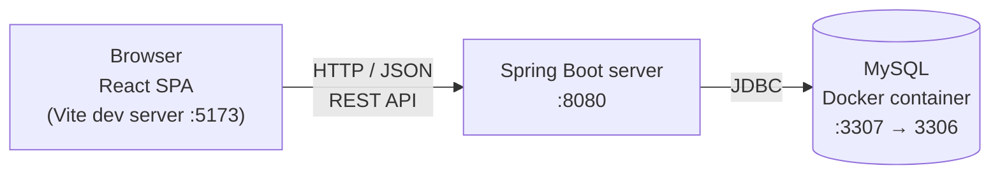

[← Back to README](../README.md)

# Development guide

This guide describes the current technical state of TripMate: how it is built, how its quality is controlled, how it is developed and how to run it from the source code. It is updated at the end of every phase.

## Index

- [Introduction](#introduction)
- [Technologies](#technologies)
- [Tools](#tools)
- [Architecture](#architecture)
  - [Deployment](#deployment)
  - [REST API](#rest-api)
- [Quality control](#quality-control)
  - [Automated tests](#automated-tests)
  - [Static code analysis](#static-code-analysis)
  - [Code style](#code-style)
- [Development process](#development-process)
  - [Task management](#task-management)
  - [Git](#git)
  - [Continuous integration](#continuous-integration)
- [Running and editing the code](#running-and-editing-the-code)
  - [Cloning the repository](#cloning-the-repository)
  - [Running the application](#running-the-application)
  - [Using the tools](#using-the-tools)
  - [Running the tests](#running-the-tests)
  - [Creating a release](#creating-a-release)
- [Design decisions](#design-decisions)
- [Problems and solutions](#problems-and-solutions)

## Introduction

TripMate is a web application with a **Single Page Application (SPA)** architecture. In an SPA, the browser downloads a single HTML page once, together with the JavaScript code of the client application. From then on, the client updates the view dynamically and exchanges data with the server through a **REST API** (JSON over HTTP), instead of requesting a new HTML page from the server for every interaction. This separates the user interface completely from the business logic and lets other clients (for example, a mobile app or the Telegram bot) reuse the same API.

The application has three parts that run as independent processes:

- **Client (frontend):** a React application that runs in the user's browser.
- **Server (backend):** a Spring Boot application that exposes the REST API and contains the business logic. It is designed as a modular monolith organized by domain, so that it can be split into independent services in TFG2.
- **Database:** a MySQL server that stores the application's data.

| Aspect                  | Description                                                                                                                                                                                                                                                           |
| ----------------------- | --------------------------------------------------------------------------------------------------------------------------------------------------------------------------------------------------------------------------------------------------------------------- |
| **Type**                | Web SPA with a REST API backend (modular monolith)                                                                                                                                                                                                                    |
| **Technologies**        | Backend: Java 21, Spring Boot, Spring Data JPA, MySQL. Frontend: React, TypeScript, Vite                                                                                                                                                                              |
| **Tools**               | Visual Studio Code, Maven, npm, Docker, Postman, Git, GitHub                                                                                                                                                                                                          |
| **Quality control**     | Unit, integration and system tests for backend and frontend (JUnit, Mockito, Testcontainers, Rest Assured, Selenium, Vitest, Testing Library); test coverage (JaCoCo, Vitest); static code analysis (SonarQube Cloud); code style checks (Spotless, ESLint, Prettier) |
| **Deployment**          | Not available yet. The application will be packaged with Docker and Docker Compose in Phase 3 and deployed in Phase 4                                                                                                                                                 |
| **Development process** | Iterative and incremental; Git with GitHub Flow; continuous integration with GitHub Actions; tasks managed with GitHub Issues and GitHub Projects                                                                                                                     |

## Technologies

Technologies used by the application at runtime.

### Java

Programming language of the backend. The project uses Java 21, the current long-term support (LTS) version.
https://www.java.com/

### Spring Boot

Framework for building Java applications with minimal configuration. In TripMate it provides the web server, the REST API controllers, dependency injection and the configuration of the application.
https://spring.io/projects/spring-boot

### Spring Data JPA

Spring module that simplifies data access with JPA (Java Persistence API). The application's entities are mapped to database tables, and repositories provide the database queries without writing SQL for the common operations.
https://spring.io/projects/spring-data-jpa

### springdoc-openapi

Library that generates the OpenAPI specification of the REST API from the Spring controllers and serves an interactive Swagger UI to explore it.
https://springdoc.org/

### MySQL

Open-source relational database management system. It stores all the persistent data of the application.
https://www.mysql.com/

### React

JavaScript library for building user interfaces from reusable components. It is used to implement the SPA client.
https://react.dev/

### TypeScript

Typed superset of JavaScript used for all the frontend code. The compiler (`tsc`, in strict mode) checks the types before the build, and the types of the REST API data are defined in `src/types` to match the backend DTOs.
https://www.typescriptlang.org/

### Vite

Build tool and development server for the frontend. It serves the React application during development with instant reload and generates the optimized production build.
https://vite.dev/

## Tools

Tools used to develop the application.

### Visual Studio Code

Code editor used for both backend and frontend development. The repository includes shared settings (`.vscode/settings.json`) that format files on save.
https://code.visualstudio.com/

### Maven

Build and dependency management tool for the backend. The repository includes the Maven Wrapper (`mvnw`), so Maven does not need to be installed.
https://maven.apache.org/

### npm

Package manager for JavaScript (Node.js). It installs the frontend dependencies and runs its scripts (development server, build, tests, linting and formatting).
https://www.npmjs.com/

### Docker

Container platform. During development it is used to run the MySQL database and, through Testcontainers, to start a real MySQL instance for the integration and system tests.
https://www.docker.com/

### Postman

Tool to send HTTP requests and test REST APIs. The repository includes a Postman collection with example requests for every operation of the API.
https://www.postman.com/

### Git and GitHub

Git is the version control system; GitHub hosts the repository, the issues, the project board and the CI workflows.
https://git-scm.com/ · https://github.com/

### GitHub Actions

Continuous integration service of GitHub. It runs the quality control workflows automatically on every push and pull request.
https://github.com/features/actions

### SonarQube Cloud

Cloud service for static code analysis. It detects bugs, vulnerabilities, code smells and duplicated code, and shows the test coverage.
https://sonarcloud.io/

### Testcontainers

Library that starts Docker containers from the tests. It is used to run the integration and system tests against a real MySQL database instead of an in-memory one.
https://testcontainers.com/

### Spotless, ESLint and Prettier

Code style tools. Spotless formats the Java code following the Google Java Style (google-java-format); Prettier formats the frontend code; ESLint detects problems and bad practices in the frontend code.
https://github.com/diffplug/spotless · https://eslint.org/ · https://prettier.io/

## Architecture

### Deployment

During development, TripMate runs as three independent processes:



- The **browser** loads the React application from the Vite development server and calls the REST API of the backend using HTTP with JSON payloads.
- The **Spring Boot server** handles the requests, applies the business logic and accesses the database through JDBC (using Spring Data JPA).
- The **MySQL database** runs in a Docker container. The container's port 3306 is published on port 3307 of the host.

From Phase 3, the frontend will be served as static resources by the Spring Boot server over HTTPS (port 443), and the whole application will be packaged with Docker and Docker Compose.

### REST API

The REST API is documented with OpenAPI. The specification is stored in [`docs/api/api-docs.yaml`](api/api-docs.yaml) and its HTML version can be viewed here:

**[REST API documentation](https://raw.githack.com/codeurjc-students/2026-ViajesRuben/main/docs/api/api-docs.html)**

Current operations:

| Method | URL             | Description               |
| ------ | --------------- | ------------------------- |
| GET    | `/api/v1/trips` | Returns the list of trips |

## Quality control

### Automated tests

The application has automated tests at every level for both the backend and the frontend. Each test is traced to the functionality it verifies. At this stage, the implemented functionality is the **minimum functionality of Phase 2 (MF)**: listing the sample trips stored in the database on the home page, which is the first step towards feature B1.

| Test                         | Location                          | Type                                     | Tools                                   | What it verifies                                                                             | Functionality |
| ---------------------------- | --------------------------------- | ---------------------------------------- | --------------------------------------- | -------------------------------------------------------------------------------------------- | ------------- |
| `TripServiceUnitTest`        | `backend/src/test/.../service`    | Backend unit                             | JUnit, Mockito                          | The service returns the list of trips, with the repository mocked                            | MF            |
| `TripServiceIntegrationTest` | `backend/src/test/.../service`    | Backend integration (service – database) | JUnit, Spring Boot Test, Testcontainers | The service returns the trips previously stored in a real MySQL database                     | MF            |
| `TripApiE2ETest`             | `backend/src/test/.../controller` | Backend system (REST API)                | JUnit, Rest Assured, Testcontainers     | `GET /api/v1/trips` returns the sample trips                                                 | MF            |
| `TripUiE2ETest`              | `backend/src/test/.../ui`         | Frontend system (UI)                     | JUnit, Selenium (headless Chrome)       | The home page of the running application shows the sample trips in the browser               | MF            |
| `TripList.test.tsx`          | `frontend/src/components`         | Frontend unit (component)                | Vitest, Testing Library                 | The component renders the list of trips, with the service mocked and a virtual DOM           | MF            |
| `tripService.test.tsx`       | `frontend/src/services`           | Frontend unit (service)                  | Vitest                                  | The service requests the trips from the REST API and returns them, with the HTTP call mocked | MF            |
| `App.test.tsx`               | `frontend/src`                    | Frontend unit (component)                | Vitest, Testing Library                 | The main component renders the trip list                                                     | MF            |
| `TripList.int.test.tsx`      | `frontend/src/components`         | Client – server integration              | Vitest, Testing Library                 | The component renders the trips obtained from the real REST API                              | MF            |

Support classes (not tests): `TestcontainersConfiguration` defines the MySQL container shared by the backend integration and system tests, and `TestBackendApplication` starts the backend locally using that container as its database.

**Statistics** (19/10/2026):

| Metric               | Backend             | Frontend |
| -------------------- | ------------------- | -------- |
| Test classes / files | 4                   | 4        |
| Number of tests      | 4                   | 4        |
| Unit tests           | 1                   | 3        |
| Integration tests    | 1                   | 1        |
| System tests         | 2 (REST API and UI) | —        |
| Line coverage        | 85%                 | 100%     |

Backend tests (unit, integration and system):


Backend coverage report (JaCoCo):


Frontend unit tests with coverage (Vitest):


Client – server integration tests:


UI system tests (Selenium):


### Static code analysis

The code is analysed with [SonarQube Cloud](https://sonarcloud.io/summary/new_code?id=codeurjc-students_2026-ViajesRuben) on every push, as part of the basic quality workflow. The analysis includes the test coverage of both backend and frontend. The reported issues are reviewed and fixed during development.


Code size metrics (19/10/2026, from SonarQube Cloud → _Measures → Size_):

| Metric               | Java (backend) | TypeScript (frontend) | Total |
| -------------------- | -------------- | --------------------- | ----- |
| Lines of code        | 138            | 44                    | 182   |
| Files                | 7              | 4                     | 11    |
| Classes / components | 7              | 0                     | 7     |


### Code style

All the code follows the same style rules, which are checked automatically in the basic quality workflow:

- **Backend:** [Spotless](https://github.com/diffplug/spotless) with google-java-format, which also removes unused imports.
- **Frontend:** [Prettier](https://prettier.io/) for formatting and [ESLint](https://eslint.org/) for detecting code problems. `eslint-config-prettier` disables the ESLint rules that conflict with Prettier.
- **Line endings:** a `.gitattributes` file normalizes all text files to LF, so the checks behave the same on Windows and on the Linux CI runners.
- **Editor:** VSCode formats files on save using the shared settings in `.vscode/settings.json`.

All the source code and comments are written in English.

## Development process

The project follows an iterative and incremental process based on the principles of the Agile Manifesto, applying some practices from Extreme Programming (XP), such as automated testing, continuous integration and small releases, and from Kanban, such as visual task management and limiting work in progress.

### Task management

Tasks are managed as GitHub Issues and organized on a Kanban board in [GitHub Projects](https://github.com/orgs/codeurjc-students/projects/46). Each phase is broken down into issues that move through the board columns as they progress. A task is only considered done when its automated tests are implemented and the quality controls pass.

### Git

The code is stored in a Git repository hosted on GitHub. The branching strategy is **GitHub Flow**:

- `main` is the stable branch. It never receives direct commits, and its code is always ready to be deployed.
- Each feature or fix is developed in its own short-lived branch, named `feature/<short-description>` or `fix/<short-description>` (for example, `feature/add-code-style-checks`).
- Branches are merged into `main` through pull requests, which can only be merged when the full quality workflow passes. Each pull request closes its related issues.

Git metrics (19/10/2026):

| Metric               | Value |
| -------------------- | ----- |
| Commits on `main`    | 33    |
| Branches             | 2     |
| Pull requests merged | 6     |

### Continuous integration

The CI is implemented with GitHub Actions and runs quality controls at two levels of code maturity:

| Workflow                                | Trigger                                                      | Jobs and steps                                                                                                                                                                                                                                                            |
| --------------------------------------- | ------------------------------------------------------------ | ------------------------------------------------------------------------------------------------------------------------------------------------------------------------------------------------------------------------------------------------------------------------- |
| **Basic quality** (`basic-quality.yml`) | Every push to any branch, and manually (`workflow_dispatch`) | **Backend:** compile, code style check (Spotless), unit tests with coverage. **Frontend:** lint (ESLint), formatting check (Prettier), build, unit tests with coverage. **Sonar:** static code analysis with SonarQube Cloud, including the coverage reports of both jobs |
| **Full quality** (`full-quality.yml`)   | Pull requests to `main`                                      | **Backend:** unit, integration and system tests. **Frontend:** unit, integration and system tests. The branch protection rules of `main` prevent merging if this workflow fails                                                                                           |

## Running and editing the code

### Cloning the repository

```bash
git clone https://github.com/codeurjc-students/2026-ViajesRuben.git
cd 2026-ViajesRuben
```

### Running the application

**Requirements:** Java 21, Node.js (LTS version) and Docker ([Docker Desktop](https://docs.docker.com/desktop/) on Windows and Mac).

1. **Start the database.** The first time, create the MySQL container (the values must match `backend/src/main/resources/application.properties`):

   ```bash
   docker run -d --name tripmate-mysql -e MYSQL_ROOT_PASSWORD=password -e MYSQL_DATABASE=tripmate -p 3307:3306 mysql:9
   ```

   The next times, start the existing container:

   ```bash
   docker start tripmate-mysql
   ```

   The backend reads its database settings from environment variables, with defaults for the local container:

   | Variable      | Default                                  |
   | ------------- | ---------------------------------------- |
   | `DB_URL`      | `jdbc:mysql://localhost:3307/tripmate`   |
   | `DB_USERNAME` | `root`                                   |
   | `DB_PASSWORD` | `password`                               |
   | `DDL_AUTO`    | `update`                                 |

   Tests use `create-drop` through `backend/src/test/resources/application.properties`.

2. **Start the backend** (it loads the sample data on start-up):

   ```bash
   cd backend
   ./mvnw spring-boot:run        # Windows: .\mvnw.cmd spring-boot:run
   ```

3. **Start the frontend** in another terminal:

   ```bash
   cd frontend
   npm install                   # only the first time or when dependencies change
   npm run dev
   ```

4. **Open the application** at http://localhost:5173

| Service         | URL                                   |
| --------------- | ------------------------------------- |
| Web application | http://localhost:5173                 |
| REST API        | http://localhost:8080/api/v1/trips    |
| Swagger UI      | http://localhost:8080/swagger-ui.html |

To stop everything, press `Ctrl + C` in the backend and frontend terminals and run `docker stop tripmate-mysql`.

### Using the tools

- **Visual Studio Code:** open the repository root folder. The recommended extensions are Extension Pack for Java, ESLint and Prettier. Files are formatted automatically on save.
- **Swagger UI:** with the backend running, open http://localhost:8080/swagger-ui.html to explore and try the REST API from the browser.
- **Postman:** import the collection [`docs/api/tripmate.postman_collection.json`](api/tripmate.postman_collection.json) (_File → Import_). It contains example requests for every operation of the REST API. The collection variable `baseUrl` points to `http://localhost:8080`.
- **Regenerating the API documentation:** with the backend running, the OpenAPI specification is available at http://localhost:8080/v3/api-docs.yaml. Save it to `docs/api/api-docs.yaml` and regenerate `docs/api/api-docs.html` from it.
- **Code style:** before committing, format the code with:

  ```bash
  cd backend && ./mvnw spotless:apply
  cd frontend && npm run format && npm run lint
  ```

### Running the tests

**Docker must be running** for the backend integration and system tests, since Testcontainers starts a MySQL container.

Backend:

```bash
cd backend
./mvnw test                                  # all the tests
./mvnw test -Dtest='*UnitTest'               # unit tests
./mvnw test -Dtest='*IntegrationTest'        # integration tests (service – database)
./mvnw test -Dtest=TripApiE2ETest            # REST API system tests
./mvnw test -Dtest=TripUiE2ETest             # UI system tests (Selenium)
```

The coverage report is generated in `backend/target/site/jacoco/index.html`.

The Selenium tests (`TripUiE2ETest`) open the web application in a headless Google Chrome, so they need **Chrome installed** and the **whole application running**: database, backend and frontend (see [Running the application](#running-the-application)). By default they use http://localhost:5173; another URL can be passed with `-Dapp.url`:

```bash
./mvnw test -Dtest=TripUiE2ETest -Dapp.url=http://localhost:5173
```

Running `./mvnw test` without the application running makes `TripUiE2ETest` fail; to run only the tests that do not need it, use `./mvnw test -Dtest='!TripUiE2ETest'`.

Frontend:

```bash
cd frontend
npm test                                     # unit tests
npm run test:coverage                        # unit tests with coverage
npx vitest run src/components/TripList.int.test.tsx   # client – server integration tests
```

The coverage report is generated in `frontend/coverage/index.html`. The client – server integration tests call the real REST API, so the database and the backend must be running (see [Running the application](#running-the-application)).

Code style checks (the same ones that run in CI):

```bash
cd backend && ./mvnw spotless:check
cd frontend && npm run lint && npm run format:check
```

### Creating a release

Releases are created from GitHub (**Releases → Draft a new release**), with a tag named after the version (for example, `0.1`), and with the notes of that version taken from [`CHANGELOG.md`](../CHANGELOG.md). The complete release process, including the publication of Docker images and the version updates in `pom.xml` and `package.json`, will be defined in Phase 3.

## Design decisions

Relevant technical decisions taken during the development, with their reasons.

| Date     | Decision                                                   | Alternatives considered                     | Reason                                                                                                                                                    |
| -------- | ---------------------------------------------------------- | ------------------------------------------- | --------------------------------------------------------------------------------------------------------------------------------------------------------- |
| Sep 2026 | Telegram as the instant messaging platform                 | WhatsApp                                    | The Telegram Bot API is free and allows bots to manage groups (invite links, join request approval, removing members), which the trip group feature needs |
| Sep 2026 | Modular monolith organized by domain                       | Classic layered monolith                    | Makes it easier to split the application into independent services in TFG2                                                                                |
| Oct 2026 | Testcontainers with MySQL for integration and system tests | In-memory H2 database                       | Tests run against the same database engine used in production, avoiding SQL dialect differences                                                           |
| Oct 2026 | Code style checks in CI (Spotless, ESLint, Prettier)       | Only formatting on save                     | Guarantees a consistent style regardless of the editor and makes style errors visible in every push                                                       |
| Oct 2026 | `.gitattributes` forcing LF line endings                   | Relying on each machine's Git configuration | The project is developed on Windows and CI runs on Linux; the checks must behave the same in both                                                         |
| Oct 2026 | MySQL container published on host port 3307                | Default port 3306                           | Avoids conflicts with a local MySQL installation using port 3306                                                                                          |

## Problems and solutions

Technical problems found during the development and how they were solved.

| Date         | Problem                                                                                                                | Solution                                                                                              |
| ------------ | ---------------------------------------------------------------------------------------------------------------------- | ----------------------------------------------------------------------------------------------------- |
| Oct 14, 2026 | The backend integration and system tests failed locally with _"Previous attempts to find a Docker environment failed"_ | Testcontainers needs a running Docker engine. Docker Desktop must be started before running the tests |
| Oct 14, 2026 | ESLint reported an unused `it` import in `TripList.test.tsx` after enabling linting                                    | Removed the unused import                                                                             |
| Oct 14, 2026 | Git warned that CRLF line endings would be replaced by LF after adding `.gitattributes`                                | Expected behaviour: files are normalized to LF in the repository                                      |
