[← Back to README](../README.md)

# Development guide

This guide describes the current technical state of TripMate: how it is built, how its quality is controlled, how it is developed and how to run it from the source code. It is updated at the end of every phase.

## Index

- [Introduction](#introduction)
- [Technologies](#technologies)
- [Tools](#tools)
- [Architecture](#architecture)
  - [Deployment](#deployment)
    - [Docker deployment](#docker-deployment)
  - [Domain model](#domain-model)
  - [Server architecture](#server-architecture)
  - [Client architecture](#client-architecture)
  - [Security](#security)
  - [Emails](#emails)
  - [REST API](#rest-api)
  - [Frontend routing and error page](#frontend-routing-and-error-page)
- [Quality control](#quality-control)
  - [Types of tests](#types-of-tests)
  - [Automated tests](#automated-tests)
  - [Traceability between tests and features](#traceability-between-tests-and-features)
  - [Test statistics](#test-statistics)
  - [Static code analysis](#static-code-analysis)
  - [Code size](#code-size)
  - [Code style](#code-style)
- [Development process](#development-process)
  - [Task management](#task-management)
  - [Git](#git)
  - [Continuous integration](#continuous-integration)
  - [Continuous delivery](#continuous-delivery)
  - [Versioning](#versioning)
- [Running and editing the code](#running-and-editing-the-code)
  - [Cloning the repository](#cloning-the-repository)
  - [Running the application](#running-the-application)
  - [Sample data](#sample-data)
  - [Using the tools](#using-the-tools)
  - [Running the tests](#running-the-tests)
  - [Creating a release](#creating-a-release)
- [Design decisions](#design-decisions)
- [Problems and solutions](#problems-and-solutions)

## Introduction

TripMate is a web application with a **Single Page Application (SPA)** architecture. In an SPA, the browser downloads a single HTML page once, together with the JavaScript code of the client application. From then on, the client updates the view dynamically and exchanges data with the server through a **REST API** (JSON over HTTP), instead of requesting a new HTML page from the server for every interaction. This separates the user interface completely from the business logic and lets other clients (for example, a mobile app or the Telegram bot) reuse the same API.

The application has three parts that run as independent processes:

- **Client (frontend):** a React application that runs in the user's browser.
- **Server (backend):** a Spring Boot application that exposes the REST API and contains the business logic. It is designed as a modular monolith organized by domain, so that it can be split into independent services in TFG2.
- **Database:** a MySQL server that stores the application's data.

| Aspect                  | Description                                                                                                                                                                                                                                                           |
| ----------------------- | --------------------------------------------------------------------------------------------------------------------------------------------------------------------------------------------------------------------------------------------------------------------- |
| **Type**                | Web SPA with a REST API backend (modular monolith)                                                                                                                                                                                                                    |
| **Technologies**        | Backend: Java 21, Spring Boot, Spring Security, Spring Data JPA, MySQL. Frontend: React, React Router, React Bootstrap, Recharts, TypeScript, Vite                                                                                                                    |
| **Tools**               | Visual Studio Code, Maven, npm, Docker, Postman, Git, GitHub                                                                                                                                                                                                          |
| **Quality control**     | Unit, integration and system tests for backend and frontend (JUnit, Mockito, Testcontainers, Rest Assured, Selenium, Vitest, Testing Library); test coverage (JaCoCo, Vitest); static code analysis (SonarQube Cloud); code style checks (Spotless, ESLint, Prettier) |
| **Deployment**          | One Docker image (Spring Boot serving the React application over HTTPS) published on DockerHub, run with Docker Compose next to MySQL (see [Deployment](#deployment))                                                                                                 |
| **Development process** | Iterative and incremental; Git with GitHub Flow; continuous integration with GitHub Actions; tasks managed with GitHub Issues and GitHub Projects                                                                                                                     |

## Technologies

Technologies used by the application at runtime.

### Java

Programming language of the backend. The project uses Java 21, the current long-term support (LTS) version.
https://www.java.com/

### Spring Boot

Framework for building Java applications with minimal configuration. In TripMate it provides the web server, the REST API controllers, dependency injection and the configuration of the application.
https://spring.io/projects/spring-boot

### Spring Data JPA

Spring module that simplifies data access with JPA (Java Persistence API). The application's entities are mapped to database tables, and repositories provide the database queries without writing SQL for the common operations.
https://spring.io/projects/spring-data-jpa

### Spring Security

Spring module for authentication and authorization. In TripMate it checks the JWT that comes in a cookie (OAuth2 resource server), loads the user on every request and protects the URLs by role (see [Security](#security)). Passwords are stored with BCrypt.
https://spring.io/projects/spring-security

### springdoc-openapi

Library that generates the OpenAPI specification of the REST API from the Spring controllers and serves an interactive Swagger UI to explore it.
https://springdoc.org/

### MySQL

Open-source relational database management system. It stores all the persistent data of the application.
https://www.mysql.com/

### React

JavaScript library for building user interfaces from reusable components. It is used to implement the SPA client.
https://react.dev/

### React Router

Routing library of the SPA: it maps every URL (`/trips`, `/trips/:id`, `/admin/users`...) to a screen and keeps the navigation history without reloading the page.
https://reactrouter.com/

### React Bootstrap

Bootstrap components rebuilt for React (grid, cards, alerts, forms, modals). Bootstrap is themed with the TripMate design tokens instead of its default look; see the [design system](design-system.md).
https://react-bootstrap.github.io/

### Recharts

Chart library for React, used for the spending charts of the trip page (I5). Its charts are declarative React components that draw SVG, so they fit the rest of the application and, unlike a canvas, their bars, lines and reference lines are real DOM elements that the Vitest tests can inspect. Its version is pinned in `package.json` (no `^`).
https://recharts.org/

### TypeScript

Typed superset of JavaScript used for all the frontend code. The compiler (`tsc`, in strict mode) checks the types before the build, and the types of the REST API data are defined in `src/types` to match the backend DTOs.
https://www.typescriptlang.org/

### Vite

Build tool and development server for the frontend. It serves the React application during development with instant reload and generates the optimized production build.
https://vite.dev/

## Tools

Tools used to develop the application.

### Visual Studio Code

Code editor used for both backend and frontend development. The repository includes shared settings (`.vscode/settings.json`) that format files on save.
https://code.visualstudio.com/

### Maven

Build and dependency management tool for the backend. The repository includes the Maven Wrapper (`mvnw`), so Maven does not need to be installed.
https://maven.apache.org/

### npm

Package manager for JavaScript (Node.js). It installs the frontend dependencies and runs its scripts (development server, build, tests, linting and formatting).
https://www.npmjs.com/

### Docker

Container platform. During development it runs the MySQL database and, through Testcontainers, a real MySQL instance for the integration and system tests. It also packages the application as an image, which Docker Compose runs together with MySQL.
https://www.docker.com/

### Docker Compose and DockerHub

Docker Compose runs the application and its database together from one file. DockerHub is the registry where the image `rubenruiz7/tripmate` and the Compose file (as the OCI artifact `rubenruiz7/tripmate-compose`) are published by [continuous delivery](#continuous-delivery).
https://docs.docker.com/compose/ · https://hub.docker.com/

### Postman

Tool to send HTTP requests and test REST APIs. The repository includes a Postman collection with example requests for every operation of the API.
https://www.postman.com/

### Git and GitHub

Git is the version control system; GitHub hosts the repository, the issues, the project board and the CI workflows.
https://git-scm.com/ · https://github.com/

### GitHub Actions

Continuous integration service of GitHub. It runs the quality control workflows automatically on every push and pull request.
https://github.com/features/actions

### SonarQube Cloud

Cloud service for static code analysis. It detects bugs, vulnerabilities, code smells and duplicated code, and shows the test coverage.
https://sonarcloud.io/

### Testcontainers

Library that starts Docker containers from the tests. It is used to run the integration and system tests against a real MySQL database instead of an in-memory one.
https://testcontainers.com/

### Spotless, ESLint and Prettier

Code style tools. Spotless formats the Java code following the Google Java Style (google-java-format); Prettier formats the frontend code; ESLint detects problems and bad practices in the frontend code.
https://github.com/diffplug/spotless · https://eslint.org/ · https://prettier.io/

## Architecture

### Deployment

TripMate has two deployment architectures: the development one, with three processes started by the developer, and the packaged one, with two containers. The processes and the protocols between them are the following.

**Development.** TripMate runs as three independent processes:

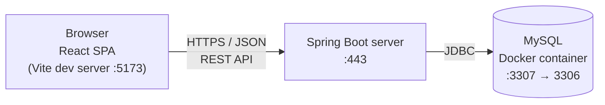

- The **browser** loads the React application from the Vite development server and calls the REST API using JSON payloads. During development, Vite proxies the `/api` requests to the backend, so the browser only talks to `http://localhost:5173` (HTTP to Vite, then HTTPS from Vite to the backend).
- The **Spring Boot server** serves HTTPS on port 443, authenticates the requests (see [Security](#security)), handles them, applies the business logic and accesses the database through JDBC (using Spring Data JPA).
- The **MySQL database** runs in a Docker container. The container's port 3306 is published on port 3307 of the host.

#### Docker deployment

**Packaged application.** The whole application is one Docker image (`rubenruiz7/tripmate`) that contains the client and the server: the Spring Boot server and the built React application, which Spring serves as static resources. It runs with Docker Compose next to a standard MySQL container, and the image and the Compose file are published on DockerHub ([`rubenruiz7/tripmate`](https://hub.docker.com/r/rubenruiz7/tripmate) and [`rubenruiz7/tripmate-compose`](https://hub.docker.com/r/rubenruiz7/tripmate-compose)). The user guide is [Execution](execution.md):

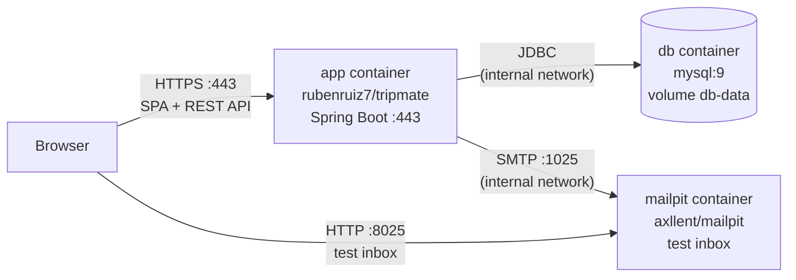

- The **`app` container** serves the SPA and the REST API from the same origin, so the browser needs no proxy. Requests to a client route (for example `https://localhost/trips`, also after a page refresh) return `index.html` so that React Router renders the screen. Unknown `/api/**` URLs keep returning the JSON error and a missing file (for example `/missing.png`) returns 404.
- The **`db` container** is not published on the host: only `app` reaches it, through the Compose network. Its data lives in the named volume `db-data`.
- The **`mailpit` container** is a test mail server: it receives the emails of the `app` container over the Compose network (SMTP, port 1025, not published on the host) and shows them in a web inbox on port 8025, which is published only on `127.0.0.1` (the emails contain the links of the invitations, so no other machine may read them). It keeps nothing after the container is removed. `app` does not wait for it, so the application also starts with another SMTP server (see [Emails](#emails)).

**Image layers.** `docker/Dockerfile` has three stages and the build context is the repository root (`.dockerignore` is an allowlist, so only the sources needed by the build are sent to Docker):

| Stage      | Base image                      | What it does                                                                                      |
| ---------- | ------------------------------- | ------------------------------------------------------------------------------------------------- |
| `frontend` | `node:24-alpine`                | `npm ci` and `npm run build` in `frontend/`                                                       |
| `backend`  | `maven:3.9-eclipse-temurin-21`  | Copies the frontend build into Spring's static resources and packages the jar (`-DskipTests`)     |
| runtime    | `eclipse-temurin:21-jre-alpine` | Only the jar, run by the non-root user `tripmate`; HTTPS on port 443 with the keystore in the jar |

The tests are not run while building the image: they run in CI. The resulting image is about 415 MB (the JRE is 165 MB and the jar 68 MB).

**Compose files.** Both files are self-contained (no `build` section, bind mounts or `env_file`), so they can be published as OCI artifacts. They only differ in the project name and the image tag:

| File                            | Project        | `app` image               | Use                                                    |
| ------------------------------- | -------------- | ------------------------- | ------------------------------------------------------ |
| `docker/docker-compose.yml`     | `tripmate`     | `rubenruiz7/tripmate:0.2` | Released version, downloaded from DockerHub            |
| `docker/docker-compose-dev.yml` | `tripmate-dev` | `rubenruiz7/tripmate:dev` | Image built locally, to test changes before publishing |

The image tag in `docker/docker-compose.yml` is always the `MAJOR.MINOR` tag of the last release (`0.1`, see [Versioning](#versioning)); the release workflow publishes that tag next to the full version. The files published by [continuous delivery](#continuous-delivery) have the tag of each publication instead.

`app` waits for `db` to be healthy (`mysqladmin ping`) before starting. All settings are environment variables with the `${VAR:-default}` syntax, so `docker compose up` works without any configuration:

| Variable                                | Default                                  | Used by | Description                                                                                                    |
| --------------------------------------- | ---------------------------------------- | ------- | -------------------------------------------------------------------------------------------------------------- |
| `MYSQL_ROOT_PASSWORD`                   | `password`                               | `db`    | Password of the MySQL `root` user                                                                              |
| `MYSQL_DATABASE`                        | `tripmate`                               | `db`    | Database created on the first start (also used in `DB_URL`)                                                    |
| `DB_URL`                                | `jdbc:mysql://db:3306/${MYSQL_DATABASE}` | `app`   | Fixed by the Compose file, pointing to the `db` service                                                        |
| `DB_USERNAME`                           | `root`                                   | `app`   | Database user                                                                                                  |
| `DB_PASSWORD`                           | `${MYSQL_ROOT_PASSWORD}`                 | `app`   | Database password                                                                                              |
| `SAMPLE_DATA`                           | `true`                                   | `app`   | Loads the 3 sample users with their 17 trips and the administrator's 3 trips (5 of them published) at start-up |
| `SAMPLE_USERS_PASSWORD`                 | `Demo-2026`                              | `app`   | Password of the sample users (development only)                                                                |
| `ADMIN_EMAIL`, `ADMIN_NAME`             | `admin@tripmate.com`, `Administrator`    | `app`   | The administrator                                                                                              |
| `ADMIN_PASSWORD_HASH`                   | BCrypt hash of the password `admin`      | `app`   | BCrypt hash of the administrator password                                                                      |
| `JWT_SECRET`                            | development key                          | `app`   | Base64 key that signs the tokens (at least 32 bytes)                                                           |
| `SSL_KEYSTORE`, `SSL_KEYSTORE_PASSWORD` | `classpath:keystore.p12`, `password`     | `app`   | Keystore with the self-signed development certificate                                                          |
| `MAIL_HOST`, `MAIL_PORT`                | `mailpit`, `1025`                        | `app`   | SMTP server of the invitation emails: the test inbox by default                                                |
| `MAIL_USERNAME`, `MAIL_PASSWORD`        | empty                                    | `app`   | Credentials of the SMTP server (an app password in Gmail)                                                      |
| `MAIL_SMTP_AUTH`, `MAIL_SMTP_STARTTLS`  | `false`, `false`                         | `app`   | `true` when the server asks for credentials and for an encrypted connection (Gmail)                            |
| `MAIL_FROM`                             | `TripMate <no-reply@tripmate.local>`     | `app`   | Sender of the emails                                                                                           |
| `APP_PUBLIC_URL`                        | `https://localhost`                      | `app`   | Address that the links in the emails start with; it must be reachable from where they are read                 |

The defaults are for development only: **outside development, `ADMIN_PASSWORD_HASH`, `JWT_SECRET`, `MYSQL_ROOT_PASSWORD` and the keystore must be replaced** (see [Running the application](#running-the-application) to create them). To change a value, set the variable before the command, for example `SAMPLE_DATA=false docker compose -f docker/docker-compose.yml up -d`.

**Running with Docker Compose.** Requirements: Docker only, and port 443 free on the host (stop the local backend if it is running).

```bash
# Released version
docker compose -f docker/docker-compose.yml up -d

# Local image: build it, tag it as dev and run it
docker build -f docker/Dockerfile -t rubenruiz7/tripmate:dev .
docker compose -f docker/docker-compose-dev.yml up -d
```

The application is then available at https://localhost/ (the browser warns about the self-signed certificate) and the REST API at https://localhost/api/v1/. Log in as `admin@tripmate.com` with the password `admin`, or as one of the [sample users](#sample-data).

**Running from the OCI artifact.** Without cloning the repository, Compose (2.34.0 or later) can run the file published on DockerHub, which is how a user runs the application (see [Execution](execution.md) and [Continuous delivery](#continuous-delivery)):

```bash
docker compose -f oci://docker.io/rubenruiz7/tripmate-compose:latest up -d --yes
```

Before running a file downloaded from a registry, `up` shows its variables and asks "Do you want to proceed with these variables?"; `--yes` answers yes. `down`, `logs` and `ps` do not ask. The tag is `latest` (last release), a release such as `0.1` (or its full version `0.1.0`), or `dev` (last version of `main`); the other commands of the table below work with the same `-f oci://…` instead of the file in `docker/`.

| Goal                                  | Command (use `docker/docker-compose-dev.yml` for the local image)                      |
| ------------------------------------- | -------------------------------------------------------------------------------------- |
| Start with the sample users and trips | `docker compose -f docker/docker-compose.yml up -d`                                    |
| Start with an empty database          | `SAMPLE_DATA=false docker compose -f docker/docker-compose.yml up -d`                  |
| See the logs                          | `docker compose -f docker/docker-compose.yml logs -f app`                              |
| Stop, keeping the data                | `docker compose -f docker/docker-compose.yml down` (the next `up` finds the same data) |
| Stop and delete all data              | `docker compose -f docker/docker-compose.yml down -v` (removes the `db-data` volume)   |

`SAMPLE_DATA` is read when the application starts. Uploaded images are stored in the database, so they follow the same rules as the rest of the data: they survive `down` and `up` and disappear with `down -v`. To go from sample data to an empty database, reset the data first with `down -v`.

### Domain model

The persistent entities are `User`, `Trip`, `Activity`, `Participation`, `Invitation`, `ActivityLogEntry` and `Image`. The trip's creator, the activity's author, the two sides of a participation, the trip and the inviter of an invitation, and the trip and the user of a change log line are required. The account of the invited person is optional (an email without an account can be invited), and so are the activity of a log line (it becomes empty when the activity is deleted) and the original of a copied trip. A user participates in a trip at most once (unique trip and user). The three links to an image are optional and each image belongs to at most one entity (`unique` foreign key). Deleting a trip also deletes its participations, invitations, change log, activities and images, and empties `copiedFrom` in its copies, all explicitly in `TripService.delete` (there are no database cascades).

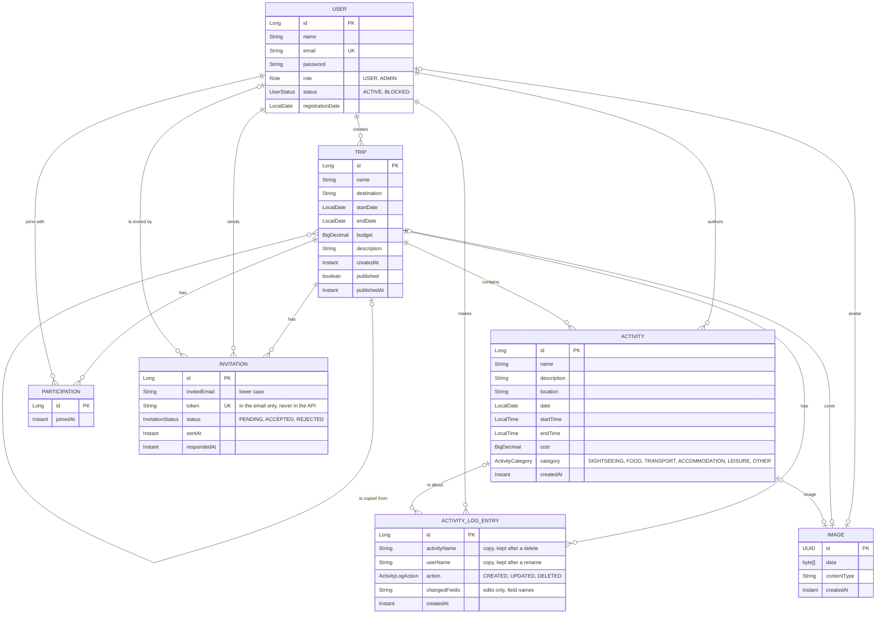

### Server architecture

The backend is organised in three layers (package-by-domain: `user`, `trip`, `activity`, `participation`, `invitation`, `image`, `metrics` and `notification`, plus `common`; each domain with its `controller`, `service` and `repository` subpackages). A controller only calls services and a service is the only one that uses repositories. The diagram shows the dependencies between controllers and services and between services and repositories, without attributes or methods. Services also call each other (for example `TripService` uses `TripAccessService`, `ActivityService` and `ImageService`, and every service that works on a trip asks `TripAccessService` who may do it), and `AuthService` provides the logged-in user; those calls are not drawn to keep it readable. The dashed arrow is the event that sends the invitation email.

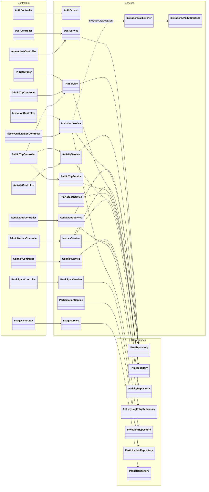

- **Controllers:** receive the HTTP requests under `/api/v1`, validate the input and return the response with its status code; they contain no business logic.
- **Services:** apply the business rules and the owner and role checks, and decide the transactions.
- **Repositories:** Spring Data JPA interfaces that access MySQL; filtering, sorting, pagination and aggregation are done in their queries.
- **Public itineraries (I7–I10).** The public reads are in `PublicTripService` (`PublicTripController`, the only trip endpoints that `SecurityConfig` opens to visitors), which only returns published trips through `TripAccessService.findPublished` (404, never 403). The search of I8 is `TripRepository.searchPublished`, in the query. Publishing is decided by `findForWrite` (creator only) and unpublishing by `findForUnpublish` (creator or administrator, I10). Copying (I9) is `TripService.copyPublic`, in one transaction.
- **Invitations and participants (I1–I3).** The `invitation` package stores the invitations and their answers (`InvitationService`); the creator manages them through `findForWrite`, and the invited person is identified by the email of the logged-in account. Accepting creates a `Participation` (`ParticipationService`, in the `participation` package), and `TripAccessService.findForRead` lets the participants read the trip. Listing and removing participants is in `ParticipantService`, decided by `findForParticipantRemoval`. The emails are sent by the `notification` package (see [Emails](#emails)). **Known limitation:** two identical invitations sent at the same moment can both pass the check for a pending one, because there is no unique constraint for it in the database; the second is an extra pending invitation that the creator can see in the list.
- **Collaborative itinerary (I4).** `TripAccessService.findForItineraryWrite` lets the creator and the participants create, edit and delete any activity of the trip and its picture; the administrator and anyone outside the trip get 403, and `findForWrite` stays creator-only for the trip itself. `ActivityService` records every change in the trip's change log (`ActivityLogService`, entity `ActivityLogEntry`) inside the transaction of the change itself, so a change that fails leaves no line; members read it with `GET /api/v1/trips/{tripId}/activity-log`, ten lines at a time, newest first. Deleting an activity first detaches its log lines (they keep the names), and deleting a trip deletes its log before its activities.
- **Spending charts (I5).** `GET /api/v1/trips/{tripId}/activities/spending` (`ActivityService.findSpending`, read access like `findCost`) gives the data of the two charts of the trip page. The two sums come from `GROUP BY` queries in `ActivityRepository` (`sumCostByCategory`, `sumCostByDay`), which ignore the activities without cost and put those without category in one group; the total is the existing `sumCost`. The service only fills in what a query cannot return: `fillDays` adds the days without cost with 0 and the running sum, so the line covers every day of the trip, and it extends the range to a day outside the trip's dates that has cost (an activity left behind by a change of dates), so the last running sum is always the total. The frontend only draws what it receives. `GET .../activities/cost` is untouched: the small figure of the trip summary does not pay for the two extra queries.
- **Platform metrics (I6).** `MetricsService` (package `metrics`, with no entity or repository of its own) reads three `COUNT`s from the user, trip and activity repositories for `GET /api/v1/admin/metrics`.
- **Known limitation:** two members who edit the same activity at the same time do not warn each other: the last save wins, and both changes appear in the change log. Optimistic locking (a version column on `Activity`, answered with 409 when it is stale) could be added later.

### Client architecture

The frontend is a React application with two layers. Components render the screens and handle the user's actions; they get data through services and never call `fetch` themselves. The hooks in `src/hooks` (`useTrip`, `usePagedList`, `useAuth`, `useTripSpending`...) and `ApiError`/`request()` in `src/services/apiError.ts` support both layers and are not drawn; a component that reads through a hook is drawn pointing at the service the hook uses (for example `TripDetailPage` reads the spending, the cost and the conflicts through `useTripSpending`, `useTripCost` and `useConflicts`). Login and registration go through `AuthProvider`, which uses `authService`. Components that only show what they receive (`SpendingSection` and its charts, `ActivityCard`, `ConflictAlert`...) are not drawn.

```mermaid
classDiagram
  direction LR
  namespace Components {
    class AuthProvider
    class PublicTripsCarousel
    class PublicTripsPage
    class PublicTripPage
    class CopyTripModal
    class UnpublishTripModal
    class ItinerarySection
    class TripList
    class PendingInvitations
    class TripFormPage
    class TripDetailPage
    class DeleteTripModal
    class InvitationsSection
    class InvitationPage
    class ParticipantsSection
    class RemoveParticipantModal
    class LeaveTripModal
    class ActivityLogSection
    class ActivityFormPage
    class DayActivities
    class DeleteActivityModal
    class ProfilePage
    class ProfileDetailsCard
    class PasswordCard
    class ProfileAvatarCard
    class ImageUpload
    class StoredImage
    class AdminDashboardPage
    class AdminUsersPage
    class EditUserModal
    class BlockUserModal
    class AdminTripsPage
  }
  namespace Services {
    class authService
    class publicTripService
    class tripService
    class activityService
    class activityLogService
    class conflictService
    class invitationService
    class participantService
    class userService
    class imageService
    class adminMetricsService
    class adminUserService
    class adminTripService
  }
  AuthProvider --> authService
  PublicTripsCarousel --> publicTripService
  PublicTripsPage --> publicTripService
  PublicTripPage --> publicTripService
  CopyTripModal --> publicTripService
  ItinerarySection --> publicTripService
  UnpublishTripModal --> tripService
  TripList --> tripService
  PendingInvitations --> invitationService
  TripFormPage --> tripService
  TripDetailPage --> tripService
  TripDetailPage --> activityService
  TripDetailPage --> conflictService
  DeleteTripModal --> tripService
  InvitationsSection --> invitationService
  InvitationPage --> invitationService
  ParticipantsSection --> participantService
  RemoveParticipantModal --> participantService
  LeaveTripModal --> participantService
  ActivityLogSection --> activityLogService
  ActivityFormPage --> activityService
  DayActivities --> activityService
  DeleteActivityModal --> activityService
  ProfilePage --> userService
  ProfileDetailsCard --> userService
  PasswordCard --> userService
  ProfileAvatarCard --> userService
  ImageUpload --> imageService
  StoredImage --> imageService
  AdminDashboardPage --> adminMetricsService
  AdminUsersPage --> adminUserService
  EditUserModal --> adminUserService
  BlockUserModal --> adminUserService
  AdminTripsPage --> adminTripService
```

- **Components:** React components in `src/components` that show the screens, the forms and the modals, manage their state and navigation (React Router), and show the errors to the user.
- **Services:** modules in `src/services`, one per API area, that make all the HTTP calls to `/api/v1` and return the typed data (`src/types`).

### Security

Authentication and authorization are implemented with Spring Security.

- **Login:** `POST /api/v1/auth/login` checks the email and password (BCrypt) and returns the user. The response sets a signed JWT (HS256) in the `AuthToken` cookie, which is `HttpOnly` (JavaScript cannot read it), `Secure` (HTTPS only), `SameSite=Strict` and limited to the path `/api`. Because of this, the frontend asks `GET /api/v1/auth/me` to know who is logged in.
- **Every request:** the token is read from the cookie and the user is loaded from the database, so the role always comes from the database (never from the token) and a user blocked or deleted after logging in is rejected immediately. A missing, invalid or expired token is answered with 401 and the cookie is cleared.
- **Roles:** `USER` and `ADMIN`. The URLs under `/api/v1/admin/**` require `ADMIN`; the rest of `/api/**` requires being logged in, except login, logout, registration, reading an image (`GET /api/v1/images/{id}`) and reading the public itineraries (`GET /api/v1/trips/public`, `/api/v1/trips/public/{id}` and `/api/v1/trips/public/{id}/activities`).
- **Administrator:** there is a single administrator, defined in the configuration (`ADMIN_EMAIL`, `ADMIN_NAME` and `ADMIN_PASSWORD_HASH`, a BCrypt hash, never a plain password). On every start-up it is created or updated in the database and any other administrator is demoted to `USER`, so the role cannot be assigned through the API.
- **Blocked users:** a user with status `BLOCKED` cannot log in (403 "Account is blocked"). The blocked check runs after the password check, so someone who does not know the password gets the generic 401 and cannot find out that the account exists.
- **CSRF:** disabled, because the session is stateless and the only credential is a `SameSite=Strict` cookie that browsers do not send on cross-site requests.
- **Errors:** security errors use the same JSON body as the rest of the API: `timestamp`, `status`, `error`, `message` and `path`.
- **Known limitation:** changing the password does not invalidate the sessions already open on other devices. The JWT is stateless and is not tied to the password, so a token issued before the change stays valid until it expires (`JWT_EXPIRATION`, 24 hours by default).
- **Known limitation:** the database schema has no migrations yet; they are planned for version 1.0, with Flyway. Until then the schema is created and extended by Hibernate (`ddl-auto=update`), which cannot add a `NOT NULL` column to a table that already has rows, nor tighten or change existing columns. B4 is the example: trips gained a mandatory creator, so a development database created before B4 must be recreated once (see [Sample data](#sample-data)). The changes of version 0.2 only add tables and columns that are nullable or have a default (`trip.published`, `published_at`, `copied_from_id`, and the participation, invitation and change log tables), so a 0.1 database is extended without losing data (see the CHANGELOG).

### Emails

The server sends one kind of email so far: the invitation to a trip (I1). It is built so that the sending can leave the application later (a separate notification service):

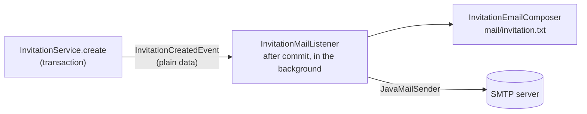

- **After the commit.** `InvitationService` saves the invitation and publishes an `InvitationCreatedEvent`. The listener (`@TransactionalEventListener(AFTER_COMMIT)` plus `@Async`) receives it only once the transaction has committed, so an invitation that is rolled back sends nothing, and a slow or failing SMTP server never delays the response or undoes the invitation.
- **Isolated.** The `notification` package (`config`, `event`, `service`) does not use anything of `trip`, `invitation` or `user`; the only thing it shares with them is the event record, which carries plain data and no entities. Its `toString` shows only the invitation id, so the token and the address cannot reach a log through it.
- **The text.** The subject and the body, in Spanish, are in `src/main/resources/mail/invitation.txt` (first line the subject, then the body, with the placeholders `{inviterName}`, `{tripName}` and `{link}`). `InvitationEmailComposer` fills them in one pass and removes line breaks from the names, so a name cannot add headers. The link is `{APP_PUBLIC_URL}/invitations/{token}`, which opens the invitation page of the application (I2).
- **Configuration.** The SMTP server comes from `spring.mail.*` (environment variables `MAIL_HOST`, `MAIL_PORT`, `MAIL_USERNAME`, `MAIL_PASSWORD`, `MAIL_SMTP_AUTH`, `MAIL_SMTP_STARTTLS`) and the sender and the public address from `app.mail.from` and `app.mail.public-url` (`MAIL_FROM`, `APP_PUBLIC_URL`). The connection timeouts are five seconds. The tables with the values are in [Docker deployment](#docker-deployment) and in [Execution](execution.md#emails), which also explains how to send real emails with Gmail.
- **Tests.** The composer and the listener have unit tests (the listener also checks that a failure is logged without the token or the address). `InvitationMailIntegrationTest` runs the whole path against a real SMTP server in the tests (GreenMail): the email arrives after the commit with the right link, nothing is sent for a refused or rolled back invitation, and a server that is down does not undo the invitation.
- **Known limitation:** an invitation email that cannot be sent is only logged (the invitation number and the kind of error) and is not retried. The invitation stays pending and appears in the creator's list, but the invited person gets nothing until the creator invites them again, which is not possible while the first invitation is pending. Retrying the sending needs a stored state per email (an outbox) and is left for a later release.

### REST API

The REST API is documented with OpenAPI. The specification is stored in [`docs/api/api-docs.yaml`](api/api-docs.yaml) and its HTML version can be viewed here:

**[REST API documentation](https://raw.githack.com/codeurjc-students/2026-ViajesRuben/main/docs/api/api-docs.html)**

Current operations:

| Method | URL                                            | Access                                     | Description                                                                                                                                                                                                                                                                                                             |
| ------ | ---------------------------------------------- | ------------------------------------------ | ----------------------------------------------------------------------------------------------------------------------------------------------------------------------------------------------------------------------------------------------------------------------------------------------------------------------- |
| GET    | `/api/v1/trips/public`                         | Public                                     | Returns one page of the public itineraries (the published trips of any user, the most recently published first), each with the author's name and the first activity of its first three days (`?search=&page=0&size=3`); `search` keeps the trips whose name or destination contains the text, ignoring case             |
| GET    | `/api/v1/trips/public/{id}`                    | Public                                     | Returns one public trip (404 for any trip that is not published, never 403)                                                                                                                                                                                                                                             |
| GET    | `/api/v1/trips/public/{id}/activities`         | Public                                     | Returns one page of a public trip's activities, sorted by date and start time (`?date=yyyy-MM-dd&page=0&size=10`)                                                                                                                                                                                                       |
| POST   | `/api/v1/trips/public/{id}/copies`             | Logged-in                                  | Copies a public itinerary, with its activities and images, into a new unpublished trip of the user; the optional `{"startDate": "yyyy-MM-dd"}` moves every date by the same number of days. 201 with `Location`, 401 for a visitor, 404 (never 403) for a trip that is not published                                    |
| GET    | `/api/v1/trips`                                | Logged-in                                  | Returns one page of the trips the user created or joined (`?page=0&size=10&sort=startDate`)                                                                                                                                                                                                                             |
| POST   | `/api/v1/trips`                                | Logged-in                                  | Creates a trip for the user; 201 with `Location`, 400 for invalid data or the end before the start                                                                                                                                                                                                                      |
| GET    | `/api/v1/trips/{id}`                           | Creator, participant, administrator        | Returns one trip (403 for a regular user who is neither its creator nor a participant, 404 if it does not exist)                                                                                                                                                                                                        |
| PUT    | `/api/v1/trips/{id}`                           | Creator                                    | Replaces the details of the trip (not the cover); new dates may leave activities outside (see `/conflicts`)                                                                                                                                                                                                             |
| PUT    | `/api/v1/trips/{id}/publication`               | Creator; administrator (only to unpublish) | Publishes or unpublishes the trip (`{"published": true}`); sets `publishedAt` once, idempotent. The administrator may unpublish any trip (I10), which keeps it for its creator, but not publish it; 403 for anyone else                                                                                                 |
| DELETE | `/api/v1/trips/{id}`                           | Creator, administrator                     | Deletes the trip with its participations, invitations, change log, activities, their images and its cover, and empties `copiedFromId` in its copies; 204                                                                                                                                                                |
| PUT    | `/api/v1/trips/{id}/cover`                     | Creator                                    | Uploads or replaces the cover (multipart `file`); 201 with `Location` the first time, 200 after                                                                                                                                                                                                                         |
| GET    | `/api/v1/trips/{id}/cover`                     | Creator, participant, administrator        | Returns the bytes of the cover (`no-cache`); 404 if there is none                                                                                                                                                                                                                                                       |
| DELETE | `/api/v1/trips/{id}/cover`                     | Creator                                    | Deletes the cover (204, also when there was none)                                                                                                                                                                                                                                                                       |
| GET    | `/api/v1/trips/{tripId}/activities/cost`       | Creator, participant, administrator        | Returns the total cost of the activities (a `SUM` in the query) and the remaining budget, which is the budget minus that total (negative when over, `null` without budget)                                                                                                                                              |
| GET    | `/api/v1/trips/{tripId}/activities/spending`   | Creator, participant, administrator        | Returns the data of the spending charts: the budget, the total cost, the cost per category (the biggest first, `category` null for the activities without one) and the cost per day with the running sum, every day of the trip included (0 when nothing was spent); all `SUM ... GROUP BY` in the query, 401, 403, 404 |
| GET    | `/api/v1/trips/{tripId}/activities`            | Creator, participant, administrator        | Returns one page of the trip's activities, sorted by date and start time (`?date=yyyy-MM-dd&page=0&size=10`)                                                                                                                                                                                                            |
| POST   | `/api/v1/trips/{tripId}/activities`            | Creator, participant                       | Creates an activity (the date must be within the trip; the user is its author); 201 with `Location`, 400 for invalid data. Recorded in the change log                                                                                                                                                                   |
| GET    | `/api/v1/trips/{tripId}/activities/{id}`       | Creator, participant, administrator        | Returns one activity (404 if it belongs to another trip)                                                                                                                                                                                                                                                                |
| PUT    | `/api/v1/trips/{tripId}/activities/{id}`       | Creator, participant                       | Replaces the details of any activity of the trip (not the image); recorded in the change log with the changed fields                                                                                                                                                                                                    |
| DELETE | `/api/v1/trips/{tripId}/activities/{id}`       | Creator, participant                       | Deletes any activity of the trip and its image; 204. Recorded in the change log                                                                                                                                                                                                                                         |
| PUT    | `/api/v1/trips/{tripId}/activities/{id}/image` | Creator, participant                       | Uploads or replaces the image (multipart `file`); 201 with `Location` the first time, 200 after. Recorded in the change log                                                                                                                                                                                             |
| GET    | `/api/v1/trips/{tripId}/activities/{id}/image` | Creator, participant, administrator        | Returns the bytes of the image (`no-cache`); 404 if there is none                                                                                                                                                                                                                                                       |
| DELETE | `/api/v1/trips/{tripId}/activities/{id}/image` | Creator, participant                       | Deletes the image (204, also when there was none). Recorded in the change log when there was one                                                                                                                                                                                                                        |
| GET    | `/api/v1/trips/{tripId}/conflicts`             | Creator, participant, administrator        | Returns the warnings of the itinerary: overlapping activities, activities outside the trip's dates and the cost above the budget (`budget` is `null` if not)                                                                                                                                                            |
| GET    | `/api/v1/trips/{tripId}/activity-log`          | Creator, participant, administrator        | Returns one page of the trip's change log, newest first (`?page=0&size=10`; `sort` accepts `id` and `createdAt`): who created, edited or deleted which activity and when, with the changed fields of an edit                                                                                                            |
| GET    | `/api/v1/trips/{tripId}/participants`          | Creator, participant, administrator        | Returns one page of the people who joined the trip, oldest first (`?page=0&size=10`), without the creator; `email` only for the creator, null for everyone else                                                                                                                                                         |
| DELETE | `/api/v1/trips/{tripId}/participants/{userId}` | Creator; participant (only themselves)     | Removes a participant, or leaves the trip; 204. 403 for anyone else (the administrator included), 404 if the user is not a participant, 409 for the creator's own id                                                                                                                                                    |
| POST   | `/api/v1/trips/{tripId}/invitations`           | Creator                                    | Invites an email to the trip (`{"email": "..."}`, trimmed and lower cased, it may have no account); 201 with `Location`, 400 for an invalid email or the creator's own, 409 if it already has a pending invitation or already participates; sends the invitation email after the commit                                 |
| GET    | `/api/v1/trips/{tripId}/invitations`           | Creator                                    | Returns one page of the trip's invitations, newest first (`?page=0&size=10`); never includes the token of the link                                                                                                                                                                                                      |
| GET    | `/api/v1/trips/{tripId}/invitations/{id}`      | Creator                                    | Returns one invitation (404 if it belongs to another trip)                                                                                                                                                                                                                                                              |
| GET    | `/api/v1/invitations`                          | Logged-in                                  | Returns one page of the pending invitations addressed to the email of the user (`?page=0&size=10`, newest first); no email or token in the answer                                                                                                                                                                       |
| GET    | `/api/v1/invitations/token/{token}`            | Invited user                               | Returns the invitation of the link of the email, in any status (403 if it was sent to another email, 404 if the token is unknown or its trip was deleted)                                                                                                                                                               |
| PUT    | `/api/v1/invitations/{id}/status`              | Invited user                               | Accepts or rejects (`{"status": "ACCEPTED"}` or `REJECTED`); accepting makes the user a participant. 400 for `PENDING`, 403, 404, 409 if it was already answered                                                                                                                                                        |
| POST   | `/api/v1/images`                               | Logged-in                                  | Uploads an image (multipart `file`); 201 with `Location`                                                                                                                                                                                                                                                                |
| GET    | `/api/v1/images/{id}`                          | Public                                     | Returns the bytes of an image with its `Content-Type`                                                                                                                                                                                                                                                                   |
| POST   | `/api/v1/users`                                | Public                                     | Registers a regular user (`name`, `email`, `password`); 201 with `Location`, 409 if the email is taken                                                                                                                                                                                                                  |
| POST   | `/api/v1/auth/login`                           | Public                                     | Logs in with email and password and sets the `AuthToken` cookie                                                                                                                                                                                                                                                         |
| POST   | `/api/v1/auth/logout`                          | Public                                     | Clears the `AuthToken` cookie                                                                                                                                                                                                                                                                                           |
| GET    | `/api/v1/auth/me`                              | Logged-in                                  | Returns the logged-in user (`id`, `name`, `email`, `role`, `avatarId`, `registrationDate`)                                                                                                                                                                                                                              |
| GET    | `/api/v1/users/{id}`                           | Own user                                   | Returns one's own profile (403 for another user, 404 if it does not exist)                                                                                                                                                                                                                                              |
| PUT    | `/api/v1/users/{id}`                           | Own user                                   | Edits the name and email (409 if the email is taken); the session stays open                                                                                                                                                                                                                                            |
| PUT    | `/api/v1/users/{id}/password`                  | Own user                                   | Changes the password (`currentPassword`, `newPassword`); 400 if the current one is wrong                                                                                                                                                                                                                                |
| PUT    | `/api/v1/users/{id}/avatar`                    | Own user                                   | Uploads or replaces the avatar (multipart `file`); 201 with `Location` the first time, 200 after                                                                                                                                                                                                                        |
| GET    | `/api/v1/users/{id}/avatar`                    | Logged-in                                  | Returns the bytes of a user's avatar (`no-cache`); 404 if there is none                                                                                                                                                                                                                                                 |
| DELETE | `/api/v1/users/{id}/avatar`                    | Own user                                   | Deletes the avatar (204, also when there was none)                                                                                                                                                                                                                                                                      |
| GET    | `/api/v1/admin/users`                          | Administrator                              | Returns one page of the regular users (`?search=&page=0&size=10`); `search` matches the name or the email, ignoring case                                                                                                                                                                                                |
| PUT    | `/api/v1/admin/users/{id}`                     | Administrator                              | Edits a user's name and email (409 if the email is taken); 403 for the administrator's own account                                                                                                                                                                                                                      |
| PUT    | `/api/v1/admin/users/{id}/status`              | Administrator                              | Blocks (`BLOCKED`) or unblocks (`ACTIVE`) a user; 403 for the administrator's own account                                                                                                                                                                                                                               |
| GET    | `/api/v1/admin/trips`                          | Administrator                              | Returns one page of the trips of every user, newest first (`?search=&page=0&size=10`); `search` matches the name, the destination or the creator's email, ignoring case                                                                                                                                                 |
| GET    | `/api/v1/admin/metrics`                        | Administrator                              | Returns the platform totals `{users, trips, activities}` (not paginated): the regular accounts (blocked ones included, the administrator not), every trip and every activity                                                                                                                                            |

#### Pagination

Every list is paginated in the database query (Spring Data `Pageable`), never in Java. The client sends `?page=0&size=10` (page numbers start at 0; the default size is 10 and the maximum is 50, set with `spring.data.web.pageable.max-page-size`; `?sort=` is accepted and an unknown property is answered with 400). The answer is always a `PageDTO` (`common/dto`):

```json
{ "content": [], "page": 0, "size": 10, "totalElements": 12, "last": false }
```

In the frontend, `usePagedList` (`src/hooks`) loads one page at a time and appends the next one, and `LoadMoreButton` shows "Más resultados" until the server says `last: true`.

#### Images

Images are stored in the database (`Image` entity: a `@Lob` byte array in a MEDIUMBLOB column, the content type and the creation time), as the project requires, and are identified by a random UUID so their URLs cannot be guessed or enumerated.

- **Upload:** `POST /api/v1/images` (logged-in users) takes a multipart form with the picture in the `file` part and answers `201` with a `Location` header and the image data (`id`, `contentType`, `size`). The type must be JPEG, PNG or WebP **and** the first bytes of the file must match the declared type, so a text file renamed to `.png` is rejected with `400`. Images over `IMAGE_MAX_SIZE` get `413`; `spring.servlet.multipart` sets a hard cap of 10 MB above that.
- **Read:** `GET /api/v1/images/{id}` is public so `` tags work without credentials. It answers the bytes with the stored `Content-Type` and `Cache-Control: max-age=31536000, public, immutable`, because an image never changes (a new upload gets a new id).
- **Frontend:** `ImageUpload` uploads the chosen file and `StoredImage` shows an image by id, falling back to `DEFAULT_TRIP_COVER` (`public/Default_trip_image.png`) when there is no id or it fails to load. The avatar of a user is the first image linked to an entity (`User.avatar`, `PUT /api/v1/users/{id}/avatar`): `ImageUpload` takes an `upload` function and `UserAvatar` shows the picture or the initial of the name. Linking images to trips and activities is done by their own features.

#### Errors

Every error has the same JSON body (`ErrorResponse`): `timestamp`, `status`, `error`, `message` and `path`. `GlobalExceptionHandler` maps exceptions to status codes, and the security filters write the same body through `ErrorResponseWriter`.

| Status | When                                                                                                              |
| ------ | ----------------------------------------------------------------------------------------------------------------- |
| 400    | Invalid body (`message` lists `field: problem` sorted by field), malformed JSON, or a parameter of the wrong type |
| 401    | Not logged in, or wrong email or password                                                                         |
| 403    | Access denied (role or ownership), or a blocked account                                                           |
| 404    | `ResourceNotFoundException` (a trip, an image...), or an unknown URL                                              |
| 405    | HTTP method not supported by the URL (the `Allow` header lists the valid ones)                                    |
| 409    | `ConflictException`                                                                                               |
| 500    | Any other exception: logged with its stack trace, but the response only says `Unexpected error`                   |

To report a new error from a service, throw `ResourceNotFoundException` or `ConflictException` with a message that is safe to show.

### Frontend routing and error page

The frontend uses React Router. `src/routes.tsx` lists one route per screen of [the analysis](analysis.md#screens-and-navigation). Every screen of versions 0.1 and 0.2 is built: home, public itineraries (`/public`) and the read-only preview of one (`/public/:tripId`), login, registration, My Trips, trip form, trip detail with the itinerary, activity form, profile, the administrator dashboard `/admin` and its pages `/admin/users` and `/admin/trips`, and the invitation page `/invitations/:token` (I2), which needs a login: a visitor is sent to log in or register and comes back to it. Only the AI generator (`/trips/:tripId/ai-generator`) still shows `PlaceholderPage`, because it belongs to a later version. Every route renders inside `AppLayout` (header, page, footer).

- **Unknown URLs** match the `*` route and show `ErrorPage` with the 404 message.
- **Failures while loading data**: services use `request()` (`src/services/apiError.ts`), which throws `ApiError` (non-2xx answer, with the status) or `NetworkError` (no answer). A component that cannot load its data rethrows the error and the route's `errorElement` shows `ErrorPage` inside the same layout, with a message for 404, 5xx or no connection and a button back to the home page.
- **Texts**: Spanish UI texts are written in the component that shows them, as in the rest of the frontend.

## Quality control

### Types of tests

Every feature has automated tests of six types, three for the backend and three for the frontend. They are selected by the suffix of the class or file name, which is what the CI workflows run, so a new test must use the same suffix.

| Type                        | Side     | What it checks                                                                                    | Tools                                     | Files                                      | Command                                 |
| --------------------------- | -------- | ------------------------------------------------------------------------------------------------- | ----------------------------------------- | ------------------------------------------ | --------------------------------------- |
| Backend unit                | Backend  | One class in isolation, with its collaborators mocked                                             | JUnit 5, Mockito, AssertJ                 | `*UnitTest.java`                           | `./mvnw test -Dtest='*UnitTest'`        |
| Backend integration         | Backend  | A service together with a real MySQL database (queries, transactions, BCrypt)                     | JUnit 5, Spring Boot Test, Testcontainers | `*IntegrationTest.java`                    | `./mvnw test -Dtest='*IntegrationTest'` |
| Backend system (REST API)   | Backend  | The whole backend through its HTTPS REST API, with MySQL in a container                           | JUnit 5, Rest Assured, Testcontainers     | `*ApiE2ETest.java`                         | `./mvnw test -Dtest='*ApiE2ETest'`      |
| Frontend unit               | Frontend | A component, hook or function with a virtual DOM and the HTTP calls mocked                        | Vitest, Testing Library                   | `*.test.ts`, `*.test.tsx`                  | `npm run test:coverage`                 |
| Client – server integration | Frontend | The frontend services and components against the real REST API                                    | Vitest, Testing Library                   | `*.int.test.ts`, `*.int.test.tsx`          | `npm run test:int`                      |
| Frontend system (UI)        | Frontend | The application in a real browser, through the screens, with the backend and the database running | JUnit 5, Selenium (headless Chrome)       | `*UiE2ETest.java` (in the backend project) | `./mvnw test -Dtest='*UiE2ETest'`       |

The UI tests need the whole application: see [Running the tests](#running-the-tests).

### Automated tests

Each test is traced to the feature it verifies. The tables below list them by feature; the [traceability matrix](#traceability-between-tests-and-features) summarizes them, and the [statistics](#test-statistics) give the numbers.

Support classes (not tests): `TestcontainersConfiguration` defines the MySQL container shared by the backend integration and system tests, and `TestBackendApplication` starts the backend locally using that container as its database.

**Security base** (login, roles, blocked users, configured administrator and HTTPS). These tests are tagged `B2`, like the registration tests below.

| Test                                                                                                                                       | Type                | What it verifies                                                                                                                                                    |
| ------------------------------------------------------------------------------------------------------------------------------------------ | ------------------- | ------------------------------------------------------------------------------------------------------------------------------------------------------------------- |
| `AuthServiceUnitTest`, `AuthControllerUnitTest`                                                                                            | Backend unit        | Login returns the user and a token, errors are propagated without issuing a token, and the controller sets and clears the cookie                                    |
| `SecurityConfigUnitTest`                                                                                                                   | Backend unit        | BCrypt hashing, and that the blocked check runs after the password check (a blocked user with a wrong password gets the generic error)                              |
| `ActiveUserJwtConverterUnitTest`, `TripMateUserDetailsServiceUnitTest`                                                                     | Backend unit        | The role comes from the stored user; blocked, deleted and malformed-subject tokens are rejected                                                                     |
| `JwtServiceUnitTest`, `JwtConfigUnitTest`, `CookieBearerTokenResolverUnitTest`                                                             | Backend unit        | Token contents and expiry, forged and expired tokens, cookie attributes, key validation, and reading the token only from the cookie                                 |
| `AdminPropertiesUnitTest`, `AdminAccountInitializerUnitTest`                                                                               | Backend unit        | A plain-text admin password is rejected at start-up; the administrator is created or updated and any other administrator is demoted                                 |
| `GlobalExceptionHandlerUnitTest`, `ErrorResponseWriterUnitTest`, `RestAuthenticationEntryPointUnitTest`, `RestAccessDeniedHandlerUnitTest` | Backend unit        | The 400, 401 and 403 error bodies and the cookie clearing                                                                                                           |
| `AdminAccountInitializerIntegrationTest`, `AuthServiceIntegrationTest`                                                                     | Backend integration | With a real MySQL database and real BCrypt: the administrator is stored from the configuration, logins succeed or fail as expected, and blocked users cannot log in |
| `AuthApiE2ETest`                                                                                                                           | Backend system      | Over HTTPS: login, cookie flags, `/me`, logout, errors, a user blocked after logging in, invalid cookies, and access to the admin area by anonymous, user and admin |

**Registration and login screens (B2).** Registration is `POST /api/v1/users`: the password is hashed with BCrypt, the new user always has the `USER` role (a `role` in the body is ignored), emails are stored in lower case and compared ignoring case, and the administrator email is refused with the same 409 as a taken one, because the administrator account is rewritten from the configuration on every start-up. The frontend logs the user in right after registering (it calls the login endpoint) and returns them to the page they came from.

| Test                                                                                                            | Type                        | What it verifies                                                                                                                                          |
| --------------------------------------------------------------------------------------------------------------- | --------------------------- | --------------------------------------------------------------------------------------------------------------------------------------------------------- |
| `UserServiceUnitTest`, `UserControllerUnitTest`                                                                 | Backend unit                | Normalised email, encoded password, role `USER`, 201 with `Location`, and a conflict for a taken email, the administrator email or a lost race            |
| `UserServiceIntegrationTest`                                                                                    | Backend integration         | With MySQL and real BCrypt: the user is stored active with a hash that matches, can log in, and duplicates (any case) and the administrator email fail    |
| `UserApiE2ETest`                                                                                                | Backend system              | Over HTTPS: 201, no password in the answer, role forced to `USER`, login and `/me` afterwards, 409, 400 (blank name, bad email, short password, bad JSON) |
| `authService.test.tsx`, `AuthProvider.test.tsx`, `RequireAuth.test.tsx`, `useAuth.test.tsx`, `authForm.test.ts` | Frontend unit               | Session calls, `/me` on load, login, register then login, logout, redirect to `/login` for anonymous visitors, and the Spanish error texts                |
| `LoginPage.test.tsx`, `RegisterPage.test.tsx`, `AppHeader.test.tsx`, `App.test.tsx`                             | Frontend unit (component)   | Client validation, inline backend errors, disabled button while sending, return to the previous page, and the header for anonymous and logged-in users    |
| `authService.int.test.tsx`                                                                                      | Client – server integration | Against the real API: register, duplicate (409), invalid data (400), wrong password (401) and no session                                                  |
| `AuthUiE2ETest`                                                                                                 | Frontend system (UI)        | Register, logged in, log out, log in; a private page redirects to `/login` and back; wrong password; duplicate email                                      |

**Profile (B3).** A registered user reads and edits their own profile at `/api/v1/users/{id}`: only that user can (another user's id is a 403, a missing one a 404). The token identifies the user by id, not by email, so changing the email does not log the user out and no token refers to the old address. The new email follows the registration rules (lower case, 409 for a taken one or the administrator's). The password change is `PUT /api/v1/users/{id}/password`: it requires the current password (a wrong one is a 400, because 401 means "log in again" for the application and 403 means "not allowed on this profile") and the new one follows the 8–72 character rule. The avatar is an `Image` linked to the user (`PUT`, `GET` and `DELETE /api/v1/users/{id}/avatar`), validated by `ImageService` like any other image; replacing or deleting it deletes the previous image. The administrator can only change their avatar. Responses never contain the password hash.

| Test                                                                                                                                                        | Type                        | What it verifies                                                                                                                                                                                                                                                      |
| ----------------------------------------------------------------------------------------------------------------------------------------------------------- | --------------------------- | --------------------------------------------------------------------------------------------------------------------------------------------------------------------------------------------------------------------------------------------------------------------- |
| `UserServiceUnitTest`, `UserControllerUnitTest`, `ImageServiceUnitTest`, `TripMateUserDetailsUnitTest`, `UserDTOUnitTest`, `GlobalExceptionHandlerUnitTest` | Backend unit                | Own profile only (403/404), email rules and lost race, administrator restrictions, wrong current password, first avatar (201) and replacement (200) deleting the old image, the mapping of the avatar id and the 403 body                                             |
| `UserServiceIntegrationTest`                                                                                                                                | Backend integration         | With MySQL: a token issued before an email change still identifies the user, only the new email logs in, the new password is a BCrypt hash, the previous avatar row is deleted and the avatar id is readable without loading the image                                |
| `UserProfileApiE2ETest`                                                                                                                                     | Backend system              | Over HTTPS, every endpoint: 401 anonymous, 403 for another user, 404, 409 (another account or the administrator), 400 (invalid data, wrong current password, not an image), 413, and the same session working after an email change                                   |
| `userService.test.tsx`, `UserAvatar.test.tsx`, `profileForm.test.ts`, `StoredImage.test.tsx`, `ImageUpload.test.tsx`, `AuthProvider.test.tsx`               | Frontend unit               | The calls to the profile endpoints, the avatar (picture or initial), the validation and error texts, and the auth context update                                                                                                                                      |
| `ProfilePage.test.tsx`, `AppHeader.test.tsx`, `App.test.tsx`                                                                                                | Frontend unit (component)   | View and edit mode, inline errors by status (409, 400, 401, 403), disabled buttons while sending, avatar upload and delete, the administrator view, the header link to `/profile`, and the auth context updated after each change                                     |
| `userService.int.test.tsx`                                                                                                                                  | Client – server integration | Against the real API: 401 without session, 403/404, email change keeping the session, 409/400, wrong and right password change, and the avatar upload, replacement and deletion                                                                                       |
| `ProfileUiE2ETest`                                                                                                                                          | Frontend system (UI)        | Register, edit the name (the header follows), upload an avatar (the browser decodes it in the header and the page), change the password, log out and log in with the new one; wrong current password; duplicate email; delete the avatar; a file that is not an image |

**Trips (B4).** A registered user creates, reads, edits and deletes their own trips at `/api/v1/trips`. Every trip has a creator; only the creator can change it (since version 0.2 its participants also read it, I2), and the cover (`/api/v1/trips/{id}/cover`) follows the same rule (another user's trip is a 403, a missing one a 404, and 404 is checked before 403, so a missing trip is reported as missing to anyone). The administrator is a user like any other for their own trips; on other users' trips they can only read and delete (trip moderation, B8), never edit. The body is validated before the service runs (400): `name` and `destination` are required (up to 100 characters), the dates are required and the end must not be before the start (the same day is a one-day trip), `budget` is optional (up to 2 decimals, not negative) and `description` optional (up to 2000 characters). `GET /api/v1/trips` returns only the trips of the logged-in user, paginated and sorted in the query; `sort` accepts only `id`, `name`, `destination`, `startDate`, `endDate` and `createdAt`. The cover is an `Image` linked to the trip, validated like any other image; a trip without cover has `coverImageId: null` and the application shows its default image (the API answers 404 to `GET /cover`). Replacing or deleting a cover, and deleting a trip, delete the image they stop using.

| Test                                                                                                                                                                                                                                 | Type                        | What it verifies                                                                                                                                                                                                                            |
| ------------------------------------------------------------------------------------------------------------------------------------------------------------------------------------------------------------------------------------ | --------------------------- | ------------------------------------------------------------------------------------------------------------------------------------------------------------------------------------------------------------------------------------------- |
| `TripServiceUnitTest`, `TripControllerUnitTest`, `TripRequestUnitTest`, `TripDTOUnitTest`, `DataLoaderUnitTest`                                                                                                                      | Backend unit                | Creator rules (404 before 403, nothing written on 403), sort whitelist, trimming, delete order (trip, then cover), first cover (201) and replacement (200), every validation rule, the mapping, and the sample data and its password        |
| `TripServiceIntegrationTest`, `DataLoaderIntegrationTest`                                                                                                                                                                            | Backend integration         | With MySQL: only the user's trips, paginated and sorted; persisted budget scale; the image rows are deleted with the cover and the trip; the sample users log in with the documented password and loading twice adds nothing                |
| `TripApiE2ETest`                                                                                                                                                                                                                     | Backend system              | Over HTTPS, every endpoint: 401 anonymous, 403 for another user (and for the administrator), 404, 400 (invalid data, end before start, malformed JSON, bad sort), cover type and size (400, 413), 201/200/204 and `Location`                |
| `tripService.test.tsx`, `usePagedList.test.tsx`, `useTrip.test.tsx`, `tripForm.test.ts`, `tripFormat.test.ts`                                                                                                                        | Frontend unit               | The calls to the trip endpoints, list reload, loading one trip, the validation codes and the formatting of dates and budget                                                                                                                 |
| `TripForm.test.tsx`, `TripFormPage.test.tsx`, `TripDetailPage.test.tsx`, `TripList.test.tsx`, `TripCard.test.tsx`, `DeleteTripModal.test.tsx`, `ConfirmModal.test.tsx`, `ImageUpload.test.tsx`, `ErrorPage.test.tsx`, `App.test.tsx` | Frontend unit (component)   | Create and edit with one form, the Spanish messages, the cover (choose, discard, remove, partial failure), creator-only actions, the confirmation modal, the 403/401/404 pages, and that an anonymous visitor never asks for trips          |
| `tripService.int.test.tsx`, `TripList.int.test.tsx`                                                                                                                                                                                  | Client – server integration | Against the real API: 401, 403 for another user, 404, 400, the cover upload, replacement and deletion deleting the old pictures, and the list paging only the user's trips                                                                  |
| `TripUiE2ETest`                                                                                                                                                                                                                      | Frontend system (UI)        | As a sample user: create a trip with a cover, see it in the list, edit it, cancel and confirm the deletion; Ana's two pages; Laura sees only her trips; end before start; a bad or too large cover; another user's trip; an anonymous visit |

**Itinerary (B5).** The creator of a trip (since version 0.2 also its participants, I4) creates, reads, edits and deletes its activities at `/api/v1/trips/{tripId}/activities`, with an optional image, and browses the itinerary one day at a time on the trip page. Access goes through `TripAccessService`, so it follows the same 404 before 403 rule as the trip; an activity of another trip is a 404, and the date of an activity must be within the trip's dates (400). Deleting a trip deletes its activities and their images. Changing the trip's dates so that an activity falls outside them is allowed and shows up as a conflict (B6). The trip page also shows the remaining budget below the budget, from `GET /api/v1/trips/{tripId}/activities/cost`.

| Test                                                                                                                                                                                                        | Type                        | What it verifies                                                                                                                                                                                                                                                                                |
| ----------------------------------------------------------------------------------------------------------------------------------------------------------------------------------------------------------- | --------------------------- | ----------------------------------------------------------------------------------------------------------------------------------------------------------------------------------------------------------------------------------------------------------------------------------------------- |
| `TripAccessServiceUnitTest`, `ActivityServiceUnitTest`, `ActivityControllerUnitTest`, `ActivityRequestUnitTest`, `ActivityDTOUnitTest`, `TripServiceUnitTest`, `ImageServiceUnitTest`, `DataLoaderUnitTest` | Backend unit                | 404 before 403 and nothing written on a refusal, an activity of another trip, the date inside the trip, end after start, the sort whitelist, the order of deleting activities, images and trip, trip dates saved without looking at the activities, 201 with `Location`, the sample itineraries |
| `ActivityServiceIntegrationTest`, `DataLoaderIntegrationTest`                                                                                                                                               | Backend integration         | With MySQL: filter by day, order by time (activities without time first), paging, deleting a trip removes its activities and all their images, a trip date edit that leaves an activity outside is accepted, the sample itineraries once                                                        |
| `ActivityApiE2ETest`, `TripApiE2ETest`                                                                                                                                                                      | Backend system              | Over HTTPS, every endpoint: 401 anonymous, 403 another user and the administrator, 404 trip, activity and activity of another trip, 400 body, ids, dates and times, the filter by day, the image (201, 200, bytes, 400, 413), deleting a trip, a trip date edit that leaves an activity outside |
| `activityService.test.tsx`, `useActivity.test.tsx`, `tripDays.test.ts`, `activityForm.test.ts`, `tripFormat.test.ts`                                                                                        | Frontend unit               | The calls to the activity endpoints, the ids of the URL, every day of a trip (month, year and clock changes), the validation codes and the request body                                                                                                                                         |
| `ItinerarySection.test.tsx`, `ActivityCard.test.tsx`, `ActivityForm.test.tsx`, `ActivityFormPage.test.tsx`, `TripDetailPage.test.tsx`, `TripFormPage.test.tsx`, `App.test.tsx`                              | Frontend unit (component)   | A tab per day, previous and next, the day in the URL, time order, empty and loading states, "More results", creator-only buttons, create and edit flows, the image failure path, 400/401/403/404 messages, the delete confirmation                                                              |
| `activityService.int.test.tsx`                                                                                                                                                                              | Client – server integration | Against the real API: 401, CRUD, the filter by day, 400 for a date outside the trip, 404 for another trip's activity, 403, the image, deleting a trip, a trip date edit that leaves an activity outside                                                                                         |
| `ActivityUiE2ETest`                                                                                                                                                                                         | Frontend system (UI)        | As a sample user: browse the days of a trip, create an activity with an image on the empty day, edit it and delete it; a day outside the trip and an end before the start; the day kept in the URL; the phone layout                                                                            |

**Conflicts (B6).** The creator of a trip (since version 0.2 everyone who can read it: the participants and the administrator) sees three kinds of warning on its page, above the itinerary: activities of the same day whose times overlap (times that only touch do not, and activities without start and end time are ignored), activities outside the trip's dates, and a total cost above the budget (equal is fine, and without budget there is none). They come from `GET /api/v1/trips/{tripId}/conflicts`, which follows the same 404 before 403 rule as the trip, and they never block saving.

| Test                                                                                                                              | Type                        | What it verifies                                                                                                                                                                                                                                  |
| --------------------------------------------------------------------------------------------------------------------------------- | --------------------------- | ------------------------------------------------------------------------------------------------------------------------------------------------------------------------------------------------------------------------------------------------- |
| `ConflictServiceUnitTest`, `ConflictControllerUnitTest`, `TripServiceUnitTest`                                                    | Backend unit                | 404 and 403 before any query, the three kinds assembled, the budget comparison (above, equal, below, no budget, no cost) and trip dates saved without refusal                                                                                     |
| `ConflictServiceIntegrationTest`, `ActivityServiceIntegrationTest`                                                                | Backend integration         | With MySQL: intersecting times, touching times, other days, activities without times, each pair once and in order, dates outside after shortening the trip, the sum with empty costs, equal to the budget, no budget, other trips not mixed in    |
| `ConflictApiE2ETest`, `TripApiE2ETest`                                                                                            | Backend system              | Over HTTPS: 401 anonymous, 403 another user and the administrator, 404, 400, an empty answer, each kind, and saving never refused because of a conflict                                                                                           |
| `conflictService.test.tsx`, `useConflicts.test.tsx`, `ConflictAlert.test.tsx`, `TripDetailPage.test.tsx`, `TripFormPage.test.tsx` | Frontend unit               | The call, the hook (reload, another trip's answer ignored, a failure shows nothing), the Spanish texts of the three kinds, edit links only for the creator, nothing shown without conflicts, and the warning refreshed after deleting an activity |
| `conflictService.int.test.tsx`, `activityService.int.test.tsx`                                                                    | Client – server integration | Against the real API: 401, overlap and touching, editing clears it, shortening the trip is accepted and reports the activity, over and equal to the budget, no budget, 403 and 404                                                                |
| `ConflictUiE2ETest`                                                                                                               | Frontend system (UI)        | As a sample user: two overlapping activities show the warning with both names, editing one so that they only touch removes it                                                                                                                     |

**Public home page (B1) and public itineraries (I7).** Anyone, logged in or not, sees the home page at `/` with a carousel of the public itineraries, and opens one at `/public/:tripId` to browse its itinerary day by day without being able to change anything. A public itinerary is a trip whose creator published it: `Trip.published` (false by default) and `Trip.publishedAt`, which orders the list, newest first. The creator publishes or unpublishes it with `PUT /api/v1/trips/{id}/publication` (the B7 status pattern: a sub-resource with a value, idempotent), through `TripAccessService.findForWrite`, so only the creator may publish, not even the administrator. Unpublishing goes through `TripAccessService.findForUnpublish` (creator or administrator), so the administrator can remove any itinerary from the public list while the trip stays with its creator (moderation, I10); the frontend shows "Despublicar" to the administrator on `/public` and `/public/:tripId`. `Trip.publish` keeps the first publication date and cuts it to microseconds, which is what the database stores, so the date answered when publishing is the one every later read gives. Hibernate adds the two columns to an existing database (`published` is filled with false), so existing trips start unpublished. The carousel reads three public, read-only endpoints under `/api/v1/trips/public`, added to `SecurityConfig` as exact `GET` paths (every other trip endpoint still needs a login). `TripAccessService.findPublished` answers 404, never 403, for a trip that is not published. `PublicTripDTO` is a whitelist: the author's name, never an email, an id of the author or participants. The home page shows three itineraries at a time (`?size=3`) and stops after the third page, so it shows the nine most recently published; each has the first activity of its first three days, which `ActivityRepository.findFirstOfFirstDays` reads for the whole page in one query. The "Ver todos" link goes to `/public`, the public itineraries page (I8). The sample data publishes five trips of three authors (the administrator's three, one of Ana and one of Carlos) only when it creates them, so a trip somebody unpublished stays unpublished after a restart; an existing development database gets them after a reset.

**Copying a public itinerary (I9).** A logged-in user copies a public itinerary into a new trip of their own with `POST /api/v1/trips/public/{id}/copies`, which answers 201 with the new trip and its URL in `Location`. It is the only non-GET URL under `/api/v1/trips/public`, and `SecurityConfig` still lists only the three GET paths as public, so a visitor gets 401. `TripService.copyPublic` finds the trip with `TripAccessService.findPublished` (404, never 403, for a trip that is not published) and does everything in one transaction: the new `Trip` (same name, destination, budget and description, not published, `copiedFrom` pointing at the original), its cover, and its activities through `ActivityService.copyAll`, with the user as author. Every picture goes through `ImageService.copy`, which stores a new `Image` row with the same bytes and type, so the copy never shares a row with the original. The optional body has a `startDate`: the offset is the number of days between the original start date and it, applied to the trip's two dates and to every activity, so the length and the day of each activity are kept (without it the offset is 0). `Trip.copiedFrom` is a lazy self reference (`copied_from_id`); `TripDTO.copiedFromId` reads its id without loading the original. There is no database cascade: `TripService.delete` first deletes the activities, then runs `TripRepository.clearCopiedFrom` (an update that sets `copied_from_id` to null on the copies) and then deletes the trip, so a copy outlives its original. In the application, the preview page `/public/:tripId` has the "Copiar en tu cuenta" button: a visitor is sent to `/login` with the page in the router state (the same mechanism `RequireAuth` uses), so after logging in they come back to the preview; a logged-in user fills the optional date in `CopyTripModal` and lands on `/trips/{newId}`, whose page shows the message left in the router state.

**Public itineraries page (I8) and moderation (I10).** `/public` lists every public itinerary, newest publication first, ten at a time with "Más resultados", with a search by trip name or destination and empty states for no public trips and for a search without results; "Viajes públicos" in the header opens it for everyone. `GET /api/v1/trips/public?search=` keeps the published trips whose name or destination contains the text, ignoring case and the spaces around it, in the query (`TripRepository.searchPublished`); a blank search lists everything. To moderate, the administrator uses the same `PUT /api/v1/trips/{id}/publication` with `{"published": false}`: `TripAccessService.findForUnpublish` accepts the creator or the administrator (404 before 403), while publishing keeps `findForWrite`, so the administrator never publishes another user's trip. The trip leaves the list and the carousel, and its creator keeps it, unpublished, in "Mis viajes". The administrator sees "Despublicar", with a confirmation (`UnpublishTripModal`), on every line of `/public` and on the preview; after it the list reloads, or the preview goes back to `/public`, with a notice.

| Test                                                                                                                                                                                                                                                                                      | Type                        | What it verifies                                                                                                                                                                                                                                                                                                                                                                                     |
| ----------------------------------------------------------------------------------------------------------------------------------------------------------------------------------------------------------------------------------------------------------------------------------------- | --------------------------- | ---------------------------------------------------------------------------------------------------------------------------------------------------------------------------------------------------------------------------------------------------------------------------------------------------------------------------------------------------------------------------------------------------- |
| `PublicTripServiceUnitTest`, `PublicTripControllerUnitTest`, `PublicTripDTOUnitTest`, `TripAccessServiceUnitTest`, `TripServiceUnitTest`, `TripUnitTest`, `ActivityServiceUnitTest`, `ImageServiceUnitTest`, `DataLoaderUnitTest`                                                         | Backend unit                | Only published trips are public (404, never 403, otherwise); the search is trimmed and a blank one lists everything; the public DTO hides emails and ids; only the creator publishes, and the creator or the administrator unpublishes (404 before 403); the first publication date is kept; the copy with its date offset, its activities and duplicated images; the published sample trips         |
| `PublicTripServiceIntegrationTest`, `TripServiceIntegrationTest`, `DataLoaderIntegrationTest`                                                                                                                                                                                             | Backend integration         | With MySQL: the published trips newest first and by pages, the search by name or destination ignoring case, the first activity of each of the first three days in one query, publishing and unpublishing (also by the administrator, keeping the trip), the copy in one transaction and `copiedFrom` emptied when the original is deleted, and the sample trips published only when they are created |
| `PublicTripApiE2ETest`, `TripPublicationApiE2ETest`, `TripCopyApiE2ETest`                                                                                                                                                                                                                 | Backend system              | Over HTTPS: the public endpoints without a login, with search and pages, and 404 for a trip that is not published; publishing is idempotent and keeps the first date; another user gets 403; the administrator cannot publish another user's trip but unpublishes it and its creator keeps it; copying needs a login (401), answers 201 with `Location` and moves the dates                          |
| `publicTripService.test`, `PublicTripCard.test`, `PublicTripsCarousel.test`, `HomePage.test`, `PublicTripsPage.test`, `PublicTripPage.test`, `CopyTripModal.test`, `UnpublishTripModal.test`, `TripCard.test`, `TripDetailPage.test`, `ItinerarySection.test`, `useTrip.test`, `App.test` | Frontend unit               | The calls with `search`; the carousel (three at a time, the author, "Ver todos"); the list with its search and empty states; the read-only preview; the copy modal (a visitor is sent to log in, optional date); "Publicar"/"Despublicar" and the "Público" badge; the administrator's "Despublicar" with its confirmation                                                                           |
| `publicTripService.int.test`, `tripService.int.test`                                                                                                                                                                                                                                      | Client – server integration | Against the real API: the public trips without a session, the search, one trip and a day of its itinerary, 404 for a trip that is not published, copying a public itinerary, and publishing and unpublishing                                                                                                                                                                                         |
| `HomeUiE2ETest`, `PublicItineraryUiE2ETest`, `PublicItinerariesUiE2ETest`, `TripCopyUiE2ETest`, `PublicItineraryModerationUiE2ETest`                                                                                                                                                      | Frontend system (UI)        | An anonymous visitor browses the carousel and a preview; a user publishes a trip, it appears in the anonymous carousel and disappears when it is unpublished; from the home page to "Ver todos", searching a trip and opening it, also at the width of a phone; copying an itinerary into one's trips; the administrator unpublishes a user's trip and its creator still has it                      |

**User management (B7).** The administrator lists, searches, edits and blocks users at `/api/v1/admin/users`, and uses the `/admin/users` page (link "Usuarios" in the header, only for the administrator). The URLs are under `/api/v1/admin/**`, which `SecurityConfig` already restricts to the `ADMIN` role, so a regular user gets 403 and an anonymous visitor 401 without any check in the service, and `/api/v1/users/{id}` keeps meaning "one's own profile". The list shows regular users only (never the administrator) and is paginated; `search` is trimmed and matches the name or the email ignoring case inside the query, and `sort` accepts only `id`, `name`, `email` and `registrationDate` (400 otherwise; sorted by name by default). Editing uses the same body, validation, lower-casing and 409 rules as registration and the profile. Blocking is `PUT /api/v1/admin/users/{id}/status` with `{"status": "BLOCKED"}` (or `ACTIVE`), idempotent. The administrator's own account cannot be edited or blocked: the request is well formed, so it is a 403 (the same answer as when the administrator edits their own profile in B3), not a 400, and its details come from the configuration anyway. Checks run in this order: 404, 403, then the body rules (409). A blocked user cannot log in (403 "Account is blocked") and their open session stops working on the next request, because `ActiveUserJwtConverter` reloads the user on every request (the API answers 401 and clears the cookie, so the SPA sends them to log in again); unblocking makes the same token valid again until it expires. On the frontend, `RequireAdmin` guards `/admin*` inside `RequireAuth` and gives anyone else the 403 error page; editing is a modal on the list and blocking asks for confirmation with `ConfirmModal`.

| Test                                                                                                                                                                                             | Type                        | What it verifies                                                                                                                                                                                                                                                                                  |
| ------------------------------------------------------------------------------------------------------------------------------------------------------------------------------------------------ | --------------------------- | ------------------------------------------------------------------------------------------------------------------------------------------------------------------------------------------------------------------------------------------------------------------------------------------------- |
| `UserServiceUnitTest`, `AdminUserControllerUnitTest`, `AdminUserDTOUnitTest`                                                                                                                     | Backend unit                | Blank and trimmed search, sort whitelist (400), edit normalisation and 409 (taken, administrator email, lost race), 404 and 403 for the administrator's account, block and unblock                                                                                                                |
| `UserServiceIntegrationTest`                                                                                                                                                                     | Backend integration         | With MySQL: search by name or email ignoring case without the administrator, paging and the last-page flag, a token issued before blocking is rejected until unblocking, an edit keeps the email unique                                                                                           |
| `AdminUserApiE2ETest`                                                                                                                                                                            | Backend system              | Over HTTPS: 401 anonymous and 403 regular user on the three operations, search, pagination, 400 for a bad sort or status, edit then login with the new email, 409, 404, block gives login 403 and the old cookie 401 and unblock restores both, the administrator cannot block or edit themselves |
| `adminUserService.test.tsx`, `AdminUsersPage.test.tsx`, `EditUserModal.test.tsx`, `BlockUserModal.test.tsx`, `RequireAdmin.test.tsx`, `AppHeader.test.tsx`, `ErrorPage.test.tsx`, `App.test.tsx` | Frontend unit               | The calls, search and "Más resultados", status badges, empty states, edit validation and 409, confirmation before blocking, 403 page for a regular user, the header link only for the administrator                                                                                               |
| `adminUserService.int.test.tsx`                                                                                                                                                                  | Client – server integration | Against the real API: 401 and 403, search ignoring case, paging without the administrator, edit and 409, block gives login 403 and a dead session, unblock, the administrator's own account gives 403                                                                                             |
| `AdminUserUiE2ETest`                                                                                                                                                                             | Frontend system (UI)        | A new user is registered; the administrator logs in, opens "Usuarios", searches the email, edits the name, blocks and unblocks; a regular user opening `/admin/users` sees the no-access page                                                                                                     |

**Trip moderation (B8).** The administrator lists and searches every trip at `GET /api/v1/admin/trips` (under `/api/v1/admin/**`, so a regular user gets 403 and an anonymous visitor 401 from `SecurityConfig`), reviews any trip and deletes it. The list is paginated, newest first by default; `search` is trimmed and matches the trip name, the destination or the creator's email ignoring case inside the query (the creator is fetched in the same query, so the email costs no extra query per row), and `sort` accepts the same properties as the user's own list (400 otherwise). Viewing and deleting reuse the existing endpoints: `TripAccessService.findForRead` and the new `findForDelete` let the `ADMIN` role through, so `GET /api/v1/trips/{id}`, the cover, the activities, `/activities/cost` and `/conflicts` answer 200 and `DELETE /api/v1/trips/{id}` answers 204 for any trip, with the same cascade as B4/B5 (activities, their images and the cover). `findForWrite` is unchanged, so the administrator still gets 403 on `PUT` of the trip, on the cover and on creating, changing or deleting activities and their images. Other regular users still get 403 on someone else's trip. The deletion is logged with ids only (trip, creator and the user who deleted it). On the frontend, `/admin/trips` (link "Viajes" in the header, only for the administrator, inside `RequireAdmin`) has a search box, the list (name, destination, dates, creator email), "Más resultados" and a link to the trip. On the trip detail page `TripDetailPage` the administrator reviewing another user's trip sees it read-only (no "Editar", no "Nueva actividad", no activity buttons), a "Volver a Viajes" link and a single "Eliminar viaje" button that asks for confirmation (`ConfirmModal`) and returns to `/admin/trips`.

| Test                                                                                                                    | Type                        | What it verifies                                                                                                                                                                                                                                                                                                                                         |
| ----------------------------------------------------------------------------------------------------------------------- | --------------------------- | -------------------------------------------------------------------------------------------------------------------------------------------------------------------------------------------------------------------------------------------------------------------------------------------------------------------------------------------------------- |
| `TripAccessServiceUnitTest`, `TripServiceUnitTest`, `AdminTripControllerUnitTest`, `AdminTripDTOUnitTest`               | Backend unit                | The administrator passes `findForRead` and `findForDelete` but not `findForWrite`, another user passes none, 404 before 403; blank and trimmed search, sort whitelist (400), the delete cascade in order for the administrator                                                                                                                           |
| `TripServiceIntegrationTest`                                                                                            | Backend integration         | With MySQL: search by name, destination and creator email ignoring case across users, paging and the last-page flag, the administrator reads and deletes another user's trip with its cover (no image left) and cannot update it or change its cover                                                                                                     |
| `AdminTripApiE2ETest` (and the updated `TripApiE2ETest`, `ActivityApiE2ETest`, `ConflictApiE2ETest`)                    | Backend system              | Over HTTPS: 401 anonymous, 403 regular user and 200 administrator on the list, search, newest first, pagination, 400 for a bad sort; the administrator reads another user's trip, activities, cost and conflicts, gets 403 on every edit, and deletes it (204) with its activities and images gone while other trips stay; a regular user still gets 403 |
| `adminTripService.test.tsx`, `AdminTripsPage.test.tsx`, `TripDetailPage.test.tsx`, `AppHeader.test.tsx`, `App.test.tsx` | Frontend unit               | The call and its parameters, the list rows, search, "Más resultados" and the empty states, the read-only detail page for the administrator with the confirmed delete going back to the list, the header link and the 403 page                                                                                                                            |
| `adminTripService.int.test.tsx`                                                                                         | Client – server integration | Against the real API: 401 and 403 on the list, search by name and creator email, paging, the administrator reads and deletes another user's trip but gets 403 on editing it, a regular user gets 403 on another user's trip                                                                                                                              |
| `AdminTripUiE2ETest`                                                                                                    | Frontend system (UI)        | A new user creates a trip; the administrator logs in, opens "Viajes", searches the trip, opens it (read-only), deletes it with confirmation and finds it gone from the list; a regular user opening `/admin/trips` sees the no-access page                                                                                                               |

**Trip invitations (I1).** The creator of a trip invites an email with `POST /api/v1/trips/{tripId}/invitations`, lists the invitations with `GET .../invitations` (ten at a time, newest first) and reads one with `GET .../invitations/{id}`; the answer never has the token of the link. Only the creator may use them (403 for another user and for the administrator, 401 for a visitor, 404 for an unknown trip), a second pending invitation for the same email is a 409, the creator's own email is a 400, and deleting the trip deletes its invitations. After the invitation is committed an email in Spanish with a link `{APP_PUBLIC_URL}/invitations/{token}` is sent in the background (see [Emails](#emails)). The creator sees the form and the list on the trip page.

| Test                                                                                                                                                           | Type                        | What it verifies                                                                                                                                                                                                                                                                                          |
| -------------------------------------------------------------------------------------------------------------------------------------------------------------- | --------------------------- | --------------------------------------------------------------------------------------------------------------------------------------------------------------------------------------------------------------------------------------------------------------------------------------------------------- |
| `InvitationServiceUnitTest`, `InvitationControllerUnitTest`, `InvitationDTOUnitTest`, `InvitationRequestUnitTest`, `InvitationUnitTest`, `TripServiceUnitTest` | Backend unit                | Normalised email, linked account, random token, 409 for a pending duplicate, 400 for the creator's own email, access errors, paging and sort whitelist, the event published only when the invitation is created, no token in the DTO, and the trip deletion removing the invitations first                |
| `InvitationEmailComposerUnitTest`, `InvitationMailListenerUnitTest`, `InvitationCreatedEventUnitTest`                                                          | Backend unit                | The Spanish subject and body with the link, placeholders and line breaks in names, a failing mail server logged (without token or address) and never thrown, and the event that hides the token in its text                                                                                               |
| `InvitationServiceIntegrationTest`                                                                                                                             | Backend integration         | With MySQL: the invitation is stored pending with a unique 43-character token, the account that owns the email is linked, duplicates and own email are refused, paging and sorting happen in the query, and deleting the trip removes only its invitations                                                |
| `InvitationMailIntegrationTest`                                                                                                                                | Backend integration         | With a real SMTP server (GreenMail): the email arrives after the commit with the right sender, subject and link, nothing is sent for a refused or rolled back invitation, and a mail server that is down does not undo the invitation                                                                     |
| `InvitationApiE2ETest`                                                                                                                                         | Backend system              | Over HTTPS: 201 with `Location` and no token in the body, 409, 400, 403 for another user and for the administrator, 401, 404, the paginated list, and the invitations deleted with the trip                                                                                                               |
| `invitationService.test.tsx`, `invitationForm.test.ts`, `InvitationsSection.test.tsx`, `TripDetailPage.test.tsx`, `App.test.tsx`                               | Frontend unit               | The calls and their parameters, the client validation (empty, invalid, own email), the button disabled while sending, the inline messages for 409, 400, network and server errors, the list, the empty state and "Más resultados", and the section only for the creator, and the public placeholder route |
| `invitationService.int.test.tsx`                                                                                                                               | Client – server integration | Against the real API: 401, the normalised email without a token, the list newest first ten at a time, 409, 400, 403 for another user and for the administrator, 404 and the invitations deleted with the trip                                                                                             |
| `InvitationUiE2ETest`                                                                                                                                          | Frontend system (UI)        | As Ana, from her trip page: the invited email appears as "Pendiente" (also after reloading), the same email twice shows the error and keeps one row, and the creator's own and an invalid email are refused before sending                                                                                |

**Answering invitations (I2).** The invited person lists the pending invitations addressed to their email with `GET /api/v1/invitations`, opens the one the email link points at with `GET /api/v1/invitations/token/{token}` and answers it with `PUT /api/v1/invitations/{id}/status`. Only the logged-in user whose normalised email equals the invited email may see or answer an invitation (403 for anyone else, the creator and the administrator included; 401 for a visitor); the matching is by email and not by the account saved when it was created, because the person may have registered later or changed their email. An invitation is answered once (409), a deleted trip deletes its invitations (404), and accepting creates the `Participation` and saves the account on the invitation in one transaction. **Invitations do not expire**: the token alone gives nothing, because only the addressee's account can use it, so a link that leaks is useless to anyone else, and an expiry would add a column, a setting and one more error without a requirement for it. The answers never include the email, the token or user ids. Participants read the trip through `TripAccessService.findForRead`; writing, publishing, inviting and deleting stay with the creator (I3 adds managing the participants). `GET /api/v1/trips` lists the trips the user created or joined with one query that pages and sorts in the database.

| Test                                                                                                                                                                                                                                                                                                  | Type                        | What it verifies                                                                                                                                                                                                                                                                                                                                                                    |
| ----------------------------------------------------------------------------------------------------------------------------------------------------------------------------------------------------------------------------------------------------------------------------------------------------- | --------------------------- | ----------------------------------------------------------------------------------------------------------------------------------------------------------------------------------------------------------------------------------------------------------------------------------------------------------------------------------------------------------------------------------- |
| `InvitationServiceUnitTest`, `InvitationUnitTest`, `InvitationDTOUnitTest`, `ReceivedInvitationDTOUnitTest`, `InvitationResponseRequestUnitTest`, `ReceivedInvitationControllerUnitTest`, `ParticipationServiceUnitTest`, `ParticipationUnitTest`, `TripAccessServiceUnitTest`, `TripServiceUnitTest` | Backend unit                | Accept (participation, account saved, answer time) and reject, 403 for another account, 409 for a second answer and for a participant, 400 for `PENDING`, the pending list, the lookup by token, the email check ignoring case, 409 when inviting a participant, a participant reads but cannot write, delete or unpublish, and the trip deletion removing the participations first |
| `InvitationResponseIntegrationTest`, `TripServiceIntegrationTest`                                                                                                                                                                                                                                     | Backend integration         | With MySQL: accepting stores the participation and the answer and the trip shows up in "My trips", rejecting stores none, an email without an account gets its account when accepted, the paginated pending list, a new invitation after a rejection, and deleting the trip removes participations and invitations; "My trips" lists created and joined trips only                  |
| `InvitationResponseApiE2ETest`                                                                                                                                                                                                                                                                        | Backend system              | Over HTTPS: accept and reject (no email or token in the answer), 403 for another user, the creator and the administrator, 401, 409, 404 also for a deleted trip, the lookup by token, the paginated list, and after accepting the participant reads the trip, its activities, cost and conflicts but gets 403 on every change; deleting the trip removes participations             |
| `invitationService.test.tsx`, `InvitationPage.test.tsx`, `PendingInvitations.test.tsx`, `InvitationsSection.test.tsx`, `TripList.test.tsx`, `TripDetailPage.test.tsx`, `TripCard.test.tsx`, `App.test.tsx`                                                                                            | Frontend unit               | The calls, the invitation page in every state (pending, accepted, rejected, for another account, unknown, failures, a 409 reloading it, the referrer meta), the pending section (answering, the notice, "Más resultados", failures), the badges, the trip list reloading after accepting, a participant seeing the trip without actions, and the login redirect of the link         |
| `invitationService.int.test.tsx`                                                                                                                                                                                                                                                                      | Client – server integration | Against the real API: 401, the pending list, accepting makes the trip readable and listed, rejecting shares nothing, 409 on a second answer, 403 for another user, 409 when inviting a participant, 404, and the invitation removed with its trip                                                                                                                                   |
| `InvitationResponseUiE2ETest`                                                                                                                                                                                                                                                                         | Frontend system (UI)        | A user who has just registered is invited by Ana, sees "Invitaciones pendientes" in "Mis viajes", accepts and the trip appears and opens read-only, and Ana sees "Aceptada"; another user rejects and no trip appears, and Ana sees "Rechazada". The email link is covered by the API, integration and frontend tests                                                               |

**Managing participants (I3).** `GET /api/v1/trips/{tripId}/participants` lists the people who joined a trip and `DELETE /api/v1/trips/{tripId}/participants/{userId}` removes one of them or lets a participant leave. Everyone who can read the trip (its creator, its participants and the administrator) may list them, because the trip page shows who is going; each entry has the user id, the name, the avatar id (a UUID, null without picture) and the join date, and **the email only reaches the trip's creator** (it is null for everyone else). The creator is not a row, because they have no participation. The creator removes any participant; a participant can only remove themselves, which is leaving. Anyone else gets 403 (another participant, the administrator, a stranger, or a user who was already removed), an unknown trip or a user who is not a participant is 404, and the creator "leaving" their own trip is a 409 whose message says to delete the trip instead. The checks run in the order 404, 403, 409, 404 and the first two are decided by `TripAccessService.findForParticipantRemoval`; `ParticipantService` holds the operations, in its own class because `TripAccessService` already depends on `ParticipationService`. The change is immediate, because reading a trip checks the participation on every request: the removed user's next request to the trip is a 403 and the trip leaves their "My trips". Only the participation is deleted: the invitation stays `ACCEPTED` as history and the person can be invited again, because I1 only refuses a second invitation while one is pending. The list is one query that projects straight into the DTO, with the paging and the sorting done in the database. Every `TripDTO` also carries `participantCount`, the number of people who joined the trip without counting its creator, so that the number of the card in "My trips" is the number of rows of the participants list: for a page of trips it comes from one grouped query over the ids of the page (`ParticipationRepository.countByTripIds`), and for a single trip from a plain count. **Note for I4:** once activities have authors, removing or leaving has to decide what happens to the activities of that user before the participation is deleted; the proposal is that they stay in the trip, because the itinerary is shared and the creator can edit or delete any of them.

| Test                                                                                                                                                                                        | Type                        | What it verifies                                                                                                                                                                                                                                                                                                                                                                            |
| ------------------------------------------------------------------------------------------------------------------------------------------------------------------------------------------- | --------------------------- | ------------------------------------------------------------------------------------------------------------------------------------------------------------------------------------------------------------------------------------------------------------------------------------------------------------------------------------------------------------------------------------------- |
| `ParticipantServiceUnitTest`, `ParticipantControllerUnitTest`, `ParticipantDTOUnitTest`, `TripAccessServiceUnitTest`                                                                        | Backend unit                | The list with and without emails and the avatar id kept (null without avatar), a sort by another property is a 400, the creator removes, a participant leaves, the creator cannot leave (409), a missing participant is 404, and who may remove whom (creator, self, another participant, administrator, stranger, 404 before 403, the participations not queried for the creator)          |
| `ParticipantIntegrationTest`                                                                                                                                                                | Backend integration         | With MySQL: the projection pages and sorts in the query, the emails are only the creator's, the avatar id is the UUID of the stored image, removing takes the trip away from the user's list and makes reading it a 403, leaving, the creator's 409, and the accepted invitation kept after removal so the person can be invited and join again                                             |
| `ParticipantApiE2ETest`                                                                                                                                                                     | Backend system              | Over HTTPS: the creator's and a participant's views of the list, the avatar id equal to the uploaded picture's UUID, removing and leaving (204) with an immediate 403 on the trip, 403 for a participant removing another or the creator, for the administrator and for strangers, 409 for the creator, 401, the 404 cases, 400 for invalid ids and sorts, and inviting again after removal |
| `participantService.test.tsx`, `ParticipantsSection.test.tsx`, `RemoveParticipantModal.test.tsx`, `LeaveTripModal.test.tsx`, `TripList.test.tsx`, `TripDetailPage.test.tsx`, `App.test.tsx` | Frontend unit               | The calls, the list (names, emails only when sent, "(tú)", avatars, empty states, "Más resultados"), "Quitar" only for the creator with its confirmation and errors, "Salir del viaje" only for participants, the notice in "Mis viajes", and the section shown to the creator and participants but not to the administrator                                                                |
| `participantService.int.test.tsx`                                                                                                                                                           | Client – server integration | Against the real API: 401, the creator's list with emails, a participant's list without them, the avatar id equal to the uploaded UUID, removing and leaving, 403 on the trip afterwards, 403 for a participant removing another, the administrator, 409 for the creator, 404, and joining again                                                                                            |
| `ParticipantsUiE2ETest`                                                                                                                                                                     | Frontend system (UI)        | Ana invites a user who has just registered, who accepts from "Invitaciones pendientes"; Ana sees them in "Participantes", cancels and then removes them, the invitation stays "Aceptada" and the user no longer has the trip. In the other test a participant opens the trip, leaves after confirming and lands on "Mis viajes" with a notice                                               |

**Collaborative itinerary and change log (I4).** The creator and the participants create, edit and delete any activity of the trip, and its picture, with the same endpoints as B5; the rule is `TripAccessService.findForItineraryWrite` (creator or participant), so the administrator and anyone outside the trip still get 403, and editing the trip itself stays creator-only. Each of those changes writes **one** line of the trip's change log in the same transaction, through `ActivityLogService` (its methods require an existing transaction, so a line can never be written without its change, and a change that fails leaves none): `CREATED`, `UPDATED` or `DELETED`, with the trip, the activity, the user and the time. An edit lists in `changedFields` the names of the fields that really changed (`ActivityFieldChanges` compares the stored form of each value, so `16.5` and `16.50` or padded text are not changes), never their values; a change of the picture is an edit of `image`; an edit that changes nothing still writes its line, with no fields, and removing a picture that is not there writes nothing. The activity name and the user name are copied into the line, and when an activity is deleted its lines are first detached (`activity_id` becomes null) and the `DELETED` line is written last, so the log keeps reading the same. `GET /api/v1/trips/{tripId}/activity-log` lists the log, newest first and ten at a time (`sort` accepts `id` and `createdAt`, another property is a 400), for anyone who can read the trip; deleting the trip deletes its log before its activities, and removing a participant keeps their activities and their lines. `ActivityDTO` has `authorName`, read in the same query as the activities (a join fetch, not one query per card); the public itinerary returns it as null, so it never names the members. The trip page shows "Historial de cambios" below the itinerary: the 5 latest lines, "Ver más" for 10 more (asking the server for the next page when needed) and "Ver menos" to go back to 5, and it is read again after an activity is deleted there.

| Test                                                                                                                                                                                                                               | Type                        | What it checks                                                                                                                                                                                                                                                                                                                                                                                                                                 |
| ---------------------------------------------------------------------------------------------------------------------------------------------------------------------------------------------------------------------------------- | --------------------------- | ---------------------------------------------------------------------------------------------------------------------------------------------------------------------------------------------------------------------------------------------------------------------------------------------------------------------------------------------------------------------------------------------------------------------------------------------- |
| `TripAccessServiceUnitTest`, `ActivityServiceUnitTest`, `ActivityLogServiceUnitTest`, `ActivityFieldChangesUnitTest`, `ActivityLogEntryDTOUnitTest`, `ActivityLogControllerUnitTest`, `ActivityDTOUnitTest`, `TripServiceUnitTest` | Backend unit                | The itinerary rule (creator and participant pass; the administrator and a stranger do not; 404 first) and `findForWrite` still creator-only; one log line per creation, edit, deletion and picture change, none when the change fails or there was no picture; which fields really changed; the delete order (detach, delete, picture, log); the page of the log and its sort whitelist; the author name and its removal in public itineraries |
| `ActivityLogIntegrationTest`                                                                                                                                                                                                       | Backend integration         | With MySQL: one line per change with its action, user and fields; deleting an activity detaches its lines and keeps the names; failed changes leave no line; paging, newest first; who may read the log; deleting a trip deletes only its own log; the activities and lines of a removed participant stay; author names in the activity pages                                                                                                  |
| `CollaborativeItineraryApiE2ETest`                                                                                                                                                                                                 | Backend system              | Over HTTPS: a participant creates, edits and deletes the creator's activities and pictures and the creator those of a participant; the administrator and a stranger get 403 and nothing changes, a visitor 401; the contents, order and paging of the log, 403, 404 and a 400 sort; deleting the trip deletes the log; a participant who leaves keeps their lines and loses access; a public itinerary hides the author names                  |
| `activityLogService.test.tsx`, `ActivityLogSection.test.tsx`, `ActivityCard.test.tsx`, `ItinerarySection.test.tsx`, `ConflictAlert.test.tsx`, `tripFormat.test.ts`, `TripDetailPage.test.tsx`, `App.test.tsx`                      | Frontend unit               | The call; the 5 lines by default, "Ver más" (10 more, loading the next page when needed) and "Ver menos", the empty line, the field names, the time and its tooltip, a failure; the buttons and the author on every activity for whoever can change the itinerary and for nobody else, also in the conflict warnings; the log read again after a deletion                                                                                      |
| `activityLogService.int.test.tsx`, `activityService.int.test.tsx`                                                                                                                                                                  | Client – server integration | The log against the real API (shape, order, paging, 401, 403, 404, deleting the trip) and a participant changing the creator's activities while a stranger gets 403                                                                                                                                                                                                                                                                            |
| `CollaborativeItineraryUiE2ETest`, `InvitationResponseUiE2ETest`                                                                                                                                                                   | Frontend system (UI)        | A new user is invited, adds an activity, edits Ana's, deletes both and leaves; both see every line of "Historial de cambios" with the user's name; a participant has the buttons of the activities but none of the trip itself                                                                                                                                                                                                                 |

**Spending charts (I5).** The creator and the participants see a "Gastos" section on the trip page, after the itinerary, with two charts drawn with Recharts; the administrator reviewing a trip and the public page do not show it. `GET /api/v1/trips/{tripId}/activities/spending` reads the data (the creator, a participant and the administrator get 200, a stranger 403, a visitor 401 and a missing trip 404). _Spending by category_ is a bar per category with some cost (in Spanish, "Sin categoría" for the activities without one), and below it the total against the budget: "Gastado X de Y" with a progress bar, which turns red with "Presupuesto superado" and "Te pasas X del presupuesto" when the total goes over, and only "Total gastado" when the trip has no budget. The budget is not a line over the category bars because a single category is usually far below the whole budget and the line would squash the bars. _Cumulative spending per day_ is a line over every day of the trip with the budget as a dashed "Presupuesto" reference line, only when the trip has a budget; over 31 days only the line is drawn, without a dot per day. A trip without costs shows "Aún no hay gastos. Añade un coste a una actividad para ver los gráficos." instead. Each chart is hidden from assistive technology (`aria-hidden`) and followed by a visually hidden table with the same figures, so a screen reader gets the data; the amounts are in euros and the dates in Spanish. The section is read again after an activity is deleted on the page, as the remaining budget is.

| Test                                                                                                                                                                                                                        | Type                        | What it checks                                                                                                                                                                                                                                                                                                   |
| --------------------------------------------------------------------------------------------------------------------------------------------------------------------------------------------------------------------------- | --------------------------- | ---------------------------------------------------------------------------------------------------------------------------------------------------------------------------------------------------------------------------------------------------------------------------------------------------------------- |
| `ActivitySpendingUnitTest`, `ActivityControllerUnitTest`                                                                                                                                                                    | Backend unit                | `fillDays` (days without cost at 0, the running sum, a one-day trip, a day after the end or before the start extends the range); the budget, the total and the categories joined; no budget; a total of 0; 403 and 404 before any query                                                                          |
| `ActivitySpendingIntegrationTest`                                                                                                                                                                                           | Backend integration         | With MySQL: several categories and days, an activity without cost ignored, those without category in one group, a cost of 0, the order (equal totals by category name), another trip's costs not mixed in, a trip without budget, a day outside the trip's dates, the participant, a stranger and a missing trip |
| `SpendingApiE2ETest`                                                                                                                                                                                                        | Backend system              | Over HTTPS: 200 for the creator, a participant and the administrator, 403 for a stranger, 401 for a visitor, 404 and 400; exact JSON with the zero days and the last running sum equal to the total; a trip without budget                                                                                       |
| `SpendingByCategoryChart.test.tsx`, `CumulativeSpendingChart.test.tsx`, `SpendingSection.test.tsx`, `useTripSpending.test.tsx`, `activityService.test.tsx`, `tripFormat.test.ts`, `TripDetailPage.test.tsx`, `App.test.tsx` | Frontend unit               | The bars and the table with Spanish names and euros, "Sin categoría", the total against the budget, over the budget, no budget, a budget of 0; the line with a point per day, the budget line only with a budget, a long trip; the empty and the error states; who sees the section; the reload after a deletion |
| `activityService.int.test.tsx`                                                                                                                                                                                              | Client – server integration | Against the real API: the sums per category and per day with the days at 0 and the null category, a trip without budget or costs, 401, 403 and 404                                                                                                                                                               |
| `SpendingChartsUiE2ETest`                                                                                                                                                                                                   | Frontend system (UI)        | Ana opens her sample trip "Summer in Rome": both charts are drawn, the total is 72,00 €, the hidden tables have the categories and the eight days ending at 72,00 €, there is no budget line; at the width of a phone nothing makes the page scroll sideways                                                     |

**Platform metrics (I6).** The administrator's dashboard at `/admin` shows the totals of the platform. `GET /api/v1/admin/metrics` (under `/api/v1/admin/**`, so a regular user gets 403 and an anonymous visitor 401 from `SecurityConfig`) answers `{"users", "trips", "activities"}`. `MetricsService.getPlatformMetrics`, in the new `metrics` package, runs three `COUNT` queries in one read-only transaction (`UserRepository.countByRole(USER)` and the inherited `count()` of the trip and activity repositories), so nothing is loaded into Java. "Users" are the regular accounts, blocked ones included and the administrator not (the same set that "Usuarios", B7, lists); "trips" include the unpublished ones; "activities" are all of them. It is not paginated: it is three numbers. On the frontend, `AdminDashboardPage` (title "Panel de administración") shows one card per total ("Usuarios", "Viajes", "Actividades"), built from a `CARDS` list, with the number written in Spanish (`12.345`), and the links "Gestionar usuarios" (`/admin/users`) and "Moderar viajes" (`/admin/trips`). The cards stack on a phone. It shows a spinner while loading and hands a failure to the shared error page. The header has a "Panel" link for the administrator. The AI requests arrive in version 1.0 and nothing exists for them yet: the figure will be one more field in `PlatformMetricsDTO`, one more count in `MetricsService` and one more entry in `CARDS`.

| Test                                                                                                                               | Type                       | What it checks                                                                                                                                                                                                                                                                                                          |
| ---------------------------------------------------------------------------------------------------------------------------------- | -------------------------- | ----------------------------------------------------------------------------------------------------------------------------------------------------------------------------------------------------------------------------------------------------------------------------------------------------------------------- |
| `MetricsServiceUnitTest`, `AdminMetricsControllerUnitTest`                                                                         | Backend unit               | The service counts the regular users, the trips and the activities with three counts and loads no rows; the controller returns the totals of the service                                                                                                                                                                |
| `MetricsServiceIntegrationTest`                                                                                                    | Backend integration        | Real MySQL: an empty platform has zeros (the administrator is not counted); a blocked user counts; published and unpublished trips of several creators count; the totals follow creating and deleting a trip and an activity                                                                                            |
| `AdminMetricsApiE2ETest`                                                                                                           | REST API                   | The administrator gets 200, a regular user 403 and a visitor 401; known data gives exact totals and no `aiRequests` field; registering, creating and deleting change the totals by exactly one                                                                                                                          |
| `adminMetricsService.test.tsx`, `usePlatformMetrics.test.tsx`, `AdminDashboardPage.test.tsx`, `AppHeader.test.tsx`, `App.test.tsx` | Frontend unit              | The URL and the 401/403 errors; the spinner and the three cards with Spanish separators; the two links; a failure goes to the error page; "Panel" only for the administrator; `/admin` shows the 403 page to a regular user without asking for the totals and sends a visitor to log in                                 |
| `adminMetricsService.int.test.tsx`                                                                                                 | Frontend – API integration | 401 without a session, 403 for a regular user, the three totals as integers for the administrator, and a new user and trip counted (at least +1, because the integration files run in parallel against the same backend)                                                                                                |
| `AdminMetricsUiE2ETest`                                                                                                            | Frontend system (UI)       | A new user creates a trip; the administrator logs in, opens "Panel" and sees the three cards with at least one user and one trip; the two links open the user and trip pages; a regular user opening `/admin` sees the no-access page; at the width of a phone the cards are in one column and nothing scrolls sideways |

### Traceability between tests and features

Each cell lists the test classes and files of that type that are tagged with the feature (`@Tag` in JUnit, the identifier in the `describe` or test name in Vitest), as `/test-matrix` finds them; the per-feature tables above describe what each one checks. A class can verify several features, so it can appear in several rows. The system tests are the REST API tests and the UI tests. Every feature of versions 0.1 and 0.2 has the six types.

| Feature                              | Backend unit                                                                                                                                                                                                                                                                                                                                                                                                                                                                                 | Backend integration                                                                                  | Backend system (REST API)                                     | Frontend unit                                                                                                                                                                                                                                                                                                | Client – server integration                               | Frontend system (UI)                        |
| ------------------------------------ | -------------------------------------------------------------------------------------------------------------------------------------------------------------------------------------------------------------------------------------------------------------------------------------------------------------------------------------------------------------------------------------------------------------------------------------------------------------------------------------------- | ---------------------------------------------------------------------------------------------------- | ------------------------------------------------------------- | ------------------------------------------------------------------------------------------------------------------------------------------------------------------------------------------------------------------------------------------------------------------------------------------------------------ | --------------------------------------------------------- | ------------------------------------------- |
| B1 Public home page                  | `ActivityServiceUnitTest`, `DataLoaderUnitTest`, `ImageContentDTOUnitTest`, `PublicTripControllerUnitTest`, `PublicTripServiceUnitTest`, `TripAccessServiceUnitTest`                                                                                                                                                                                                                                                                                                                         | `DataLoaderIntegrationTest`, `PublicTripServiceIntegrationTest`                                      | `PublicTripApiE2ETest`                                        | `App.test`, `HomePage.test`, `ItinerarySection.test`, `PublicTripCard.test`, `PublicTripPage.test`, `PublicTripsCarousel.test`, `publicTripService.test`, `useTrip.test`                                                                                                                                     | `publicTripService.int.test`                              | `HomeUiE2ETest`                             |
| B2 Register and log in               | `ActiveUserJwtConverterUnitTest`, `AdminAccountInitializerUnitTest`, `AdminPropertiesUnitTest`, `AuthControllerUnitTest`, `AuthServiceUnitTest`, `CookieBearerTokenResolverUnitTest`, `ErrorResponseWriterUnitTest`, `GlobalExceptionHandlerUnitTest`, `JwtConfigUnitTest`, `JwtServiceUnitTest`, `RestAccessDeniedHandlerUnitTest`, `RestAuthenticationEntryPointUnitTest`, `SecurityConfigUnitTest`, `TripMateUserDetailsServiceUnitTest`, `UserControllerUnitTest`, `UserServiceUnitTest` | `AdminAccountInitializerIntegrationTest`, `AuthServiceIntegrationTest`, `UserServiceIntegrationTest` | `AuthApiE2ETest`, `UserApiE2ETest`                            | `App.test`, `AppHeader.test`, `AuthProvider.test`, `LoginPage.test`, `RegisterPage.test`, `RequireAuth.test`, `authForm.test`, `authService.test`, `useAuth.test`                                                                                                                                            | `authService.int.test`                                    | `AuthUiE2ETest`                             |
| B3 Profile                           | `TripMateUserDetailsUnitTest`, `UserControllerUnitTest`, `UserDTOUnitTest`, `UserServiceUnitTest`                                                                                                                                                                                                                                                                                                                                                                                            | `UserServiceIntegrationTest`                                                                         | `UserProfileApiE2ETest`                                       | `App.test`, `AppHeader.test`, `AuthProvider.test`, `ImageUpload.test`, `ProfilePage.test`, `StoredImage.test`, `UserAvatar.test`, `authForm.test`, `profileForm.test`, `userService.test`                                                                                                                    | `userService.int.test`                                    | `ProfileUiE2ETest`                          |
| B4 Trips                             | `DataLoaderUnitTest`, `TripControllerUnitTest`, `TripDTOUnitTest`, `TripRequestUnitTest`, `TripServiceUnitTest`                                                                                                                                                                                                                                                                                                                                                                              | `DataLoaderIntegrationTest`, `TripServiceIntegrationTest`                                            | `TripApiE2ETest`                                              | `App.test`, `ConfirmModal.test`, `DeleteTripModal.test`, `EmptyTrips.test`, `ErrorPage.test`, `ImageUpload.test`, `TripCard.test`, `TripDetailPage.test`, `TripForm.test`, `TripFormPage.test`, `TripList.test`, `tripForm.test`, `tripFormat.test`, `tripService.test`, `usePagedList.test`, `useTrip.test` | `TripList.int.test`, `tripService.int.test`               | `TripUiE2ETest`                             |
| B5 Itinerary                         | `ActivityControllerUnitTest`, `ActivityDTOUnitTest`, `ActivityRequestUnitTest`, `ActivityServiceUnitTest`, `DataLoaderUnitTest`, `TripAccessServiceUnitTest`                                                                                                                                                                                                                                                                                                                                 | `ActivityServiceIntegrationTest`, `DataLoaderIntegrationTest`                                        | `ActivityApiE2ETest`, `TripApiE2ETest`                        | `ActivityCard.test`, `ActivityForm.test`, `ActivityFormPage.test`, `App.test`, `ItinerarySection.test`, `TripDetailPage.test`, `activityForm.test`, `activityService.test`, `tripDays.test`, `tripFormat.test`, `useActivity.test`                                                                           | `activityService.int.test`                                | `ActivityUiE2ETest`                         |
| B6 Conflicts                         | `ConflictControllerUnitTest`, `ConflictServiceUnitTest`                                                                                                                                                                                                                                                                                                                                                                                                                                      | `ConflictServiceIntegrationTest`                                                                     | `ConflictApiE2ETest`                                          | `ConflictAlert.test`, `TripDetailPage.test`, `activityService.test`, `conflictService.test`, `useConflicts.test`, `useTripCost.test`                                                                                                                                                                         | `activityService.int.test`, `conflictService.int.test`    | `ConflictUiE2ETest`                         |
| B7 User management                   | `AdminUserControllerUnitTest`, `AdminUserDTOUnitTest`, `UserServiceUnitTest`                                                                                                                                                                                                                                                                                                                                                                                                                 | `UserServiceIntegrationTest`                                                                         | `AdminUserApiE2ETest`                                         | `AdminUsersPage.test`, `App.test`, `AppHeader.test`, `BlockUserModal.test`, `EditUserModal.test`, `RequireAdmin.test`, `adminUserService.test`                                                                                                                                                               | `adminUserService.int.test`                               | `AdminUserUiE2ETest`                        |
| B8 Trip moderation                   | `AdminTripControllerUnitTest`, `AdminTripDTOUnitTest`, `TripAccessServiceUnitTest`, `TripServiceUnitTest`                                                                                                                                                                                                                                                                                                                                                                                    | `TripServiceIntegrationTest`                                                                         | `ActivityApiE2ETest`, `AdminTripApiE2ETest`, `TripApiE2ETest` | `AdminTripsPage.test`, `App.test`, `AppHeader.test`, `TripDetailPage.test`, `adminTripService.test`                                                                                                                                                                                                          | `adminTripService.int.test`                               | `AdminTripUiE2ETest`                        |
| I1 Invitations                       | `InvitationControllerUnitTest`, `InvitationCreatedEventUnitTest`, `InvitationDTOUnitTest`, `InvitationEmailComposerUnitTest`, `InvitationMailListenerUnitTest`, `InvitationRequestUnitTest`, `InvitationServiceUnitTest`, `InvitationUnitTest`, `TripServiceUnitTest`                                                                                                                                                                                                                        | `InvitationMailIntegrationTest`, `InvitationServiceIntegrationTest`                                  | `InvitationApiE2ETest`                                        | `InvitationsSection.test`, `TripDetailPage.test`, `invitationForm.test`, `invitationService.test`                                                                                                                                                                                                            | `invitationService.int.test`                              | `InvitationUiE2ETest`                       |
| I2 Answer invitations                | `InvitationDTOUnitTest`, `InvitationResponseRequestUnitTest`, `InvitationServiceUnitTest`, `InvitationUnitTest`, `ParticipationServiceUnitTest`, `ParticipationUnitTest`, `ReceivedInvitationControllerUnitTest`, `ReceivedInvitationDTOUnitTest`, `TripAccessServiceUnitTest`, `TripServiceUnitTest`                                                                                                                                                                                        | `InvitationResponseIntegrationTest`, `TripServiceIntegrationTest`                                    | `InvitationResponseApiE2ETest`                                | `App.test`, `InvitationPage.test`, `InvitationsSection.test`, `PendingInvitations.test`, `TripCard.test`, `TripDetailPage.test`, `TripList.test`, `invitationService.test`                                                                                                                                   | `invitationService.int.test`                              | `InvitationResponseUiE2ETest`               |
| I3 Manage participants               | `ParticipantControllerUnitTest`, `ParticipantDTOUnitTest`, `ParticipantServiceUnitTest`, `ParticipationServiceUnitTest`, `TripAccessServiceUnitTest`, `TripDTOUnitTest`                                                                                                                                                                                                                                                                                                                      | `ParticipantIntegrationTest`                                                                         | `ParticipantApiE2ETest`                                       | `LeaveTripModal.test`, `ParticipantsSection.test`, `RemoveParticipantModal.test`, `TripCard.test`, `TripDetailPage.test`, `TripList.test`, `participantService.test`                                                                                                                                         | `participantService.int.test`                             | `ParticipantsUiE2ETest`                     |
| I4 Collaborative itinerary           | `ActivityDTOUnitTest`, `ActivityFieldChangesUnitTest`, `ActivityLogControllerUnitTest`, `ActivityLogEntryDTOUnitTest`, `ActivityLogEntryUnitTest`, `ActivityLogServiceUnitTest`, `ActivityServiceUnitTest`, `TripAccessServiceUnitTest`, `TripServiceUnitTest`                                                                                                                                                                                                                               | `ActivityLogIntegrationTest`                                                                         | `CollaborativeItineraryApiE2ETest`                            | `ActivityCard.test`, `ActivityLogSection.test`, `ItinerarySection.test`, `PublicTripPage.test`, `TripDetailPage.test`, `activityLogService.test`, `tripFormat.test`                                                                                                                                          | `activityLogService.int.test`, `activityService.int.test` | `CollaborativeItineraryUiE2ETest`           |
| I5 Spending charts                   | `ActivityControllerUnitTest`, `ActivitySpendingUnitTest`                                                                                                                                                                                                                                                                                                                                                                                                                                     | `ActivitySpendingIntegrationTest`                                                                    | `SpendingApiE2ETest`                                          | `CumulativeSpendingChart.test`, `SpendingByCategoryChart.test`, `SpendingSection.test`, `TripDetailPage.test`, `activityService.test`, `tripFormat.test`, `useTripSpending.test`                                                                                                                             | `activityService.int.test`                                | `SpendingChartsUiE2ETest`                   |
| I6 Metrics dashboard                 | `AdminMetricsControllerUnitTest`, `MetricsServiceUnitTest`                                                                                                                                                                                                                                                                                                                                                                                                                                   | `MetricsServiceIntegrationTest`                                                                      | `AdminMetricsApiE2ETest`                                      | `AdminDashboardPage.test`, `App.test`, `AppHeader.test`, `adminMetricsService.test`, `usePlatformMetrics.test`                                                                                                                                                                                               | `adminMetricsService.int.test`                            | `AdminMetricsUiE2ETest`                     |
| I7 Public itineraries                | `DataLoaderUnitTest`, `PublicTripControllerUnitTest`, `PublicTripDTOUnitTest`, `PublicTripServiceUnitTest`, `TripAccessServiceUnitTest`, `TripControllerUnitTest`, `TripDTOUnitTest`, `TripServiceUnitTest`, `TripUnitTest`                                                                                                                                                                                                                                                                  | `DataLoaderIntegrationTest`, `PublicTripServiceIntegrationTest`, `TripServiceIntegrationTest`        | `PublicTripApiE2ETest`, `TripPublicationApiE2ETest`           | `App.test`, `ItinerarySection.test`, `PublicTripCard.test`, `PublicTripPage.test`, `PublicTripsCarousel.test`, `TripCard.test`, `TripDetailPage.test`, `publicTripService.test`, `tripService.test`, `useTrip.test`                                                                                          | `publicTripService.int.test`                              | `HomeUiE2ETest`, `PublicItineraryUiE2ETest` |
| I8 Public itineraries page           | `PublicTripControllerUnitTest`, `PublicTripServiceUnitTest`                                                                                                                                                                                                                                                                                                                                                                                                                                  | `PublicTripServiceIntegrationTest`                                                                   | `PublicTripApiE2ETest`                                        | `App.test`, `AppHeader.test`, `PublicTripsPage.test`, `publicTripService.test`                                                                                                                                                                                                                               | `publicTripService.int.test`                              | `PublicItinerariesUiE2ETest`                |
| I9 Copy a public itinerary           | `ActivityServiceUnitTest`, `ImageServiceUnitTest`, `PublicTripControllerUnitTest`, `TripDTOUnitTest`, `TripServiceUnitTest`                                                                                                                                                                                                                                                                                                                                                                  | `TripServiceIntegrationTest`                                                                         | `TripCopyApiE2ETest`                                          | `CopyTripModal.test`, `PublicTripPage.test`, `TripDetailPage.test`, `publicTripService.test`                                                                                                                                                                                                                 | `publicTripService.int.test`                              | `TripCopyUiE2ETest`                         |
| I10 Moderation of public itineraries | `TripAccessServiceUnitTest`, `TripServiceUnitTest`                                                                                                                                                                                                                                                                                                                                                                                                                                           | `TripServiceIntegrationTest`                                                                         | `TripPublicationApiE2ETest`                                   | `PublicTripPage.test`, `PublicTripsPage.test`, `UnpublishTripModal.test`                                                                                                                                                                                                                                     | `tripService.int.test`                                    | `PublicItineraryModerationUiE2ETest`        |

Cross-cutting tests that are not tied to one feature: `ErrorHandlingApiE2ETest`, `SpaForwardingApiE2ETest` and `ErrorPageUiE2ETest` (error bodies, serving the SPA and the error page), `AdminAccountInitializerUnitTest` and `AdminAccountInitializerIntegrationTest` (the configured administrator), `DataLoaderUnitTest` and `DataLoaderIntegrationTest` (the sample data) and the unit tests of the security and common classes.

### Test statistics

Results of running every suite on 26/11/2026 (all tests passed, with MySQL in Docker, and for the client – server integration and UI tests the backend on https://localhost:8443 with a new database that only has the sample data, and the production build of the frontend served by `vite preview`):

| Type                        | Test classes / files | Number of tests | Result  | Command                                       |
| --------------------------- | -------------------- | --------------- | ------- | --------------------------------------------- |
| Backend unit                | 68                   | 542             | ✅ pass | `./mvnw test -Dtest='*UnitTest'`              |
| Backend integration         | 16                   | 163             | ✅ pass | `./mvnw test -Dtest='*IntegrationTest'`       |
| Backend system (REST API)   | 20                   | 298             | ✅ pass | `./mvnw test -Dtest='*ApiE2ETest'`            |
| Frontend unit               | 79                   | 858             | ✅ pass | `npm run test:coverage`                       |
| Client – server integration | 14                   | 137             | ✅ pass | `npm run test:int`                            |
| Frontend system (UI)        | 19                   | 61              | ✅ pass | `./mvnw test -Dtest='*UiE2ETest' -Dapp.url=…` |
| **Total**                   | **216**              | **2,059**       |         |                                               |

Line coverage, measured as the CI does it (the backend only from the unit tests, with a clean `jacoco.exec`):

| Side     | Tool                     | Line coverage | Required |
| -------- | ------------------------ | ------------- | -------- |
| Backend  | JaCoCo, `*UnitTest` only | 97.4%         | ≥ 70%    |
| Frontend | Vitest (V8), unit tests  | 98.4%         | ≥ 70%    |

Backend unit tests (the integration and REST API runs end in the same way, with the figures of the table above):

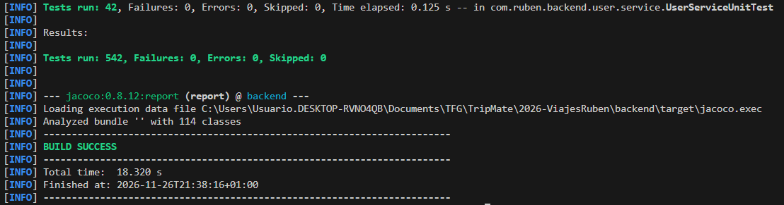

Backend coverage report (JaCoCo):

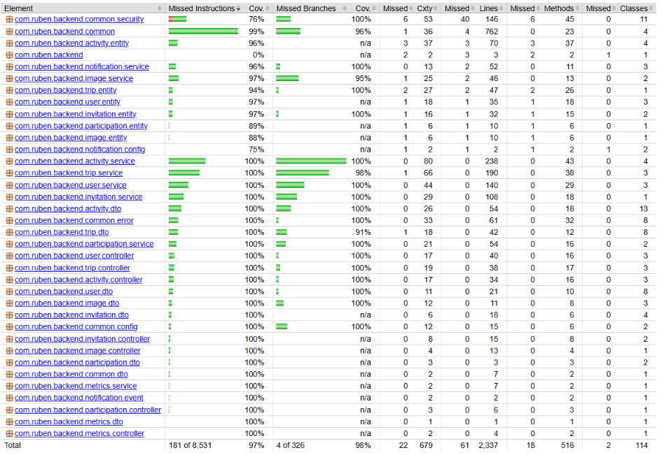

Frontend unit tests with coverage (Vitest):

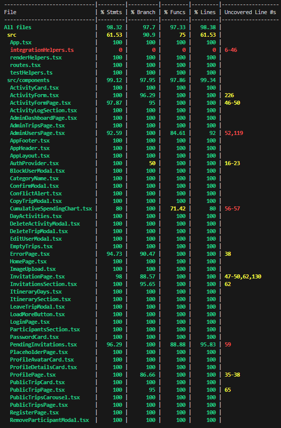

Client – server integration tests:

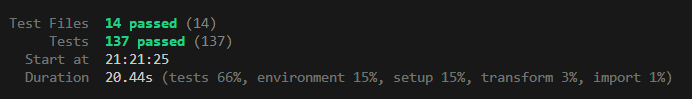

UI system tests (Selenium):

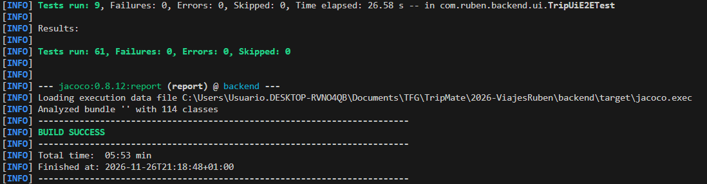

### Static code analysis

The code is analysed with [SonarQube Cloud](https://sonarcloud.io/summary/new_code?id=codeurjc-students_2026-ViajesRuben) on every push, as part of the basic quality workflow. The analysis includes the test coverage of both backend and frontend (the backend coverage comes from the unit tests only). A pull request cannot be merged while the quality gate fails, and the reported issues are reviewed and fixed during development (for example in the pull requests `fix/sonar-issues` and `fix/security-issue` of Phase 3, and `fix/code-quality-phase4` of Phase 4).

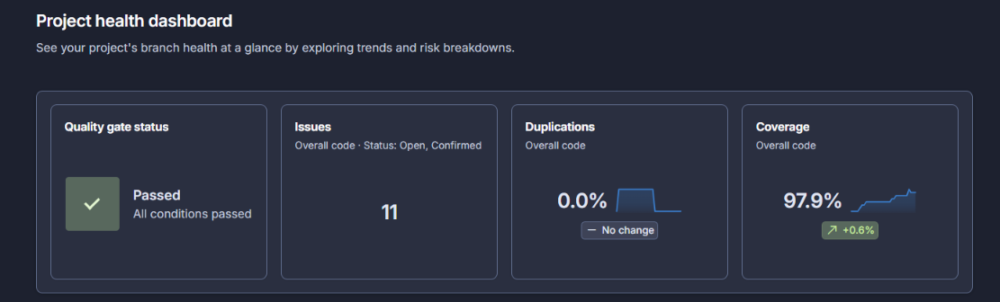

SonarQube Cloud results on `main` (date: 26/11/2026):

| Metric            | Value  |
| ----------------- | ------ |
| Quality gate      | Passed |
| Bugs              | 0      |
| Vulnerabilities   | 0      |
| Security hotspots | 0      |
| Code smells       | 11     |
| Coverage          | 97.9%  |
| Duplicated lines  | 0.0%   |

### Code size

Computed from the source code on 26/11/2026 (lines of code are the lines that are neither blank nor comments; a test file is counted separately from the code it tests). Classes are the `class`, `interface`, `record` and `enum` declarations of the Java files (including nested ones), and components are the `.tsx` files, since each one defines React components. A TypeScript file is a test when its name contains `.test.`, so the shared test helpers (`testHelpers.ts`, `renderHelpers.tsx`, `integrationHelpers.ts` and `setupTests.ts`) are counted with the application, as in version 0.1.

| Technology                     | Files   | Classes / components                          | Lines of code |
| ------------------------------ | ------- | --------------------------------------------- | ------------- |
| Java, application (`src/main`) | 118     | 121 classes                                   | 6,424         |
| Java, tests (`src/test`)       | 128     | 128 classes                                   | 19,903        |
| TypeScript, application        | 107     | 61 components (`.tsx`) and 46 modules (`.ts`) | 6,176         |
| TypeScript, tests              | 93      | —                                             | 10,388        |
| CSS (`frontend/src`)           | 30      | —                                             | 1,159         |
| **Total**                      | **476** |                                               | **44,050**    |

The application has 12,600 lines of Java and TypeScript, and the tests have 30,291: there are about two and a half lines of test for each line of application code (almost two in version 0.1). Compared with version 0.1, the application grew by 3,673 lines of Java and TypeScript and the tests by 13,097. SonarQube Cloud reports 13,741 lines of code (Java, TypeScript and CSS, without tests) under _Measures → Size_, very close to the 13,759 counted here (12,600 plus 1,159 of CSS); the small difference comes from its own rules for what a line of code is.

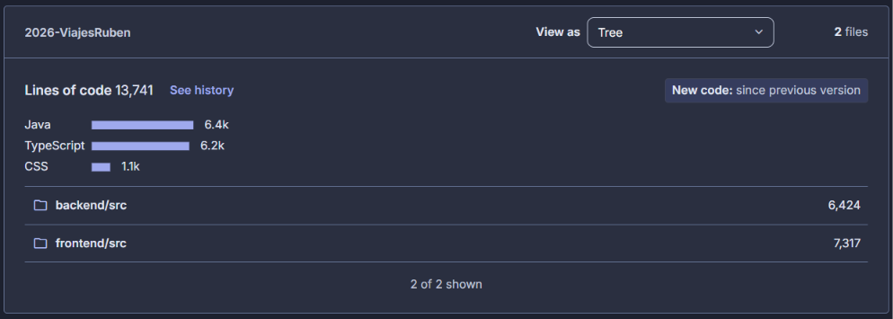

### Code style

All the code follows the same style rules, which are checked automatically in the basic quality workflow:

- **Backend:** [Spotless](https://github.com/diffplug/spotless) with google-java-format, which also removes unused imports.
- **Frontend:** [Prettier](https://prettier.io/) for formatting and [ESLint](https://eslint.org/) for detecting code problems. `eslint-config-prettier` disables the ESLint rules that conflict with Prettier.
- **Line endings:** a `.gitattributes` file normalizes all text files to LF, so the checks behave the same on Windows and on the Linux CI runners.
- **Editor:** VSCode formats files on save using the shared settings in `.vscode/settings.json`.

All the source code and comments are written in English.

## Development process

The project follows an iterative and incremental process based on the principles of the [Agile Manifesto](https://agilemanifesto.org/): the software is built in phases that each end with a working release (0.1, 0.2 and 1.0), the plan is adjusted as the work advances, working software is preferred to extensive documentation, and every feature is demonstrated with its tests before it is merged. It is not Scrum: there are no sprints, roles or ceremonies. It takes some practices from two methods:

- **Extreme Programming (XP):**
  - _Continuous integration_: every push runs the build, the code style checks, the unit tests and the static analysis, and every pull request runs the whole test suite (see [Continuous integration](#continuous-integration)).
  - _Automated tests_: every feature is only done when it has its six types of tests (see [Types of tests](#types-of-tests)).
  - _Small releases_: a release at the end of every phase, and every feature in a short branch merged by a small pull request.
  - _Refactoring_: the code is reorganized when a feature needs it, for example when the access rule for trips moved to `TripAccessService` so that later features extend it in one place.
- **Kanban:** the tasks are cards on a visual board, they flow through its columns, and the work in progress is limited (see [Task management](#task-management)).

### Task management

Tasks are managed as GitHub Issues and organized on a Kanban board in [GitHub Projects](https://github.com/orgs/codeurjc-students/projects/46). Each phase is broken down into issues that move through the board columns as they progress, and the number of tasks in progress at the same time is limited. A task is only considered done when its automated tests are implemented and the quality controls pass.

### Git

The code is stored in a Git repository hosted on GitHub. The branching strategy is **GitHub Flow**:

- `main` is the stable branch. It never receives direct commits, and its code is always ready to be deployed.
- Each feature or fix is developed in its own short-lived branch, named `feature/<ID>-<short-description>` (for example, `feature/B4-trip-crud`) or `feature/<short-description>` for technical work, `fix/<short-description>`, `refactor/...` or `docs/...`. A branch is deleted after its pull request is merged.
- Branches are merged into `main` through pull requests, which can only be merged when the full quality workflow passes. Each pull request closes its related issues.

Git metrics (03/11/2026, from `git rev-list`, `git branch` and `git log`):

| Metric                                         | Value                                                |
| ---------------------------------------------- | ---------------------------------------------------- |
| Commits on `main`                              | 151                                                  |
| Pull requests merged into `main`               | 25 (#22 to #76)                                      |
| Branches that are still open                   | 1 (`main`; the branches are deleted after the merge) |
| Pull requests of a feature (`feature/B1`–`B8`) | 8                                                    |
| Pull requests of fixes                         | 5                                                    |

### Continuous integration

The CI is implemented with GitHub Actions and runs quality controls at two levels of code maturity:

| Workflow                                | Trigger                                                      | Jobs and steps                                                                                                                                                                                                                                                            |
| --------------------------------------- | ------------------------------------------------------------ | ------------------------------------------------------------------------------------------------------------------------------------------------------------------------------------------------------------------------------------------------------------------------- |
| **Basic quality** (`basic-quality.yml`) | Every push to any branch, and manually (`workflow_dispatch`) | **Backend:** compile, code style check (Spotless), unit tests with coverage. **Frontend:** lint (ESLint), formatting check (Prettier), build, unit tests with coverage. **Sonar:** static code analysis with SonarQube Cloud, including the coverage reports of both jobs |
| **Full quality** (`full-quality.yml`)   | Pull requests to `main`                                      | **Backend:** unit, integration and system tests. **Frontend:** unit, integration and system tests. The branch protection rules of `main` prevent merging if this workflow fails                                                                                           |

### Continuous delivery

Four more GitHub Actions workflows publish the application on DockerHub. They only add files: the quality workflows above are not modified, and nothing is published by them.

| Workflow                                    | Trigger                                         | Image `rubenruiz7/tripmate` and artifact `rubenruiz7/tripmate-compose` tags    | Compose file published          |
| ------------------------------------------- | ----------------------------------------------- | ------------------------------------------------------------------------------ | ------------------------------- |
| **Deliver dev** (`deliver-dev.yml`)         | Every push to `main`                            | `dev`                                                                          | `docker/docker-compose-dev.yml` |
| **Deliver release** (`deliver-release.yml`) | A GitHub release is published                   | `x.y.0`, `x.y` and `latest` (a pre-release does not move `latest`)             | `docker/docker-compose.yml`     |
| **Deliver manual** (`deliver-manual.yml`)   | Manually (_Actions → Run workflow_), any branch | `<branch>-<YYYYMMDD>-<short commit>`, for example `feature-x-20261023-abc1234` | `docker/docker-compose-dev.yml` |
| **Publish Docker** (`publish-docker.yml`)   | Called by the three above (`workflow_call`)     | The tag it receives, plus optional aliases                                     | The file it receives            |

`publish-docker.yml` does the work, always in the same way: it logs in to DockerHub, builds `docker/Dockerfile` and pushes the image, and publishes the Compose file as an OCI artifact (`docker compose publish`). The credentials are the repository secrets `DOCKERHUB_USERNAME` and `DOCKERHUB_TOKEN` (a DockerHub access token with read and write permission); they are only used by the login step and never printed.

**Which image the artifact runs.** The committed Compose files are never edited. The workflow copies the file to a temporary folder and changes only its `app` image line to `rubenruiz7/tripmate:<tag>`; everything else, including the `${VAR:-default}` expressions, stays as it is, so the artifact is as configurable as the original. It stops if more than one line changed and checks the result with `docker compose config --images`. After publishing, it reads every artifact back from DockerHub and checks the image again. The image inside an artifact is always an immutable tag (`dev`, the version, or the branch-date-commit tag): `rubenruiz7/tripmate-compose:latest` and `:0.1` run `rubenruiz7/tripmate:0.1.0`, not `latest`, so an artifact keeps running the same image. The committed file names `rubenruiz7/tripmate:0.1`, which is why that tag is published too; the published copy replaces it with `0.1.0`.

| Case         | Artifact tags            | Image run by the artifact                                   |
| ------------ | ------------------------ | ----------------------------------------------------------- |
| Push to main | `dev`                    | `rubenruiz7/tripmate:dev`                                   |
| Release 0.2  | `0.2.0`, `0.2`, `latest` | `rubenruiz7/tripmate:0.2.0`                                 |
| Manual run   | The branch tag           | `rubenruiz7/tripmate:feature-x-20261023-abc1234` (same tag) |

**Docker Compose version.** `docker compose publish` and `-f oci://…` need Compose 2.34.0 or later (before that, `publish` was an alpha command). The runner image can change its Compose version without notice, so the workflow installs a pinned version with `docker/setup-compose-action` (`COMPOSE_VERSION` in `publish-docker.yml`) and fails if the installed version is different. Every `docker compose` command that talks to the registry runs with its input closed, `--yes` where Compose supports it, and a step timeout, so it cannot wait for a confirmation.

**Manual tags.** Docker tags cannot contain `/` and are limited to 128 characters, so the branch name is converted to lower case, every character outside `a-z 0-9 _ . -` becomes `-` (`feature/x` becomes `feature-x`) and it is shortened if needed; the date is UTC.

**Release gate.** The release workflow does not repeat the tests. Before publishing it checks that the release tag is `MAJOR.MINOR` (for example `0.1`; a `v` prefix or a third number is rejected), that the tagged commit is on `main`, and that the Basic quality run of that commit has succeeded; if that run is still in progress it waits for it (up to 15 minutes), and it fails if it did not succeed. This is enough because of the branch protection rules of `main`: **the gate assumes that `main` only receives pull requests with the full quality workflow passing** (_Require a pull request_ and required status checks), so a commit on `main` has already passed the whole test suite. If the protection is removed, the gate no longer guarantees it. The dev workflow and the manual workflow do not check anything: they publish development images.

**Where to see the result.** The summary of each run lists the published image and artifact, and the DockerHub repositories [`rubenruiz7/tripmate`](https://hub.docker.com/r/rubenruiz7/tripmate) and [`rubenruiz7/tripmate-compose`](https://hub.docker.com/r/rubenruiz7/tripmate-compose) show the tags. To try a branch before merging, run _Deliver manual_ on it and use the tag printed in the summary: `docker compose -f oci://docker.io/rubenruiz7/tripmate-compose:<tag> up -d --yes`.

### Versioning

TripMate follows [Semantic Versioning](https://semver.org/spec/v2.0.0.html): `MAJOR.MINOR.PATCH`. While the major version is `0`, the minor version changes with each release that adds functionality (`0.1.0` with features B1–B8, `0.2.0` with I1–I10) and the patch version with fixes. A release is named with two numbers, `MAJOR.MINOR` (`0.1`, no `v` prefix), and its version is `MAJOR.MINOR.0` (`0.1.0`): the Git tag and the GitHub release are `0.1`, the files and the image use `0.1.0`, and the image and the Compose artifact are also published as `0.1` so that the committed Compose file resolves. The release workflow rejects any other tag.

| Place                         | Value                                                   |
| ----------------------------- | ------------------------------------------------------- |
| Git tag and GitHub release    | `x.y`                                                   |
| `backend/pom.xml`             | `x.y.0` in a release, `x.y+1.0-SNAPSHOT` after it       |
| `frontend/package.json`       | `x.y.0` in a release, `x.y+1.0` after it                |
| `rubenruiz7/tripmate`         | `x.y.0`, `x.y` and `latest`                             |
| `rubenruiz7/tripmate-compose` | `x.y.0`, `x.y` and `latest` (all run the image `x.y.0`) |
| `docker/docker-compose.yml`   | Image `rubenruiz7/tripmate:x.y`                         |
| `CHANGELOG.md`                | A section `## [x.y.0] - date`                           |
| `main` (after the first push) | Image and Compose artifact `dev`                        |

**Releasing a version `x.y`** (for example `0.1`, whose version is `0.1.0`):

1. Check that `main` is green (CI and SonarQube Cloud quality gate) and create a branch `release/x.y`.
2. Set the version `x.y.0` in `backend/pom.xml` and `frontend/package.json` (with its lockfile).
3. Set the `x.y` tag in `docker/docker-compose.yml` (`rubenruiz7/tripmate:x.y`).
4. In `CHANGELOG.md`, move the "Unreleased" entries to `## [x.y.0] - <date>` and update the comparison links.
5. Merge the pull request into `main` (it needs the full quality workflow to pass).
6. On GitHub, create the release (**Releases → Draft a new release**) with a new tag `x.y` on `main` and the notes of that version from the changelog, and publish it. _Deliver release_ publishes the image and the Compose artifact (`x.y.0`, `x.y` and `latest`); check the run and the tags on DockerHub.
7. In another pull request, move the development versions to the next ones (`backend/pom.xml` to `x.y+1.0-SNAPSHOT`, `frontend/package.json` to `x.y+1.0` and the image of `docker/docker-compose.yml` to `x.y+1`) and add an empty "Unreleased" section to the changelog.

Releases:

| Version | Date                | Summary                                                                                                                                                                                                                                                                                                   |
| ------- | ------------------- | --------------------------------------------------------------------------------------------------------------------------------------------------------------------------------------------------------------------------------------------------------------------------------------------------------- |
| `0.0.1` | 15/09/2026          | Phase 1: project documentation (milestone, no GitHub release)                                                                                                                                                                                                                                             |
| `0.0.2` | 19/10/2026          | Phase 2: minimum functionality, automated tests and continuous integration (milestone, no GitHub release)                                                                                                                                                                                                 |
| `0.1`   | 04/11/2026          | Phase 3, the first GitHub release (tag `0.1`, version `0.1.0`): basic functionality B1–B8, the Docker image and continuous delivery                                                                                                                                                                       |
| `0.2`   | 27/11/2026          | Phase 4, the second GitHub release (tag `0.2`, version `0.2.0`): intermediate functionality I1–I10. Public itineraries with search, copying and moderation; invitations by email, participants and a collaborative itinerary with a change log; spending charts and the administrator's metrics dashboard |
| `1.0`   | Planned: 20/12/2026 | Phase 5: advanced functionality (A1–A6, AI and Telegram), database migrations with Flyway and the update of the dependencies                                                                                                                                                                              |

## Running and editing the code

### Cloning the repository

```bash
git clone https://github.com/codeurjc-students/2026-ViajesRuben.git
cd 2026-ViajesRuben
```

### Running the application

This section runs the application from the source code. To run the packaged application with Docker only, see [Docker deployment](#docker-deployment).

**Requirements:** Java 21, Node.js (LTS version) and Docker ([Docker Desktop](https://docs.docker.com/desktop/) on Windows and Mac).

1. **Start the database.** The first time, create the MySQL container (the values must match `backend/src/main/resources/application.properties`):

   ```bash
   docker run -d --name tripmate-mysql -e MYSQL_ROOT_PASSWORD=password -e MYSQL_DATABASE=tripmate -p 3307:3306 mysql:9
   ```

   The next times, start the existing container:

   ```bash
   docker start tripmate-mysql
   ```

   The backend reads its database settings from environment variables, with defaults for the local container:

   | Variable      | Default                                |
   | ------------- | -------------------------------------- |
   | `DB_URL`      | `jdbc:mysql://localhost:3307/tripmate` |
   | `DB_USERNAME` | `root`                                 |
   | `DB_PASSWORD` | `password`                             |
   | `DDL_AUTO`    | `update`                               |

   Tests use `create-drop` through `backend/src/test/resources/application.properties`.

2. **Start the test inbox** (optional: only to see the invitation emails). Mailpit catches the emails that the backend sends, so nothing reaches a real address. The first time:

   ```bash
   docker run -d --name tripmate-mailpit -p 1025:1025 -p 8025:8025 axllent/mailpit:v1.33.1
   ```

   The next times, `docker start tripmate-mailpit`. The emails are read at http://localhost:8025. The backend sends to `localhost:1025` by default, so nothing else has to be configured, except the address of the links: they start with `APP_PUBLIC_URL` (`https://localhost` by default), and the backend alone does not serve the web client, so start it with `APP_PUBLIC_URL=http://localhost:5173`, the address of the Vite server (step 5). The other variables are in [Execution](execution.md#email-settings). Without the inbox the invitations still work: the email fails, is logged, and nothing else changes. On Docker Desktop for Windows the SMTP port published on the host did not answer on the development machine (see [Problems and solutions](#problems-and-solutions)); if the emails do not arrive, run the application with Docker Compose instead.

3. **Check the security configuration.** The backend serves HTTPS on port 443 with a self-signed development certificate that is already in the repository (`backend/src/main/resources/keystore.p12`, password `password`, only for development). It also reads the administrator and the token settings from environment variables, with development defaults:

   | Variable                | Default                                       | Description                                                                                                                                  |
   | ----------------------- | --------------------------------------------- | -------------------------------------------------------------------------------------------------------------------------------------------- |
   | `SERVER_PORT`           | `443`                                         | HTTPS port of the backend                                                                                                                    |
   | `SSL_KEYSTORE`          | `classpath:keystore.p12`                      | PKCS12 keystore with the certificate (`file:/path/to/keystore.p12` for an external one)                                                      |
   | `SSL_KEYSTORE_PASSWORD` | `password`                                    | Keystore password                                                                                                                            |
   | `ADMIN_EMAIL`           | `admin@tripmate.com`                          | Email of the only administrator                                                                                                              |
   | `ADMIN_NAME`            | `Administrator`                               | Name of the administrator                                                                                                                    |
   | `ADMIN_PASSWORD_HASH`   | BCrypt hash of the password `admin`           | BCrypt hash of the administrator password. The application does not start with anything else                                                 |
   | `JWT_SECRET`            | development key (in `application.properties`) | Base64 key used to sign the tokens, at least 32 bytes                                                                                        |
   | `JWT_EXPIRATION`        | `PT24H`                                       | Lifetime of the login cookie and token (ISO-8601 duration)                                                                                   |
   | `SAMPLE_DATA`           | `true`                                        | Loads the sample users, their trips and the administrator's trips (five of them published) that are missing at start-up (`false` to disable) |
   | `SAMPLE_USERS_PASSWORD` | `Demo-2026`                                   | Password of the sample users, encoded when they are created (development only)                                                               |
   | `IMAGE_MAX_SIZE`        | `5MB`                                         | Largest image accepted by `POST /api/v1/images`                                                                                              |

   **In production, `ADMIN_PASSWORD_HASH`, `JWT_SECRET` and the keystore must be replaced** with private values. To create a hash for the administrator password (the `$` characters must not be expanded by the shell, so use single quotes):

   ```bash
   docker run --rm httpd:2 htpasswd -bnBC 10 "" 'my-admin-password' | tr -d ':\n'
   export ADMIN_PASSWORD_HASH='<the hash printed above>'
   ```

   To generate a new `JWT_SECRET`: `openssl rand -base64 32`.

   The development keystore was generated with the following command (run inside `backend/`); it is only needed to replace it, for example if it expires (validity: 10 years):

   ```bash
   keytool -genkeypair -alias tripmate -keyalg RSA -keysize 2048 -validity 3650 \
     -storetype PKCS12 -keystore src/main/resources/keystore.p12 -storepass password \
     -dname "CN=localhost, OU=TripMate, O=URJC, C=ES" -ext "SAN=dns:localhost,ip:127.0.0.1"
   ```

   The certificate is self-signed, so browsers and tools warn about it when they connect to the backend directly (for example `curl` needs `-k`). The frontend does not show the warning because Vite proxies the requests.

4. **Start the backend** (it loads the sample data and creates the administrator on start-up):

   ```bash
   cd backend
   ./mvnw spring-boot:run        # Windows: .\mvnw.cmd spring-boot:run
   ```

   On Linux a normal user cannot use ports below 1024: run the backend on another port (`SERVER_PORT=8443 ./mvnw spring-boot:run`) and give the same address to the frontend with `BACKEND_URL=https://localhost:8443`. The CI workflow does the same.

5. **Start the frontend** in another terminal:

   ```bash
   cd frontend
   npm install                   # only the first time or when dependencies change
   npm run dev
   ```

   The Vite proxy sends `/api` to `https://localhost` and accepts its self-signed certificate. If the backend uses another address, set `BACKEND_URL` before `npm run dev` (for example `BACKEND_URL=https://localhost:8443`).

6. **Open the application** at http://localhost:5173

| Service                      | URL                               |
| ---------------------------- | --------------------------------- |
| Web application              | http://localhost:5173             |
| REST API                     | https://localhost/api/v1/         |
| Swagger UI                   | https://localhost/swagger-ui.html |
| Test inbox (Mailpit, step 2) | http://localhost:8025             |

With the default configuration, you can log in as the administrator with `admin@tripmate.com` and the password `admin`. Quick check with `curl`:

```bash
curl -k -i -X POST https://localhost/api/v1/auth/login -H 'Content-Type: application/json' \
  -d '{"email":"admin@tripmate.com","password":"admin"}'
```

To stop everything, press `Ctrl + C` in the backend and frontend terminals and run `docker stop tripmate-mysql` (and `docker stop tripmate-mailpit` if you started the test inbox).

### Sample data

With `SAMPLE_DATA=true` (the default) the application creates, at start-up, three regular users and their trips, and three trips of the administrator, if they do not exist yet; five of the trips are published. The accounts are for development and demos and all use the same password, so **a deployment that must not have known accounts has to set `SAMPLE_DATA=false`**.

| User        | Email                 | Password    | Trips                                              |
| ----------- | --------------------- | ----------- | -------------------------------------------------- |
| Ana García  | `ana@tripmate.com`    | `Demo-2026` | 12 (a second page of "More results" on "My trips") |
| Carlos Ruiz | `carlos@tripmate.com` | `Demo-2026` | 3                                                  |
| Laura Pérez | `laura@tripmate.com`  | `Demo-2026` | 2                                                  |

Some trips come with an itinerary (B5): Ana's "Lisbon getaway" (7 activities over its first three days, two with an image) and "Summer in Rome" (4), Carlos's "Andalusia route" (3) and Laura's "Weekend in Porto" (4 over two days; the third day is empty on purpose, because the Selenium test creates and deletes an activity there). The images are small PNGs generated at start-up. A trip that already has any activity is left as it is, so nothing is duplicated and what a user changed is kept.

The administrator also gets three trips, written in Spanish like the rest of what the home page shows: "Roma en cinco días", "Escapada a las Maldivas" and "Lo mejor de Tokio", with a budget, a description, a cover photo and activities on every day of the trip (12, 14 and 14 activities). In version 0.1 they were the example itineraries of the home page (B1); since version 0.2 they are ordinary trips of the administrator that the sample data publishes. The photos are in `backend/src/main/resources/sample_images/` and `DataLoader` reads them from the classpath. A sample trip that has no cover gets its photo at start-up, so a database loaded before the photos existed also gets them; for the same reason, a cover that the administrator removes from one of these trips comes back at the next start while `SAMPLE_DATA` is `true`. A trip's itinerary is only loaded while the trip has no activity, so a development database loaded before a sample trip changed keeps the old trips and itineraries: recreate it (see above) to get the current ones.

**Public itineraries in the sample data (I7).** Five trips of three authors are published: the administrator's three, Ana's "Lisbon getaway" and Carlos's "Andalusia route" (the home page carousel shows them newest first, Roma first). A sample trip is published only when `DataLoader` creates it, so a trip somebody unpublished stays unpublished after a restart, and a database created before I7 gets them only after it is reset. There are no sample invitations or participations: they are created through the application (see [Emails](execution.md#emails)).

The password comes from `app.sample-data.password` (the environment variable `SAMPLE_USERS_PASSWORD`, `Demo-2026` by default) and `DataLoader` encodes it with BCrypt when it creates the users, so the source holds no password or hash; a test checks that the default in `application.properties` is the one written in the README. Users that already exist keep the password they had, so recreate the database to change it. The administrator is still `admin@tripmate.com` / `admin`.

**Upgrading a development database from before B4.** Trips now have a mandatory creator, and Hibernate cannot add that column to a table that already has rows, so recreate the database once: `docker rm -f tripmate-mysql` and the `docker run` command of [Running the application](#running-the-application) again (or `docker compose -f docker/docker-compose.yml down -v` for the Compose database). Tests and CI always start from an empty database.

### Using the tools

- **Visual Studio Code:** open the repository root folder. The recommended extensions are Extension Pack for Java, ESLint and Prettier. Files are formatted automatically on save.
- **Swagger UI:** with the backend running, open https://localhost/swagger-ui.html (accept the self-signed certificate warning) to explore the REST API from the browser.
- **Postman:** import the collection [`docs/api/tripmate.postman_collection.json`](api/tripmate.postman_collection.json) (_File → Import_). It contains example requests for every operation of the REST API. The collection variable `baseUrl` points to `https://localhost`. Because of the self-signed certificate, turn off _SSL certificate verification_ in the Postman settings. Run **Login** first: Postman stores the `AuthToken` cookie and sends it in the following requests.
- **Regenerating the API documentation:** with the backend running, the OpenAPI specification is available at https://localhost/v3/api-docs.yaml (`curl -k`). Save it to `docs/api/api-docs.yaml` (the generated server URL should be `https://localhost`) and regenerate `docs/api/api-docs.html` from it with `npx @redocly/cli build-docs docs/api/api-docs.yaml -o docs/api/api-docs.html`.
- **Code style:** before committing, format the code with:

  ```bash
  cd backend && ./mvnw spotless:apply
  cd frontend && npm run format && npm run lint
  ```

### Running the tests

**Docker must be running** for the backend integration and system tests, since Testcontainers starts a MySQL container.

Backend:

```bash
cd backend
./mvnw test                                  # all the tests
./mvnw test -Dtest='*UnitTest'               # unit tests
./mvnw test -Dtest='*IntegrationTest'        # integration tests (service – database)
./mvnw test -Dtest='*ApiE2ETest'             # REST API system tests (over HTTPS, random port)
./mvnw test -Dtest='*UiE2ETest'              # UI system tests (Selenium; need the whole application running)
./mvnw test -Dtest=TripServiceUnitTest       # one class
```

The coverage report is generated in `backend/target/site/jacoco/index.html`.

The Selenium tests (`*UiE2ETest`) open the web application in a headless Google Chrome, so they need **Chrome installed** and the **whole application running**: database, backend and the frontend served on port 5173 (the development server, or the production build with `npm run build && npm run preview`, which is what CI uses; if the backend is not on port 443, start it with `BACKEND_URL=https://localhost:<port> npm run preview`). By default they use http://localhost:5173; another URL can be passed with `-Dapp.url`:

```bash
./mvnw test -Dtest='*UiE2ETest' -Dapp.url=http://localhost:5173
```

Running `./mvnw test` without the application running makes the UI tests fail; to run only the tests that do not need it, use `./mvnw test -Dtest='*UnitTest,*IntegrationTest,*ApiE2ETest'`.

Frontend:

```bash
cd frontend
npm test                                     # unit tests
npm run test:coverage                        # unit tests with coverage
npm run test:int                             # client – server integration tests
```

The coverage report is generated in `frontend/coverage/index.html`. The client – server integration tests call the real REST API over HTTPS, so the database and the backend must be running (see [Running the application](#running-the-application)). They use `https://localhost` by default (or `BACKEND_URL`) and accept the self-signed certificate; Node prints a warning about it, which is expected.

Code style checks (the same ones that run in CI):

```bash
cd backend && ./mvnw spotless:check
cd frontend && npm run lint && npm run format:check
```

### Creating a release

Releases are created from GitHub (**Releases → Draft a new release**), with a tag named `MAJOR.MINOR` (for example, `0.1`, which releases the version `0.1.0`), and with the notes of that version taken from [`CHANGELOG.md`](../CHANGELOG.md). Publishing the release makes [continuous delivery](#continuous-delivery) publish the Docker image and the Compose artifact. The steps, including the version updates in `pom.xml`, `package.json` and `docker/docker-compose.yml`, are in [Versioning](#versioning).

## Design decisions

Relevant technical decisions taken during the development, with their reasons.

| Date     | Decision                                                                                                                                                                                                                                                                          | Alternatives considered                                                                                                          | Reason                                                                                                                                                                                                                                                                                                                                                                                                                                                                                                                               |
| -------- | --------------------------------------------------------------------------------------------------------------------------------------------------------------------------------------------------------------------------------------------------------------------------------- | -------------------------------------------------------------------------------------------------------------------------------- | ------------------------------------------------------------------------------------------------------------------------------------------------------------------------------------------------------------------------------------------------------------------------------------------------------------------------------------------------------------------------------------------------------------------------------------------------------------------------------------------------------------------------------------ |
| Sep 2026 | Telegram as the instant messaging platform                                                                                                                                                                                                                                        | WhatsApp                                                                                                                         | The Telegram Bot API is free and allows bots to manage groups (invite links, join request approval, removing members), which the trip group feature needs                                                                                                                                                                                                                                                                                                                                                                            |
| Sep 2026 | Modular monolith organized by domain                                                                                                                                                                                                                                              | Classic layered monolith                                                                                                         | Makes it easier to split the application into independent services in TFG2                                                                                                                                                                                                                                                                                                                                                                                                                                                           |
| Oct 2026 | Testcontainers with MySQL for integration and system tests                                                                                                                                                                                                                        | In-memory H2 database                                                                                                            | Tests run against the same database engine used in production, avoiding SQL dialect differences                                                                                                                                                                                                                                                                                                                                                                                                                                      |
| Oct 2026 | Code style checks in CI (Spotless, ESLint, Prettier)                                                                                                                                                                                                                              | Only formatting on save                                                                                                          | Guarantees a consistent style regardless of the editor and makes style errors visible in every push                                                                                                                                                                                                                                                                                                                                                                                                                                  |
| Oct 2026 | `.gitattributes` forcing LF line endings                                                                                                                                                                                                                                          | Relying on each machine's Git configuration                                                                                      | The project is developed on Windows and CI runs on Linux; the checks must behave the same in both                                                                                                                                                                                                                                                                                                                                                                                                                                    |
| Oct 2026 | MySQL container published on host port 3307                                                                                                                                                                                                                                       | Default port 3306                                                                                                                | Avoids conflicts with a local MySQL installation using port 3306                                                                                                                                                                                                                                                                                                                                                                                                                                                                     |
| Oct 2026 | JWT in an `HttpOnly` cookie, validated with Spring Security's own resource server (Nimbus)                                                                                                                                                                                        | Token in `localStorage` sent as a `Bearer` header; a JWT library such as jjwt                                                    | JavaScript cannot read the cookie, which limits the damage of an XSS attack; no extra dependency is needed                                                                                                                                                                                                                                                                                                                                                                                                                           |
| Oct 2026 | CSRF protection disabled in Spring Security (stateless API)                                                                                                                                                                                                                       | CSRF tokens (`CookieCsrfTokenRepository`)                                                                                        | The API has no server session or form login; its only credential is the `AuthToken` cookie (`HttpOnly; Secure; SameSite=Strict`), which browsers never send on cross-site requests. Tokens would add a header to every mutation without closing a real gap                                                                                                                                                                                                                                                                           |
| Oct 2026 | The user is loaded from the database on every authenticated request                                                                                                                                                                                                               | Trusting the role stored in the token until it expires                                                                           | A blocked user is rejected immediately and the role cannot become stale; the cost is one query by primary key per request                                                                                                                                                                                                                                                                                                                                                                                                            |
| Oct 2026 | The administrator is defined in the configuration and synchronized into the `users` table on start-up                                                                                                                                                                             | Keeping the administrator only in memory                                                                                         | Other entities (for example the sample trips created by the administrator) can reference it, and it still cannot be created or assigned through the API                                                                                                                                                                                                                                                                                                                                                                              |
| Oct 2026 | HTTPS on port 443 by default, with a self-signed development keystore committed to the repository                                                                                                                                                                                 | HTTP in development and HTTPS only in production                                                                                 | Development behaves like production (`Secure` cookie) and CI needs no extra setup; the keystore holds nothing private of the real deployment                                                                                                                                                                                                                                                                                                                                                                                         |
| Oct 2026 | CI runs the backend on HTTPS port 8443 (`SERVER_PORT`)                                                                                                                                                                                                                            | Port 443                                                                                                                         | The GitHub Actions runner cannot bind ports below 1024                                                                                                                                                                                                                                                                                                                                                                                                                                                                               |
| Oct 2026 | One Docker image with the Spring Boot server serving the built React application                                                                                                                                                                                                  | A separate frontend container (for example nginx)                                                                                | The SPA and the API share the same origin (no CORS or proxy), there is one HTTPS endpoint and a single artifact to publish, as the guide asks                                                                                                                                                                                                                                                                                                                                                                                        |
| Oct 2026 | The container listens on port 443 as the non-root user `tripmate`, with `sysctls: net.ipv4.ip_unprivileged_port_start: 0` in the Compose files                                                                                                                                    | The container on 8443 published as `443:8443`; running the container as root                                                     | The guide asks for HTTPS on port 443. The sysctl lets a non-root process bind port 443 inside the container's own network namespace, so the process does not run as root; it was verified on Docker Desktop. If a platform rejects the sysctl, the fallback is to run the container as root                                                                                                                                                                                                                                          |
| Oct 2026 | Two Compose files (release and `dev`) with different project names                                                                                                                                                                                                                | One file with the image tag as a variable                                                                                        | The guide asks for a released and a development file, each publishable as an OCI artifact; different project names keep their volumes and containers separate                                                                                                                                                                                                                                                                                                                                                                        |
| Oct 2026 | The published Compose file is a copy of the committed one with only the `app` image line changed (`sed`)                                                                                                                                                                          | Writing it with `docker compose config`; `yq`; one file with the tag as a variable                                               | `config` resolves every variable to its default and `yq` removes blank lines; changing one line keeps the file identical to the committed one and as configurable, and the result is checked with `config --images`                                                                                                                                                                                                                                                                                                                  |
| Oct 2026 | A Compose artifact always points to an immutable image tag (`x.y.z`, `dev` or the branch tag), also the artifact tagged `latest`                                                                                                                                                  | An artifact `latest` that runs the image `latest`                                                                                | An artifact then keeps running the same image, and the version of the application it runs is always known                                                                                                                                                                                                                                                                                                                                                                                                                            |
| Oct 2026 | Docker Compose pinned in the delivery workflow (`docker/setup-compose-action`)                                                                                                                                                                                                    | The version installed in the runner image                                                                                        | `publish` needs Compose 2.34.0 or later and the runner image changes its version without notice                                                                                                                                                                                                                                                                                                                                                                                                                                      |
| Oct 2026 | The release workflow checks that the commit is on `main` and that Basic quality passed (waiting up to 15 minutes), instead of running the tests again                                                                                                                             | Re-running every test; no check                                                                                                  | The tests already ran in the pull request (branch protection on `main`) and the full workflow cannot be reused; the check also covers a release created on a commit whose analysis is still running                                                                                                                                                                                                                                                                                                                                  |
| Oct 2026 | Releases publish `x.y.z` and `latest`, never `x.y`                                                                                                                                                                                                                                | Also a moving `x.y` tag                                                                                                          | One exact tag per release and no tag that changes under the user; the Compose file of the release names the full version                                                                                                                                                                                                                                                                                                                                                                                                             |
| Nov 2026 | Releases are tagged `MAJOR.MINOR` (`0.1`) and publish `x.y.0`, `x.y` and `latest`; the committed Compose file names `rubenruiz7/tripmate:x.y` (replaces "never `x.y`" above)                                                                                                      | Tag `x.y.z` with only `x.y.z` and `latest`                                                                                       | The TFG guide asks for releases named `0.1` and a Compose file that resolves `rubenruiz7/tripmate:0.1`. The artifact still runs the immutable `x.y.0`, so it never changes under the user                                                                                                                                                                                                                                                                                                                                            |
| Oct 2026 | `.dockerignore` as an allowlist                                                                                                                                                                                                                                                   | A list of excluded folders                                                                                                       | Nothing enters the build context unless the build needs it, so private files, `.git` and documentation cannot end up in an image                                                                                                                                                                                                                                                                                                                                                                                                     |
| Oct 2026 | The administrator's own profile is read-only except the avatar (changing its name, email or password answers 403)                                                                                                                                                                 | Letting the administrator edit its profile like any other user                                                                   | The administrator's name, email and password hash come from the configuration and are written to the database on every start-up: a name or password changed through the API would be lost on the next restart, and a changed email would make the next start-up create a second administrator account with the configured email and demote the edited one. The avatar is not in the configuration, so it can be changed                                                                                                              |
| Oct 2026 | Avatars are shown through the public `GET /api/v1/images/{id}` (the `avatarId` of the user), while `GET /api/v1/users/{id}/avatar` requires login                                                                                                                                 | Serving avatars only from the user URL; making the user URL public                                                               | The image URL is a random UUID that cannot be guessed or enumerated (the same as the rest of the images), works in `` tags and can be cached forever because a new upload gets a new id. The user URL is guessable (sequential ids), so it requires login, and its content changes when the avatar is replaced, so it is sent with `no-cache`. The trade-off is that anyone who obtains an avatar's UUID can see that picture without logging in; avatars are not sensitive data, and the UUID is only given to logged-in users |
| Oct 2026 | A trip is readable and editable only by its creator; 404 is checked before 403, in the service (`findTripForRead` / `findTripForWrite`)                                                                                                                                           | Checking ownership in the controller; answering 404 for another user's trip                                                      | The two methods are the only place to extend when participants (I3) and trip moderation by the administrator (B8) arrive; a missing trip is reported as missing to anyone                                                                                                                                                                                                                                                                                                                                                            |
| Oct 2026 | The administrator gets 403 on other users' trips until trip moderation (B8) exists                                                                                                                                                                                                | Letting the administrator read and delete any trip now                                                                           | "User permissions" gives that power to the moderation feature, not to trip management                                                                                                                                                                                                                                                                                                                                                                                                                                                |
| Nov 2026 | The administrator can read and delete any trip (B8) but never edit it: `findForRead` and `findForDelete` accept the `ADMIN` role, `findForWrite` stays creator-only                                                                                                               | One `findForWrite` that lets the administrator through; an admin-only delete endpoint                                            | Moderation is reviewing and removing. Editing another user's trip or activities would change their content. The rule stays in `TripAccessService`, and the existing endpoints and the cascade of B4/B5 are reused                                                                                                                                                                                                                                                                                                                    |
| Oct 2026 | Trip covers are shown through the public `GET /api/v1/images/{id}`, while `GET /api/v1/trips/{id}/cover` is restricted to the creator                                                                                                                                             | Serving covers only from the trip URL                                                                                            | Same trade-off as avatars: the image URL is a random UUID that only someone who can read the trip is given, and `` tags need a plain URL                                                                                                                                                                                                                                                                                                                                                                                        |
| Oct 2026 | Deleting a trip deletes its children explicitly in the service, then the trip, then its images; there are no database cascades                                                                                                                                                    | `ON DELETE CASCADE`; JPA `cascade = REMOVE`                                                                                      | Stored images must be deleted too, which cascades do not do, and the order stays visible in one method that each later feature extends                                                                                                                                                                                                                                                                                                                                                                                               |
| Oct 2026 | One form component and one page create and edit a trip; the cover is chosen in the form and sent after the trip is saved                                                                                                                                                          | Separate create and edit pages; uploading the cover as soon as it is chosen                                                      | The trip does not exist when a new trip's cover is chosen, and one button saves everything                                                                                                                                                                                                                                                                                                                                                                                                                                           |
| Oct 2026 | The sample users' password is a property (`SAMPLE_USERS_PASSWORD`), encoded with the `PasswordEncoder` at start-up, with a test that its default matches the README                                                                                                               | A BCrypt hash constant in the source (SonarQube flags it as a secret)                                                            | No credential or hash in the code, the README credentials cannot drift, and the password can be changed without rebuilding                                                                                                                                                                                                                                                                                                                                                                                                           |
| Oct 2026 | The permission to read or change a trip lives in `TripAccessService` (`findForRead`, `findForWrite`), and every service that works on a trip or on something that belongs to it authorises through it (an update of the rule of B4 that put the two methods inside `TripService`) | Making the methods of `TripService` public; letting `ActivityService` read the creator itself                                    | `ActivityService` needs the rule and `TripService` needs `ActivityService` (to delete the activities and to check the new dates), so the rule cannot live in either without a dependency cycle. Each service uses only its own repository, and participants (I3) and the administrator (B8) are added in one class                                                                                                                                                                                                                   |
| Oct 2026 | Changing the dates of a trip so that an activity falls outside them is allowed and reported as a conflict (B6); B5 had refused it with a 409                                                                                                                                      | Refusing it; moving or deleting the activities automatically                                                                     | The activities left outside stay visible and can be fixed from the warning's "Editar" links; deleting data silently is not acceptable. Creating or editing an activity still requires a date inside the trip (400)                                                                                                                                                                                                                                                                                                                   |
| Oct 2026 | Conflicts (B6) are warnings computed in queries by `GET /api/v1/trips/{tripId}/conflicts`: overlaps by a self-join, dates outside by comparing with the trip, the cost by `SUM`; the endpoint is not paginated                                                                    | Checking in the browser or in Java loops after loading every activity; refusing to save a conflicting activity; a paginated list | The project filters and aggregates in the database; the answer is one small report per trip, so paging it would only hide conflicts; a conflict is information for the user, never a reason to lose their data                                                                                                                                                                                                                                                                                                                       |
| Oct 2026 | An activity lasts one day: the end time must be strictly after the start and there are no overnight activities                                                                                                                                                                    | Allowing an end on the next day                                                                                                  | The schedule is shown per day and conflict detection (B6) compares times of the same day; an activity that crosses midnight is entered as two                                                                                                                                                                                                                                                                                                                                                                                        |
| Oct 2026 | The selected day of the itinerary is in the URL (`?day=yyyy-MM-dd`)                                                                                                                                                                                                               | Component state                                                                                                                  | The form returns to the same day, the browser's Back button and a refresh keep it, and a day can be linked                                                                                                                                                                                                                                                                                                                                                                                                                           |
| Oct 2026 | The itinerary list is paginated and filtered by day in the query (`?date=`), and the activities without a start time come first on their day                                                                                                                                      | Loading the whole itinerary and grouping it in the browser; sorting them last                                                    | The rule of the project is to filter and page in the database; MySQL sorts nulls first, which puts the "all day" activities at the head of their day                                                                                                                                                                                                                                                                                                                                                                                 |
| Oct 2026 | The example trips of the public home page (B1) are the trips the administrator created, read from public `GET /api/v1/trips/examples` endpoints                                                                                                                                   | A flag or an `example` table; copying the trips into a separate table                                                            | The administrator already manages trips with the normal pages (B4, B5), so there is nothing new to keep in step; a trip of anyone else can never be exposed because the query is by the creator's role, and it is a 404, not a 403, for anything else                                                                                                                                                                                                                                                                                |
| Nov 2026 | Public itineraries (I7) are trips with a `published` flag and a `publishedAt` date, read from `GET /api/v1/trips/public`; the B1 example trips are now just the published trips of the administrator                                                                              | Keeping the trips of the administrator as the only examples; a separate table for public trips                                   | Any user can publish, so the role of the creator no longer says what is public, and a flag keeps one table, one set of pages and no copies to keep in step; a trip that is not published is a 404, not a 403, so nothing is revealed about it; publishing is a sub-resource decided by `findForWrite`, so even the administrator cannot publish another user's trip; unpublishing is decided by `findForUnpublish` (I10), so the administrator moderates without a separate admin endpoint, as B8 did for delete                     |
| Nov 2026 | Copying a public itinerary (I9) duplicates the image rows (the cover and the picture of each activity) instead of sharing them                                                                                                                                                    | Pointing the copy at the same `Image` rows; copying the images lazily, only when the copy is edited                              | More storage (each copy stores its own bytes), but a copy never depends on the original: deleting the original trip, or one of its pictures, cannot break the copy, and the existing delete code (a trip deletes its own images) keeps working unchanged, without counting how many trips use an image                                                                                                                                                                                                                               |
| Oct 2026 | The first activity of each of the first three days of the example trips is read in one query for the whole page (`findFirstOfFirstDays`)                                                                                                                                          | Loading every activity of each trip and choosing in Java; one query per trip                                                     | The project filters and aggregates in the database, and the home page would otherwise load every itinerary of the page                                                                                                                                                                                                                                                                                                                                                                                                               |
| Oct 2026 | The text of the example trips (names, places, descriptions and activities) is written in Spanish in `DataLoader`; the rest of the sample data, the identifiers and the comments stay in English                                                                                   | English text, as the other sample trips                                                                                          | The home page shows the examples exactly as stored, to Spanish-speaking visitors, and there is no translation layer for data; it is content, not an identifier                                                                                                                                                                                                                                                                                                                                                                       |
| Oct 2026 | The home page shows the examples three at a time and, only when there are more than three, pages through them with previous and next buttons, not with "More results"                                                                                                             | A button that appends the next page; always showing the buttons                                                                  | The design asked for a fixed row of three cards that changes, so the page replaces the cards; with the three sample examples there is nothing to page, so the buttons stay hidden; the endpoint is the usual paginated one                                                                                                                                                                                                                                                                                                           |
| Oct 2026 | The category of an activity is a closed list (`SIGHTSEEING`, `FOOD`, `TRANSPORT`, `ACCOMMODATION`, `LEISURE`, `OTHER`)                                                                                                                                                            | Free text                                                                                                                        | The spending chart by category (I5) and the AI proposals (A1) need values that can be grouped; the Spanish names are written in the frontend component                                                                                                                                                                                                                                                                                                                                                                               |
| Nov 2026 | Invitation emails (I1) are sent by a listener in the background after the invitation's transaction commits (`@TransactionalEventListener(AFTER_COMMIT)` with `@Async`), triggered by an `InvitationCreatedEvent` that carries plain data                                          | Sending the email inside the service method, in the same transaction                                                             | A slow or failing SMTP server must not delay the answer or undo the invitation, and a rolled back invitation must not send anything. The listener is in its own `notification` package, which only knows the event, so it can become a separate service later. The cost is that a failed email is only logged and not retried                                                                                                                                                                                                        |
| Nov 2026 | Mailpit (`axllent/mailpit`, pinned tag) as the test inbox in the Compose files and for local runs                                                                                                                                                                                 | MailHog; a real SMTP account (Gmail) for everyone                                                                                | One container with an SMTP server and a web inbox, no account and no secrets, and it never delivers to a real address. MailHog has had no release since August 2020. A real SMTP server is still possible with the `MAIL_*` variables                                                                                                                                                                                                                                                                                                |
| Nov 2026 | Invitations (I2) do not expire: they are valid until answered or until their trip is deleted (which deletes them, so the link then answers 404)                                                                                                                                   | A configurable number of days, with a column and a 410 for an expired link                                                       | The token alone gives nothing: only the logged-in account whose email matches can see or answer it, so a leaked link is useless to anyone else, and the creator can always send a new one. No requirement asks for an expiry                                                                                                                                                                                                                                                                                                         |
| Nov 2026 | The invited person is identified by the normalised email of the logged-in account, not by the account saved on the invitation                                                                                                                                                     | Comparing `invitedUser`                                                                                                          | The invitation may predate the account, and the email of an account can change; the account is saved on the invitation when it is accepted                                                                                                                                                                                                                                                                                                                                                                                           |
| Nov 2026 | Participants read the trip from I2 (`TripAccessService.findForRead`) and the trip appears in their "My trips", with one query that pages and sorts in the database; writing stays creator-only                                                                                    | Waiting for I3, so that accepting an invitation would have no visible result                                                     | Accepting has to do something the user can see; I3 only adds listing, removing and leaving                                                                                                                                                                                                                                                                                                                                                                                                                                           |
| Nov 2026 | Everyone who can read a trip (creator, participants, administrator) sees who joined it (I3); only the creator receives their emails                                                                                                                                               | The creator only, as the README says                                                                                             | The trip page of the analysis shows the participants' avatars to everyone who opens the trip, and in a group trip knowing who goes is part of viewing it. The emails are personal data that only the creator already holds (they typed them when inviting), so they stay with the creator                                                                                                                                                                                                                                            |
| Nov 2026 | The data of the spending charts (I5) comes from a new `GET .../activities/spending`, not from the existing `GET .../activities/cost`                                                                                                                                              | Adding the per-category and per-day sums to `/cost`                                                                              | The summary figure of the trip page only needs one `SUM`; putting two `GROUP BY` queries behind it would make every page view pay for them and change an endpoint that B6 already tests. The new one reuses `sumCost` and the same read rule, so nothing is duplicated                                                                                                                                                                                                                                                               |
| Nov 2026 | The zero days and the running sum of the spending line are computed in `ActivityService.fillDays`, not in the frontend or in SQL                                                                                                                                                  | Filling the gaps in the component; a calendar table or a recursive query in MySQL                                                | The queries only return what exists (the per-day sums); a pure function is unit-tested without a database, the frontend only draws, and the range also covers a day outside the trip's dates, so the line always ends at the total                                                                                                                                                                                                                                                                                                   |
| Nov 2026 | Charts are drawn with Recharts (SVG), pinned to one exact version                                                                                                                                                                                                                 | Chart.js with react-chartjs-2 (canvas)                                                                                           | Declarative components that fit React, and SVG elements that the jsdom tests can count and read, where a canvas is opaque and needs a mock; it costs a larger bundle, accepted for this application                                                                                                                                                                                                                                                                                                                                  |
| Nov 2026 | The category chart shows the total against the budget as a progress bar below the bars, not as a budget line on the bars                                                                                                                                                          | A reference line on the category axis                                                                                            | One category is usually far below the whole budget, so the line would squash the bars; the bar answers "does the trip go over the budget?" at a glance                                                                                                                                                                                                                                                                                                                                                                               |
| Nov 2026 | The "users" total of the dashboard (I6) counts the regular accounts, blocked ones included, and not the administrator                                                                                                                                                             | Counting only the active users, or every row of the table                                                                        | A blocked user still has an account that the administrator can unblock, and the single administrator comes from the configuration; it is also the set that the user list (B7) shows                                                                                                                                                                                                                                                                                                                                                  |
| Nov 2026 | The platform totals (I6) are three `COUNT`s read by `MetricsService` in a new `metrics` package, with no entity or repository of its own                                                                                                                                          | A `GROUP BY` projection, or adding the counts to `UserService` and `TripService`                                                 | Each total is one table, so a count is enough; the user, trip and activity packages stay unaware of the dashboard, and the AI requests of version 1.0 are one more field and one more count                                                                                                                                                                                                                                                                                                                                          |
| Nov 2026 | The creator "leaving" their own trip is a 409 whose message says to delete the trip                                                                                                                                                                                               | 400 or 403                                                                                                                       | The request is valid and the user is allowed to make it, but it conflicts with the state of the trip, which always has its creator. The message tells the client what to do instead                                                                                                                                                                                                                                                                                                                                                  |
| Nov 2026 | Removing or leaving deletes only the participation; the invitation stays `ACCEPTED` as history and the person can be invited again                                                                                                                                                | Deleting or changing the invitation                                                                                              | The creator keeps an honest record of what happened, and inviting again needs nothing new because I1 only refuses a duplicate while the first invitation is pending                                                                                                                                                                                                                                                                                                                                                                  |
| Nov 2026 | The participant count of a trip (I3) does not include its creator, and it is a field of `TripDTO` for every endpoint                                                                                                                                                              | Counting the creator too; a separate summary DTO only for the list                                                               | The number of the card then equals the rows of the "Participantes" list, which does not list the creator. One DTO keeps a single `Trip` type in the frontend; the list pays one grouped query per page, not one per trip                                                                                                                                                                                                                                                                                                             |
| Nov 2026 | The participant operations (I3) are in `ParticipantService`, not in `ParticipationService`                                                                                                                                                                                        | Adding them to `ParticipationService`                                                                                            | `TripAccessService` already depends on `ParticipationService` to know who may read a trip, and the operations need `TripAccessService` to know who may remove whom, so putting them together would be a dependency cycle                                                                                                                                                                                                                                                                                                             |
| Nov 2026 | The creator and the participants create, edit and delete any activity (I4), through one rule, `TripAccessService.findForItineraryWrite`; `findForWrite` stays creator-only                                                                                                        | The first analysis: participants only their own activities, the creator any                                                      | The itinerary is planned together and the author of the project decided it so. One rule for the five operations needs no ownership check per activity, and the administrator and strangers stay at 403                                                                                                                                                                                                                                                                                                                               |
| Nov 2026 | The change log copies the names of the activity and of the user, and the activity id becomes null when the activity is deleted                                                                                                                                                    | A foreign key with a database cascade; keeping the old and new values of each field                                              | A line must read the same after the activity is deleted or the user changes their name, and the lines are detached explicitly before the delete, like every other delete in the project. Only field names are stored, never values, so the log cannot repeat what was written in a field                                                                                                                                                                                                                                             |
| Nov 2026 | A change and its log line are written in the same transaction, and an edit that changes no field still writes its line                                                                                                                                                            | Writing the line after the commit, in a listener; skipping edits that change nothing                                             | A change that fails then leaves no line and one that commits always has exactly one, so the log can be trusted. Skipping empty edits would make "one line per request" untrue                                                                                                                                                                                                                                                                                                                                                        |

## Problems and solutions

Technical problems found during the development and how they were solved.

| Date         | Problem                                                                                                                                                                                                                                                                                                                                                                            | Solution                                                                                                                                                                                                                                                                                                                                                                         |
| ------------ | ---------------------------------------------------------------------------------------------------------------------------------------------------------------------------------------------------------------------------------------------------------------------------------------------------------------------------------------------------------------------------------- | -------------------------------------------------------------------------------------------------------------------------------------------------------------------------------------------------------------------------------------------------------------------------------------------------------------------------------------------------------------------------------- |
| Oct 14, 2026 | The backend integration and system tests failed locally with _"Previous attempts to find a Docker environment failed"_                                                                                                                                                                                                                                                             | Testcontainers needs a running Docker engine. Docker Desktop must be started before running the tests                                                                                                                                                                                                                                                                            |
| Oct 14, 2026 | ESLint reported an unused `it` import in `TripList.test.tsx` after enabling linting                                                                                                                                                                                                                                                                                                | Removed the unused import                                                                                                                                                                                                                                                                                                                                                        |
| Oct 14, 2026 | Git warned that CRLF line endings would be replaced by LF after adding `.gitattributes`                                                                                                                                                                                                                                                                                            | Expected behaviour: files are normalized to LF in the repository                                                                                                                                                                                                                                                                                                                 |
| Oct 22, 2026 | The client – server integration tests could not connect to the backend after enabling HTTPS (self-signed certificate)                                                                                                                                                                                                                                                              | `NODE_TLS_REJECT_UNAUTHORIZED=0` is set only in `vitest.int.config.ts`, and the Vite proxy uses `secure: false`                                                                                                                                                                                                                                                                  |
| Oct 22, 2026 | The backend unit-test coverage fell to 58% after adding the security classes, below the 70% required                                                                                                                                                                                                                                                                               | Added unit tests for the classes that were only covered by the slower system tests (error handlers, controller, security configuration)                                                                                                                                                                                                                                          |
| Oct 22, 2026 | A test with an expired token failed with _"expiresAt must be after issuedAt"_ when the token was created with a negative lifetime                                                                                                                                                                                                                                                  | Spring refuses to build such a token; the test now creates it directly with the encoder, issued two hours ago and expired one hour ago                                                                                                                                                                                                                                           |
| Nov 18, 2026 | The invitation emails never reached Mailpit when the backend ran on the host and Mailpit was published with `-p 1025:1025` (Docker Desktop on Windows): the SMTP connection was accepted but the server greeting never arrived, on any host port, while Mailpit and its web port worked. The application logged `could not be sent (MailSendException)` after the 5 second timeout | Not a bug of the application: a message sent from another container to `mailpit:1025` over a Docker network was received and shown in the inbox, which is the path the Compose files use, so there the emails arrive. The cause on the host was not found. On such a machine, run the application with Docker Compose to see the emails, or send them through a real SMTP server |
