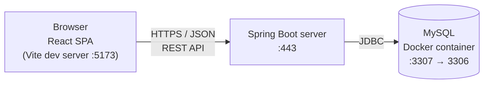
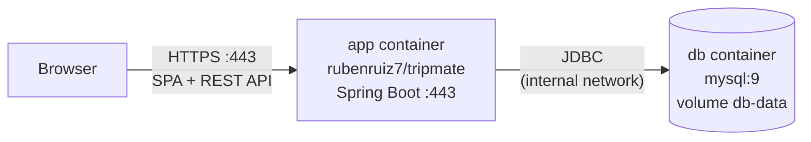
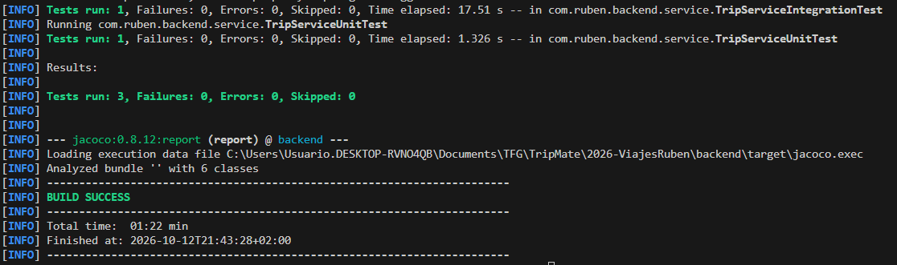
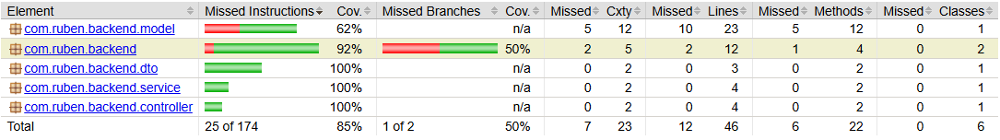
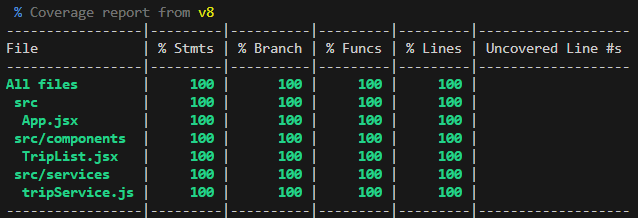
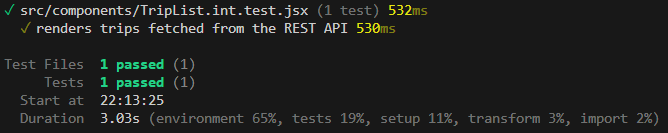
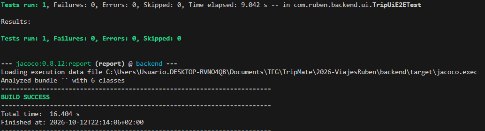
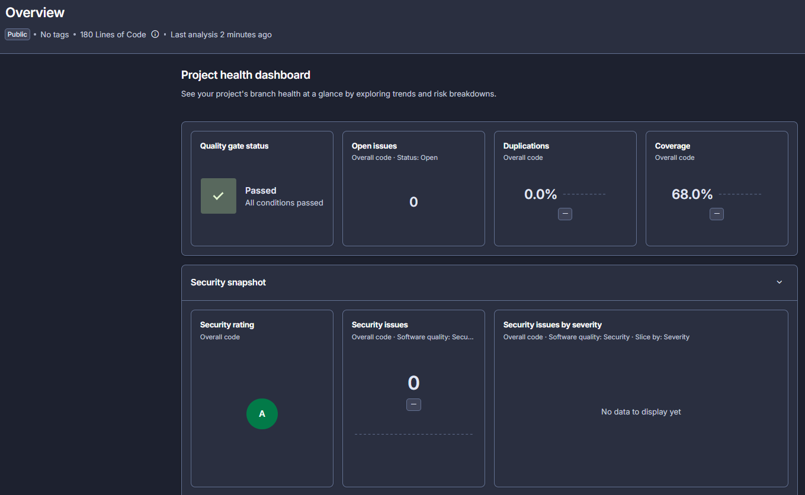
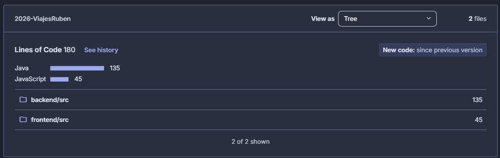

[← Back to README](../README.md)

# Development guide

This guide describes the current technical state of TripMate: how it is built, how its quality is controlled, how it is developed and how to run it from the source code. It is updated at the end of every phase.

## Index

- [Introduction](#introduction)
- [Technologies](#technologies)
- [Tools](#tools)
- [Architecture](#architecture)
  - [Deployment](#deployment)
    - [Docker deployment](#docker-deployment)
  - [REST API](#rest-api)
  - [Frontend routing and error page](#frontend-routing-and-error-page)
- [Quality control](#quality-control)
  - [Automated tests](#automated-tests)
  - [Static code analysis](#static-code-analysis)
  - [Code style](#code-style)
- [Development process](#development-process)
  - [Task management](#task-management)
  - [Git](#git)
  - [Continuous integration](#continuous-integration)
  - [Continuous delivery](#continuous-delivery)
  - [Versioning](#versioning)
- [Running and editing the code](#running-and-editing-the-code)
  - [Cloning the repository](#cloning-the-repository)
  - [Running the application](#running-the-application)
  - [Sample data](#sample-data)
  - [Using the tools](#using-the-tools)
  - [Running the tests](#running-the-tests)
  - [Creating a release](#creating-a-release)
- [Design decisions](#design-decisions)
- [Problems and solutions](#problems-and-solutions)

## Introduction

TripMate is a web application with a **Single Page Application (SPA)** architecture. In an SPA, the browser downloads a single HTML page once, together with the JavaScript code of the client application. From then on, the client updates the view dynamically and exchanges data with the server through a **REST API** (JSON over HTTP), instead of requesting a new HTML page from the server for every interaction. This separates the user interface completely from the business logic and lets other clients (for example, a mobile app or the Telegram bot) reuse the same API.

The application has three parts that run as independent processes:

- **Client (frontend):** a React application that runs in the user's browser.
- **Server (backend):** a Spring Boot application that exposes the REST API and contains the business logic. It is designed as a modular monolith organized by domain, so that it can be split into independent services in TFG2.
- **Database:** a MySQL server that stores the application's data.

| Aspect                  | Description                                                                                                                                                                                                                                                           |
| ----------------------- | --------------------------------------------------------------------------------------------------------------------------------------------------------------------------------------------------------------------------------------------------------------------- |
| **Type**                | Web SPA with a REST API backend (modular monolith)                                                                                                                                                                                                                    |
| **Technologies**        | Backend: Java 21, Spring Boot, Spring Data JPA, MySQL. Frontend: React, React Bootstrap, TypeScript, Vite                                                                                                                                                             |
| **Tools**               | Visual Studio Code, Maven, npm, Docker, Postman, Git, GitHub                                                                                                                                                                                                          |
| **Quality control**     | Unit, integration and system tests for backend and frontend (JUnit, Mockito, Testcontainers, Rest Assured, Selenium, Vitest, Testing Library); test coverage (JaCoCo, Vitest); static code analysis (SonarQube Cloud); code style checks (Spotless, ESLint, Prettier) |
| **Deployment**          | Docker image served by Spring Boot over HTTPS and Docker Compose with MySQL (see [Deployment](#deployment)). Deployment to a server will be done in Phase 4                                                                                                           |
| **Development process** | Iterative and incremental; Git with GitHub Flow; continuous integration with GitHub Actions; tasks managed with GitHub Issues and GitHub Projects                                                                                                                     |

## Technologies

Technologies used by the application at runtime.

### Java

Programming language of the backend. The project uses Java 21, the current long-term support (LTS) version.
https://www.java.com/

### Spring Boot

Framework for building Java applications with minimal configuration. In TripMate it provides the web server, the REST API controllers, dependency injection and the configuration of the application.
https://spring.io/projects/spring-boot

### Spring Data JPA

Spring module that simplifies data access with JPA (Java Persistence API). The application's entities are mapped to database tables, and repositories provide the database queries without writing SQL for the common operations.
https://spring.io/projects/spring-data-jpa

### springdoc-openapi

Library that generates the OpenAPI specification of the REST API from the Spring controllers and serves an interactive Swagger UI to explore it.
https://springdoc.org/

### MySQL

Open-source relational database management system. It stores all the persistent data of the application.
https://www.mysql.com/

### React

JavaScript library for building user interfaces from reusable components. It is used to implement the SPA client.
https://react.dev/

### React Bootstrap

Bootstrap components rebuilt for React (grid, cards, alerts, forms, modals). Bootstrap is themed with the TripMate design tokens instead of its default look; see the [design system](design-system.md).
https://react-bootstrap.github.io/

### TypeScript

Typed superset of JavaScript used for all the frontend code. The compiler (`tsc`, in strict mode) checks the types before the build, and the types of the REST API data are defined in `src/types` to match the backend DTOs.
https://www.typescriptlang.org/

### Vite

Build tool and development server for the frontend. It serves the React application during development with instant reload and generates the optimized production build.
https://vite.dev/

## Tools

Tools used to develop the application.

### Visual Studio Code

Code editor used for both backend and frontend development. The repository includes shared settings (`.vscode/settings.json`) that format files on save.
https://code.visualstudio.com/

### Maven

Build and dependency management tool for the backend. The repository includes the Maven Wrapper (`mvnw`), so Maven does not need to be installed.
https://maven.apache.org/

### npm

Package manager for JavaScript (Node.js). It installs the frontend dependencies and runs its scripts (development server, build, tests, linting and formatting).
https://www.npmjs.com/

### Docker

Container platform. During development it runs the MySQL database and, through Testcontainers, a real MySQL instance for the integration and system tests. It also packages the application as an image, which Docker Compose runs together with MySQL.
https://www.docker.com/

### Postman

Tool to send HTTP requests and test REST APIs. The repository includes a Postman collection with example requests for every operation of the API.
https://www.postman.com/

### Git and GitHub

Git is the version control system; GitHub hosts the repository, the issues, the project board and the CI workflows.
https://git-scm.com/ · https://github.com/

### GitHub Actions

Continuous integration service of GitHub. It runs the quality control workflows automatically on every push and pull request.
https://github.com/features/actions

### SonarQube Cloud

Cloud service for static code analysis. It detects bugs, vulnerabilities, code smells and duplicated code, and shows the test coverage.
https://sonarcloud.io/

### Testcontainers

Library that starts Docker containers from the tests. It is used to run the integration and system tests against a real MySQL database instead of an in-memory one.
https://testcontainers.com/

### Spotless, ESLint and Prettier

Code style tools. Spotless formats the Java code following the Google Java Style (google-java-format); Prettier formats the frontend code; ESLint detects problems and bad practices in the frontend code.
https://github.com/diffplug/spotless · https://eslint.org/ · https://prettier.io/

## Architecture

### Deployment

During development, TripMate runs as three independent processes:



- The **browser** loads the React application from the Vite development server and calls the REST API using JSON payloads. During development, Vite proxies the `/api` requests to the backend, so the browser only talks to `http://localhost:5173`.
- The **Spring Boot server** serves HTTPS on port 443, authenticates the requests (see [Security](#security)), handles them, applies the business logic and accesses the database through JDBC (using Spring Data JPA).
- The **MySQL database** runs in a Docker container. The container's port 3306 is published on port 3307 of the host.

#### Docker deployment

The whole application is packaged as a single Docker image (`rubenruiz7/tripmate`) that contains the Spring Boot server and the built React application, which Spring serves as static resources. It runs with Docker Compose next to a standard MySQL container:



- The **`app` container** serves the SPA and the REST API from the same origin, so the browser needs no proxy. Requests to a client route (for example `https://localhost/trips`, also after a page refresh) return `index.html` so that React Router renders the screen. Unknown `/api/**` URLs keep returning the JSON error and a missing file (for example `/missing.png`) returns 404.
- The **`db` container** is not published on the host: only `app` reaches it, through the Compose network. Its data lives in the named volume `db-data`.

**Image layers.** `docker/Dockerfile` has three stages and the build context is the repository root (`.dockerignore` is an allowlist, so only the sources needed by the build are sent to Docker):

| Stage      | Base image                      | What it does                                                                                      |
| ---------- | ------------------------------- | ------------------------------------------------------------------------------------------------- |
| `frontend` | `node:24-alpine`                | `npm ci` and `npm run build` in `frontend/`                                                       |
| `backend`  | `maven:3.9-eclipse-temurin-21`  | Copies the frontend build into Spring's static resources and packages the jar (`-DskipTests`)     |
| runtime    | `eclipse-temurin:21-jre-alpine` | Only the jar, run by the non-root user `tripmate`; HTTPS on port 443 with the keystore in the jar |

The tests are not run while building the image: they run in CI. The resulting image is about 415 MB (the JRE is 165 MB and the jar 68 MB).

**Compose files.** Both files are self-contained (no `build` section, bind mounts or `env_file`), so they can be published as OCI artifacts. They only differ in the project name and the image tag:

| File                            | Project        | `app` image                 | Use                                                    |
| ------------------------------- | -------------- | --------------------------- | ------------------------------------------------------ |
| `docker/docker-compose.yml`     | `tripmate`     | `rubenruiz7/tripmate:0.1.0` | Released version, downloaded from DockerHub            |
| `docker/docker-compose-dev.yml` | `tripmate-dev` | `rubenruiz7/tripmate:dev`   | Image built locally, to test changes before publishing |

The image tag in `docker/docker-compose.yml` is always the full version of the last release (`x.y.z`, see [Versioning](#versioning)). The files published by [continuous delivery](#continuous-delivery) have the tag of each publication instead.

`app` waits for `db` to be healthy (`mysqladmin ping`) before starting. All settings are environment variables with the `${VAR:-default}` syntax, so `docker compose up` works without any configuration:

| Variable                                | Default                                  | Used by | Description                                                 |
| --------------------------------------- | ---------------------------------------- | ------- | ----------------------------------------------------------- |
| `MYSQL_ROOT_PASSWORD`                   | `password`                               | `db`    | Password of the MySQL `root` user                           |
| `MYSQL_DATABASE`                        | `tripmate`                               | `db`    | Database created on the first start (also used in `DB_URL`) |
| `DB_URL`                                | `jdbc:mysql://db:3306/${MYSQL_DATABASE}` | `app`   | Fixed by the Compose file, pointing to the `db` service     |
| `DB_USERNAME`                           | `root`                                   | `app`   | Database user                                               |
| `DB_PASSWORD`                           | `${MYSQL_ROOT_PASSWORD}`                 | `app`   | Database password                                           |
| `SAMPLE_DATA`                           | `true`                                   | `app`   | Loads the 3 sample users and their 17 trips at start-up     |
| `ADMIN_EMAIL`, `ADMIN_NAME`             | `admin@tripmate.com`, `Administrator`    | `app`   | The administrator                                           |
| `ADMIN_PASSWORD_HASH`                   | BCrypt hash of the password `admin`      | `app`   | BCrypt hash of the administrator password                   |
| `JWT_SECRET`                            | development key                          | `app`   | Base64 key that signs the tokens (at least 32 bytes)        |
| `SSL_KEYSTORE`, `SSL_KEYSTORE_PASSWORD` | `classpath:keystore.p12`, `password`     | `app`   | Keystore with the self-signed development certificate       |

The defaults are for development only: **outside development, `ADMIN_PASSWORD_HASH`, `JWT_SECRET`, `MYSQL_ROOT_PASSWORD` and the keystore must be replaced** (see [Running the application](#running-the-application) to create them). To change a value, set the variable before the command, for example `SAMPLE_DATA=false docker compose -f docker/docker-compose.yml up -d`.

**Running with Docker Compose.** Requirements: Docker only, and port 443 free on the host (stop the local backend if it is running).

```bash
# Released version
docker compose -f docker/docker-compose.yml up -d

# Local image: build it, tag it as dev and run it
docker build -f docker/Dockerfile -t rubenruiz7/tripmate:dev .
docker compose -f docker/docker-compose-dev.yml up -d
```

The application is then available at https://localhost/ (the browser warns about the self-signed certificate) and the REST API at https://localhost/api/v1/. Log in as `admin@tripmate.com` with the password `admin`, or as one of the [sample users](#sample-data).

**Running from the OCI artifact.** Without cloning the repository, Compose (2.34.0 or later) can run the file published on DockerHub (see [Continuous delivery](#continuous-delivery)):

```bash
docker compose -f oci://docker.io/rubenruiz7/tripmate-compose:latest up -d --yes
```

Before running a file downloaded from a registry, `up` shows its variables and asks "Do you want to proceed with these variables?"; `--yes` answers yes. `down`, `logs` and `ps` do not ask. The tag is `latest` (last release), a version such as `0.1.0`, or `dev` (last version of `main`); the other commands of the table below work with the same `-f oci://…` instead of the file in `docker/`.

| Goal                           | Command (use `docker/docker-compose-dev.yml` for the local image)                      |
| ------------------------------ | -------------------------------------------------------------------------------------- |
| Start with the sample users and trips | `docker compose -f docker/docker-compose.yml up -d`                                    |
| Start with an empty database   | `SAMPLE_DATA=false docker compose -f docker/docker-compose.yml up -d`                  |
| See the logs                   | `docker compose -f docker/docker-compose.yml logs -f app`                              |
| Stop, keeping the data         | `docker compose -f docker/docker-compose.yml down` (the next `up` finds the same data) |
| Stop and delete all data       | `docker compose -f docker/docker-compose.yml down -v` (removes the `db-data` volume)   |

`SAMPLE_DATA` is read when the application starts. Uploaded images are stored in the database, so they follow the same rules as the rest of the data: they survive `down` and `up` and disappear with `down -v`. To go from sample data to an empty database, reset the data first with `down -v`.

### Security

Authentication and authorization are implemented with Spring Security.

- **Login:** `POST /api/v1/auth/login` checks the email and password (BCrypt) and returns the user. The response sets a signed JWT (HS256) in the `AuthToken` cookie, which is `HttpOnly` (JavaScript cannot read it), `Secure` (HTTPS only), `SameSite=Strict` and limited to the path `/api`. Because of this, the frontend asks `GET /api/v1/auth/me` to know who is logged in.
- **Every request:** the token is read from the cookie and the user is loaded from the database, so the role always comes from the database (never from the token) and a user blocked or deleted after logging in is rejected immediately. A missing, invalid or expired token is answered with 401 and the cookie is cleared.
- **Roles:** `USER` and `ADMIN`. The URLs under `/api/v1/admin/**` require `ADMIN`; the rest of `/api/**` requires being logged in, except login, logout, registration and reading an image (`GET /api/v1/images/{id}`).
- **Administrator:** there is a single administrator, defined in the configuration (`ADMIN_EMAIL`, `ADMIN_NAME` and `ADMIN_PASSWORD_HASH`, a BCrypt hash, never a plain password). On every start-up it is created or updated in the database and any other administrator is demoted to `USER`, so the role cannot be assigned through the API.
- **Blocked users:** a user with status `BLOCKED` cannot log in (403 "Account is blocked"). The blocked check runs after the password check, so someone who does not know the password gets the generic 401 and cannot find out that the account exists.
- **CSRF:** disabled, because the session is stateless and the only credential is a `SameSite=Strict` cookie that browsers do not send on cross-site requests.
- **Errors:** security errors use the same JSON body as the rest of the API: `timestamp`, `status`, `error`, `message` and `path`.
- **Known limitation:** changing the password does not invalidate the sessions already open on other devices. The JWT is stateless and is not tied to the password, so a token issued before the change stays valid until it expires (`JWT_EXPIRATION`, 24 hours by default).
- **Known limitation:** database schema changes need Flyway migrations after 0.1.0. Until then the schema is created and extended by Hibernate (`ddl-auto=update`), which cannot add a `NOT NULL` column to a table that already has rows, nor tighten or change existing columns. B4 is the example: trips gained a mandatory creator, so a development database created before B4 must be recreated once (see [Sample data](#sample-data)).

### REST API

The REST API is documented with OpenAPI. The specification is stored in [`docs/api/api-docs.yaml`](api/api-docs.yaml) and its HTML version can be viewed here:

**[REST API documentation](https://raw.githack.com/codeurjc-students/2026-ViajesRuben/main/docs/api/api-docs.html)**

Current operations:

| Method | URL                           | Access    | Description                                                                                            |
| ------ | ----------------------------- | --------- | ------------------------------------------------------------------------------------------------------ |
| GET    | `/api/v1/trips`               | Logged-in | Returns one page of the user's own trips (`?page=0&size=10&sort=startDate`)                            |
| POST   | `/api/v1/trips`               | Logged-in | Creates a trip for the user; 201 with `Location`, 400 for invalid data or the end before the start     |
| GET    | `/api/v1/trips/{id}`          | Creator   | Returns one trip (403 for another user's trip, 404 if it does not exist)                               |
| PUT    | `/api/v1/trips/{id}`          | Creator   | Replaces the details of the trip (not the cover)                                                       |
| DELETE | `/api/v1/trips/{id}`          | Creator   | Deletes the trip and its cover image; 204                                                              |
| PUT    | `/api/v1/trips/{id}/cover`    | Creator   | Uploads or replaces the cover (multipart `file`); 201 with `Location` the first time, 200 after       |
| GET    | `/api/v1/trips/{id}/cover`    | Creator   | Returns the bytes of the cover (`no-cache`); 404 if there is none                                      |
| DELETE | `/api/v1/trips/{id}/cover`    | Creator   | Deletes the cover (204, also when there was none)                                                      |
| POST   | `/api/v1/images`              | Logged-in | Uploads an image (multipart `file`); 201 with `Location`                                               |
| GET    | `/api/v1/images/{id}`         | Public    | Returns the bytes of an image with its `Content-Type`                                                  |
| POST   | `/api/v1/users`               | Public    | Registers a regular user (`name`, `email`, `password`); 201 with `Location`, 409 if the email is taken |
| POST   | `/api/v1/auth/login`          | Public    | Logs in with email and password and sets the `AuthToken` cookie                                        |
| POST   | `/api/v1/auth/logout`         | Public    | Clears the `AuthToken` cookie                                                                          |
| GET    | `/api/v1/auth/me`             | Logged-in | Returns the logged-in user (`id`, `name`, `email`, `role`, `avatarId`, `registrationDate`)             |
| GET    | `/api/v1/users/{id}`          | Own user  | Returns one's own profile (403 for another user, 404 if it does not exist)                             |
| PUT    | `/api/v1/users/{id}`          | Own user  | Edits the name and email (409 if the email is taken); the session stays open                           |
| PUT    | `/api/v1/users/{id}/password` | Own user  | Changes the password (`currentPassword`, `newPassword`); 400 if the current one is wrong               |
| PUT    | `/api/v1/users/{id}/avatar`   | Own user  | Uploads or replaces the avatar (multipart `file`); 201 with `Location` the first time, 200 after       |
| GET    | `/api/v1/users/{id}/avatar`   | Logged-in | Returns the bytes of a user's avatar (`no-cache`); 404 if there is none                                |
| DELETE | `/api/v1/users/{id}/avatar`   | Own user  | Deletes the avatar (204, also when there was none)                                                     |

#### Pagination

Every list is paginated in the database query (Spring Data `Pageable`), never in Java. The client sends `?page=0&size=10` (page numbers start at 0; the default size is 10 and the maximum is 50, set with `spring.data.web.pageable.max-page-size`; `?sort=` is accepted and an unknown property is answered with 400). The answer is always a `PageDTO` (`common/dto`):

```json
{ "content": [], "page": 0, "size": 10, "totalElements": 12, "last": false }
```

In the frontend, `usePagedList` (`src/hooks`) loads one page at a time and appends the next one, and `LoadMoreButton` shows "Más resultados" until the server says `last: true`.

#### Images

Images are stored in the database (`Image` entity: a `@Lob` byte array in a MEDIUMBLOB column, the content type and the creation time), as the project requires, and are identified by a random UUID so their URLs cannot be guessed or enumerated.

- **Upload:** `POST /api/v1/images` (logged-in users) takes a multipart form with the picture in the `file` part and answers `201` with a `Location` header and the image data (`id`, `contentType`, `size`). The type must be JPEG, PNG or WebP **and** the first bytes of the file must match the declared type, so a text file renamed to `.png` is rejected with `400`. Images over `IMAGE_MAX_SIZE` get `413`; `spring.servlet.multipart` sets a hard cap of 10 MB above that.
- **Read:** `GET /api/v1/images/{id}` is public so `` tags work without credentials. It answers the bytes with the stored `Content-Type` and `Cache-Control: max-age=31536000, public, immutable`, because an image never changes (a new upload gets a new id).
- **Frontend:** `ImageUpload` uploads the chosen file and `StoredImage` shows an image by id, falling back to `DEFAULT_TRIP_COVER` (`public/Default_trip_image.png`) when there is no id or it fails to load. The avatar of a user is the first image linked to an entity (`User.avatar`, `PUT /api/v1/users/{id}/avatar`): `ImageUpload` takes an `upload` function and `UserAvatar` shows the picture or the initial of the name. Linking images to trips and activities is done by their own features.

#### Errors

Every error has the same JSON body (`ErrorResponse`): `timestamp`, `status`, `error`, `message` and `path`. `GlobalExceptionHandler` maps exceptions to status codes, and the security filters write the same body through `ErrorResponseWriter`.

| Status | When                                                                                                              |
| ------ | ----------------------------------------------------------------------------------------------------------------- |
| 400    | Invalid body (`message` lists `field: problem` sorted by field), malformed JSON, or a parameter of the wrong type |
| 401    | Not logged in, or wrong email or password                                                                         |
| 403    | Access denied (role or ownership), or a blocked account                                                           |
| 404    | `ResourceNotFoundException` (a trip, an image...), or an unknown URL                                              |
| 405    | HTTP method not supported by the URL (the `Allow` header lists the valid ones)                                    |
| 409    | `ConflictException`                                                                                               |
| 500    | Any other exception: logged with its stack trace, but the response only says `Unexpected error`                   |

To report a new error from a service, throw `ResourceNotFoundException` or `ConflictException` with a message that is safe to show.

### Frontend routing and error page

The frontend uses React Router. `src/routes.tsx` lists one route per screen of [the analysis](analysis.md#screens-and-navigation); only `/trips` (My Trips) is built so far, and the rest show `PlaceholderPage`. Every route renders inside `AppLayout` (header, page, footer).

- **Unknown URLs** match the `*` route and show `ErrorPage` with the 404 message.
- **Failures while loading data**: services use `request()` (`src/services/apiError.ts`), which throws `ApiError` (non-2xx answer, with the status) or `NetworkError` (no answer). A component that cannot load its data rethrows the error and the route's `errorElement` shows `ErrorPage` inside the same layout, with a message for 404, 5xx or no connection and a button back to the home page.
- **Texts**: Spanish UI texts are written in the component that shows them, as in the rest of the frontend.

## Quality control

### Automated tests

The application has automated tests at every level for both the backend and the frontend. Each test is traced to the functionality it verifies. At this stage, the implemented functionality is the **minimum functionality of Phase 2 (MF)**: listing the sample trips stored in the database on the home page, which is the first step towards feature B1.

| Test                         | Location                          | Type                                     | Tools                                   | What it verifies                                                                             | Functionality |
| ---------------------------- | --------------------------------- | ---------------------------------------- | --------------------------------------- | -------------------------------------------------------------------------------------------- | ------------- |
| `TripServiceUnitTest`        | `backend/src/test/.../service`    | Backend unit                             | JUnit, Mockito                          | The service returns the list of trips, with the repository mocked                            | MF            |
| `TripServiceIntegrationTest` | `backend/src/test/.../service`    | Backend integration (service – database) | JUnit, Spring Boot Test, Testcontainers | The service returns the trips previously stored in a real MySQL database                     | MF            |
| `TripApiE2ETest`             | `backend/src/test/.../controller` | Backend system (REST API)                | JUnit, Rest Assured, Testcontainers     | The trips endpoints (see feature B4 below)                                                   | MF, B4        |
| `TripUiE2ETest`              | `backend/src/test/.../ui`         | Frontend system (UI)                     | JUnit, Selenium (headless Chrome)       | The trip screens in the browser (see feature B4 below)                                       | MF, B4        |
| `TripList.test.tsx`          | `frontend/src/components`         | Frontend unit (component)                | Vitest, Testing Library                 | The component renders the list of trips, with the service mocked and a virtual DOM           | MF            |
| `tripService.test.tsx`       | `frontend/src/services`           | Frontend unit (service)                  | Vitest                                  | The service requests the trips from the REST API and returns them, with the HTTP call mocked | MF            |
| `App.test.tsx`               | `frontend/src`                    | Frontend unit (component)                | Vitest, Testing Library                 | The main component renders the trip list                                                     | MF            |
| `TripList.int.test.tsx`      | `frontend/src/components`         | Client – server integration              | Vitest, Testing Library                 | The component renders the trips obtained from the real REST API                              | MF            |

Support classes (not tests): `TestcontainersConfiguration` defines the MySQL container shared by the backend integration and system tests, and `TestBackendApplication` starts the backend locally using that container as its database.

**Security base** (login, roles, blocked users, configured administrator and HTTPS). These tests are tagged `B2`, like the registration tests below.

| Test                                                                                                                                       | Type                | What it verifies                                                                                                                                                    |
| ------------------------------------------------------------------------------------------------------------------------------------------ | ------------------- | ------------------------------------------------------------------------------------------------------------------------------------------------------------------- |
| `AuthServiceUnitTest`, `AuthControllerUnitTest`                                                                                            | Backend unit        | Login returns the user and a token, errors are propagated without issuing a token, and the controller sets and clears the cookie                                    |
| `SecurityConfigUnitTest`                                                                                                                   | Backend unit        | BCrypt hashing, and that the blocked check runs after the password check (a blocked user with a wrong password gets the generic error)                              |
| `ActiveUserJwtConverterUnitTest`, `TripMateUserDetailsServiceUnitTest`                                                                     | Backend unit        | The role comes from the stored user; blocked, deleted and malformed-subject tokens are rejected                                                                     |
| `JwtServiceUnitTest`, `JwtConfigUnitTest`, `CookieBearerTokenResolverUnitTest`                                                             | Backend unit        | Token contents and expiry, forged and expired tokens, cookie attributes, key validation, and reading the token only from the cookie                                 |
| `AdminPropertiesUnitTest`, `AdminAccountInitializerUnitTest`                                                                               | Backend unit        | A plain-text admin password is rejected at start-up; the administrator is created or updated and any other administrator is demoted                                 |
| `GlobalExceptionHandlerUnitTest`, `ErrorResponseWriterUnitTest`, `RestAuthenticationEntryPointUnitTest`, `RestAccessDeniedHandlerUnitTest` | Backend unit        | The 400, 401 and 403 error bodies and the cookie clearing                                                                                                           |
| `AdminAccountInitializerIntegrationTest`, `AuthServiceIntegrationTest`                                                                     | Backend integration | With a real MySQL database and real BCrypt: the administrator is stored from the configuration, logins succeed or fail as expected, and blocked users cannot log in |
| `AuthApiE2ETest`                                                                                                                           | Backend system      | Over HTTPS: login, cookie flags, `/me`, logout, errors, a user blocked after logging in, invalid cookies, and access to the admin area by anonymous, user and admin |

**Registration and login screens (B2).** Registration is `POST /api/v1/users`: the password is hashed with BCrypt, the new user always has the `USER` role (a `role` in the body is ignored), emails are stored in lower case and compared ignoring case, and the administrator email is refused with the same 409 as a taken one, because the administrator account is rewritten from the configuration on every start-up. The frontend logs the user in right after registering (it calls the login endpoint) and returns them to the page they came from.

| Test                                                                                                            | Type                        | What it verifies                                                                                                                                          |
| --------------------------------------------------------------------------------------------------------------- | --------------------------- | --------------------------------------------------------------------------------------------------------------------------------------------------------- |
| `UserServiceUnitTest`, `UserControllerUnitTest`                                                                 | Backend unit                | Normalised email, encoded password, role `USER`, 201 with `Location`, and a conflict for a taken email, the administrator email or a lost race            |
| `UserServiceIntegrationTest`                                                                                    | Backend integration         | With MySQL and real BCrypt: the user is stored active with a hash that matches, can log in, and duplicates (any case) and the administrator email fail    |
| `UserApiE2ETest`                                                                                                | Backend system              | Over HTTPS: 201, no password in the answer, role forced to `USER`, login and `/me` afterwards, 409, 400 (blank name, bad email, short password, bad JSON) |
| `authService.test.tsx`, `AuthProvider.test.tsx`, `RequireAuth.test.tsx`, `useAuth.test.tsx`, `authForm.test.ts` | Frontend unit               | Session calls, `/me` on load, login, register then login, logout, redirect to `/login` for anonymous visitors, and the Spanish error texts                |
| `LoginPage.test.tsx`, `RegisterPage.test.tsx`, `AppHeader.test.tsx`, `App.test.tsx`                             | Frontend unit (component)   | Client validation, inline backend errors, disabled button while sending, return to the previous page, and the header for anonymous and logged-in users    |
| `authService.int.test.tsx`                                                                                      | Client – server integration | Against the real API: register, duplicate (409), invalid data (400), wrong password (401) and no session                                                  |
| `AuthUiE2ETest`                                                                                                 | Frontend system (UI)        | Register, logged in, log out, log in; a private page redirects to `/login` and back; wrong password; duplicate email                                      |

**Profile (B3).** A registered user reads and edits their own profile at `/api/v1/users/{id}`: only that user can (another user's id is a 403, a missing one a 404). The token identifies the user by id, not by email, so changing the email does not log the user out and no token refers to the old address. The new email follows the registration rules (lower case, 409 for a taken one or the administrator's). The password change is `PUT /api/v1/users/{id}/password`: it requires the current password (a wrong one is a 400, because 401 means "log in again" for the application and 403 means "not allowed on this profile") and the new one follows the 8–72 character rule. The avatar is an `Image` linked to the user (`PUT`, `GET` and `DELETE /api/v1/users/{id}/avatar`), validated by `ImageService` like any other image; replacing or deleting it deletes the previous image. The administrator can only change their avatar. Responses never contain the password hash.

| Test                                                                                                                                                        | Type                        | What it verifies                                                                                                                                                                                                                                                      |
| ----------------------------------------------------------------------------------------------------------------------------------------------------------- | --------------------------- | --------------------------------------------------------------------------------------------------------------------------------------------------------------------------------------------------------------------------------------------------------------------- |
| `UserServiceUnitTest`, `UserControllerUnitTest`, `ImageServiceUnitTest`, `TripMateUserDetailsUnitTest`, `UserDTOUnitTest`, `GlobalExceptionHandlerUnitTest` | Backend unit                | Own profile only (403/404), email rules and lost race, administrator restrictions, wrong current password, first avatar (201) and replacement (200) deleting the old image, the mapping of the avatar id and the 403 body                                             |
| `UserServiceIntegrationTest`                                                                                                                                | Backend integration         | With MySQL: a token issued before an email change still identifies the user, only the new email logs in, the new password is a BCrypt hash, the previous avatar row is deleted and the avatar id is readable without loading the image                                |
| `UserProfileApiE2ETest`                                                                                                                                     | Backend system              | Over HTTPS, every endpoint: 401 anonymous, 403 for another user, 404, 409 (another account or the administrator), 400 (invalid data, wrong current password, not an image), 413, and the same session working after an email change                                   |
| `userService.test.tsx`, `UserAvatar.test.tsx`, `profileForm.test.ts`, `StoredImage.test.tsx`, `ImageUpload.test.tsx`, `AuthProvider.test.tsx`               | Frontend unit               | The calls to the profile endpoints, the avatar (picture or initial), the validation and error texts, and the auth context update                                                                                                                                      |
| `ProfilePage.test.tsx`, `AppHeader.test.tsx`, `App.test.tsx`                                                                                                | Frontend unit (component)   | View and edit mode, inline errors by status (409, 400, 401, 403), disabled buttons while sending, avatar upload and delete, the administrator view, the header link to `/profile`, and the auth context updated after each change                                     |
| `userService.int.test.tsx`                                                                                                                                  | Client – server integration | Against the real API: 401 without session, 403/404, email change keeping the session, 409/400, wrong and right password change, and the avatar upload, replacement and deletion                                                                                       |
| `ProfileUiE2ETest`                                                                                                                                          | Frontend system (UI)        | Register, edit the name (the header follows), upload an avatar (the browser decodes it in the header and the page), change the password, log out and log in with the new one; wrong current password; duplicate email; delete the avatar; a file that is not an image |

**Trips (B4).** A registered user creates, reads, edits and deletes their own trips at `/api/v1/trips`. Every trip has a creator; only the creator can read, change or delete it, and the cover (`/api/v1/trips/{id}/cover`) follows the same rule (another user's trip is a 403, a missing one a 404, and 404 is checked before 403, so a missing trip is reported as missing to anyone). The administrator is a user like any other for their own trips and gets a 403 on other users' trips until trip moderation (B8) exists. The body is validated before the service runs (400): `name` and `destination` are required (up to 100 characters), the dates are required and the end must not be before the start (the same day is a one-day trip), `budget` is optional (up to 2 decimals, not negative) and `description` optional (up to 2000 characters). `GET /api/v1/trips` returns only the trips of the logged-in user, paginated and sorted in the query; `sort` accepts only `id`, `name`, `destination`, `startDate`, `endDate` and `createdAt`. The cover is an `Image` linked to the trip, validated like any other image; a trip without cover has `coverImageId: null` and the application shows its default image (the API answers 404 to `GET /cover`). Replacing or deleting a cover, and deleting a trip, delete the image they stop using.

| Test                                                                                                                      | Type                        | What it verifies                                                                                                                                                                                                                  |
| ------------------------------------------------------------------------------------------------------------------------- | --------------------------- | --------------------------------------------------------------------------------------------------------------------------------------------------------------------------------------------------------------------------------- |
| `TripServiceUnitTest`, `TripControllerUnitTest`, `TripRequestUnitTest`, `TripDTOUnitTest`, `DataLoaderUnitTest`            | Backend unit                | Creator rules (404 before 403, nothing written on 403), sort whitelist, trimming, delete order (trip, then cover), first cover (201) and replacement (200), every validation rule, the mapping, and the sample data and its password |
| `TripServiceIntegrationTest`, `DataLoaderIntegrationTest`                                                                  | Backend integration         | With MySQL: only the user's trips, paginated and sorted; persisted budget scale; the image rows are deleted with the cover and the trip; the sample users log in with the documented password and loading twice adds nothing    |
| `TripApiE2ETest`                                                                                                           | Backend system              | Over HTTPS, every endpoint: 401 anonymous, 403 for another user (and for the administrator), 404, 400 (invalid data, end before start, malformed JSON, bad sort), cover type and size (400, 413), 201/200/204 and `Location`       |
| `tripService.test.tsx`, `usePagedList.test.tsx`, `useTrip.test.tsx`, `tripForm.test.ts`, `tripFormat.test.ts`              | Frontend unit               | The calls to the trip endpoints, list reload, loading one trip, the validation codes and the formatting of dates and budget                                                                                                       |
| `TripForm.test.tsx`, `TripFormPage.test.tsx`, `TripDetailPage.test.tsx`, `TripList.test.tsx`, `TripCard.test.tsx`, `DeleteTripModal.test.tsx`, `ConfirmModal.test.tsx`, `ImageUpload.test.tsx`, `ErrorPage.test.tsx`, `App.test.tsx` | Frontend unit (component)   | Create and edit with one form, the Spanish messages, the cover (choose, discard, remove, partial failure), creator-only actions, the confirmation modal, the 403/401/404 pages, and that an anonymous visitor never asks for trips |
| `tripService.int.test.tsx`, `TripList.int.test.tsx`                                                                        | Client – server integration | Against the real API: 401, 403 for another user, 404, 400, the cover upload, replacement and deletion deleting the old pictures, and the list paging only the user's trips                                                       |
| `TripUiE2ETest`                                                                                                            | Frontend system (UI)        | As a sample user: create a trip with a cover, see it in the list, edit it, cancel and confirm the deletion; Ana's two pages; Laura sees only her trips; end before start; a bad or too large cover; another user's trip; an anonymous visit |

**Statistics** (19/10/2026):

| Metric               | Backend             | Frontend |
| -------------------- | ------------------- | -------- |
| Test classes / files | 4                   | 4        |
| Number of tests      | 4                   | 4        |
| Unit tests           | 1                   | 3        |
| Integration tests    | 1                   | 1        |
| System tests         | 2 (REST API and UI) | —        |
| Line coverage        | 85%                 | 100%     |

Backend tests (unit, integration and system):



Backend coverage report (JaCoCo):



Frontend unit tests with coverage (Vitest):



Client – server integration tests:



UI system tests (Selenium):



### Static code analysis

The code is analysed with [SonarQube Cloud](https://sonarcloud.io/summary/new_code?id=codeurjc-students_2026-ViajesRuben) on every push, as part of the basic quality workflow. The analysis includes the test coverage of both backend and frontend. The reported issues are reviewed and fixed during development.



Code size metrics (19/10/2026, from SonarQube Cloud → _Measures → Size_):

| Metric               | Java (backend) | TypeScript (frontend) | Total |
| -------------------- | -------------- | --------------------- | ----- |
| Lines of code        | 138            | 44                    | 182   |
| Files                | 7              | 4                     | 11    |
| Classes / components | 7              | 0                     | 7     |



### Code style

All the code follows the same style rules, which are checked automatically in the basic quality workflow:

- **Backend:** [Spotless](https://github.com/diffplug/spotless) with google-java-format, which also removes unused imports.
- **Frontend:** [Prettier](https://prettier.io/) for formatting and [ESLint](https://eslint.org/) for detecting code problems. `eslint-config-prettier` disables the ESLint rules that conflict with Prettier.
- **Line endings:** a `.gitattributes` file normalizes all text files to LF, so the checks behave the same on Windows and on the Linux CI runners.
- **Editor:** VSCode formats files on save using the shared settings in `.vscode/settings.json`.

All the source code and comments are written in English.

## Development process

The project follows an iterative and incremental process based on the principles of the Agile Manifesto, applying some practices from Extreme Programming (XP), such as automated testing, continuous integration and small releases, and from Kanban, such as visual task management and limiting work in progress.

### Task management

Tasks are managed as GitHub Issues and organized on a Kanban board in [GitHub Projects](https://github.com/orgs/codeurjc-students/projects/46). Each phase is broken down into issues that move through the board columns as they progress. A task is only considered done when its automated tests are implemented and the quality controls pass.

### Git

The code is stored in a Git repository hosted on GitHub. The branching strategy is **GitHub Flow**:

- `main` is the stable branch. It never receives direct commits, and its code is always ready to be deployed.
- Each feature or fix is developed in its own short-lived branch, named `feature/<short-description>` or `fix/<short-description>` (for example, `feature/add-code-style-checks`).
- Branches are merged into `main` through pull requests, which can only be merged when the full quality workflow passes. Each pull request closes its related issues.

Git metrics (19/10/2026):

| Metric               | Value |
| -------------------- | ----- |
| Commits on `main`    | 33    |
| Branches             | 2     |
| Pull requests merged | 6     |

### Continuous integration

The CI is implemented with GitHub Actions and runs quality controls at two levels of code maturity:

| Workflow                                | Trigger                                                      | Jobs and steps                                                                                                                                                                                                                                                            |
| --------------------------------------- | ------------------------------------------------------------ | ------------------------------------------------------------------------------------------------------------------------------------------------------------------------------------------------------------------------------------------------------------------------- |
| **Basic quality** (`basic-quality.yml`) | Every push to any branch, and manually (`workflow_dispatch`) | **Backend:** compile, code style check (Spotless), unit tests with coverage. **Frontend:** lint (ESLint), formatting check (Prettier), build, unit tests with coverage. **Sonar:** static code analysis with SonarQube Cloud, including the coverage reports of both jobs |
| **Full quality** (`full-quality.yml`)   | Pull requests to `main`                                      | **Backend:** unit, integration and system tests. **Frontend:** unit, integration and system tests. The branch protection rules of `main` prevent merging if this workflow fails                                                                                           |

### Continuous delivery

Four more GitHub Actions workflows publish the application on DockerHub. They only add files: the quality workflows above are not modified, and nothing is published by them.

| Workflow                                    | Trigger                                         | Image `rubenruiz7/tripmate` and artifact `rubenruiz7/tripmate-compose` tags    | Compose file published          |
| ------------------------------------------- | ----------------------------------------------- | ------------------------------------------------------------------------------ | ------------------------------- |
| **Deliver dev** (`deliver-dev.yml`)         | Every push to `main`                            | `dev`                                                                          | `docker/docker-compose-dev.yml` |
| **Deliver release** (`deliver-release.yml`) | A GitHub release is published                   | `x.y.z` and `latest` (a pre-release does not move `latest`)                    | `docker/docker-compose.yml`     |
| **Deliver manual** (`deliver-manual.yml`)   | Manually (_Actions → Run workflow_), any branch | `<branch>-<YYYYMMDD>-<short commit>`, for example `feature-x-20261023-abc1234` | `docker/docker-compose-dev.yml` |
| **Publish Docker** (`publish-docker.yml`)   | Called by the three above (`workflow_call`)     | The tag it receives, plus optional aliases                                     | The file it receives            |

`publish-docker.yml` does the work, always in the same way: it logs in to DockerHub, builds `docker/Dockerfile` and pushes the image, and publishes the Compose file as an OCI artifact (`docker compose publish`). The credentials are the repository secrets `DOCKERHUB_USERNAME` and `DOCKERHUB_TOKEN` (a DockerHub access token with read and write permission); they are only used by the login step and never printed.

**Which image the artifact runs.** The committed Compose files are never edited. The workflow copies the file to a temporary folder and changes only its `app` image line to `rubenruiz7/tripmate:<tag>`; everything else, including the `${VAR:-default}` expressions, stays as it is, so the artifact is as configurable as the original. It stops if more than one line changed and checks the result with `docker compose config --images`. After publishing, it reads every artifact back from DockerHub and checks the image again. The image inside an artifact is always an immutable tag (`dev`, the version, or the branch-date-commit tag): `rubenruiz7/tripmate-compose:latest` runs `rubenruiz7/tripmate:x.y.z`, not `latest`, so an artifact keeps running the same image.

| Case          | Artifact tags     | Image run by the artifact                                   |
| ------------- | ----------------- | ----------------------------------------------------------- |
| Push to main  | `dev`             | `rubenruiz7/tripmate:dev`                                   |
| Release 0.1.0 | `0.1.0`, `latest` | `rubenruiz7/tripmate:0.1.0`                                 |
| Manual run    | The branch tag    | `rubenruiz7/tripmate:feature-x-20261023-abc1234` (same tag) |

**Docker Compose version.** `docker compose publish` and `-f oci://…` need Compose 2.34.0 or later (before that, `publish` was an alpha command). The runner image can change its Compose version without notice, so the workflow installs a pinned version with `docker/setup-compose-action` (`COMPOSE_VERSION` in `publish-docker.yml`) and fails if the installed version is different. Every `docker compose` command that talks to the registry runs with its input closed, `--yes` where Compose supports it, and a step timeout, so it cannot wait for a confirmation.

**Manual tags.** Docker tags cannot contain `/` and are limited to 128 characters, so the branch name is converted to lower case, every character outside `a-z 0-9 _ . -` becomes `-` (`feature/x` becomes `feature-x`) and it is shortened if needed; the date is UTC.

**Release gate.** The release workflow does not repeat the tests. Before publishing it checks that the version is `x.y.z` (a leading `v` is ignored), that the tagged commit is on `main`, and that the Basic quality run of that commit has succeeded; if that run is still in progress it waits for it (up to 15 minutes), and it fails if it did not succeed. This is enough because of the branch protection rules of `main`: **the gate assumes that `main` only receives pull requests with the full quality workflow passing** (_Require a pull request_ and required status checks), so a commit on `main` has already passed the whole test suite. If the protection is removed, the gate no longer guarantees it. The dev workflow and the manual workflow do not check anything: they publish development images.

**Where to see the result.** The summary of each run lists the published image and artifact, and the DockerHub repositories [`rubenruiz7/tripmate`](https://hub.docker.com/r/rubenruiz7/tripmate) and [`rubenruiz7/tripmate-compose`](https://hub.docker.com/r/rubenruiz7/tripmate-compose) show the tags. To try a branch before merging, run _Deliver manual_ on it and use the tag printed in the summary: `docker compose -f oci://docker.io/rubenruiz7/tripmate-compose:<tag> up -d --yes`.

### Versioning

TripMate follows [Semantic Versioning](https://semver.org/spec/v2.0.0.html): `MAJOR.MINOR.PATCH`. While the major version is `0`, the minor version changes with each release that adds functionality (the target of Phase 3 is `0.1.0`, with features B1–B8) and the patch version with fixes. Versions have three numbers and no prefix (`0.1.0`, not `0.1` or `v0.1.0`): the Git tag, the GitHub release, the Docker image and the Compose artifact use the same text, and the release workflow rejects anything else.

| Place                         | Value                                                |
| ----------------------------- | ---------------------------------------------------- |
| Git tag and GitHub release    | `x.y.z`                                              |
| `backend/pom.xml`             | `x.y.z` in a release, `x.y+1.0-SNAPSHOT` after it    |
| `frontend/package.json`       | `x.y.z` in a release, `x.y+1.0` after it             |
| `rubenruiz7/tripmate`         | `x.y.z` and `latest`, never `x.y`                    |
| `docker/docker-compose.yml`   | Image `rubenruiz7/tripmate:x.y.z` (the full version) |
| `CHANGELOG.md`                | A section `## [x.y.z] - date`                        |
| `main` (after the first push) | Image and Compose artifact `dev`                     |

**Releasing a version `x.y.z`:**

1. Check that `main` is green (CI and SonarQube Cloud quality gate) and create a branch `release/x.y.z`.
2. Set the version `x.y.z` in `backend/pom.xml` and `frontend/package.json` (with its lockfile).
3. Set the full version `x.y.z` in `docker/docker-compose.yml` (`rubenruiz7/tripmate:x.y.z`).
4. In `CHANGELOG.md`, move the "Unreleased" entries to `## [x.y.z] - <date>` and update the comparison links.
5. Merge the pull request into `main` (it needs the full quality workflow to pass).
6. On GitHub, create the release (**Releases → Draft a new release**) with a new tag `x.y.z` on `main` and the notes of that version from the changelog, and publish it. _Deliver release_ publishes the image and the Compose artifact (`x.y.z` and `latest`); check the run and the tags on DockerHub.
7. In another pull request, move the development versions to the next ones (`backend/pom.xml` to `x.y+1.0-SNAPSHOT`, `frontend/package.json` and the image of `docker/docker-compose.yml` to the full next version) and add an empty "Unreleased" section to the changelog.

Releases:

| Version | Date       | Summary                                                                    |
| ------- | ---------- | -------------------------------------------------------------------------- |
| `0.0.1` | 15/09/2026 | Phase 1: project documentation                                             |
| `0.0.2` | 19/10/2026 | Phase 2: minimum functionality, automated tests and continuous integration |

## Running and editing the code

### Cloning the repository

```bash
git clone https://github.com/codeurjc-students/2026-ViajesRuben.git
cd 2026-ViajesRuben
```

### Running the application

This section runs the application from the source code. To run the packaged application with Docker only, see [Docker deployment](#docker-deployment).

**Requirements:** Java 21, Node.js (LTS version) and Docker ([Docker Desktop](https://docs.docker.com/desktop/) on Windows and Mac).

1. **Start the database.** The first time, create the MySQL container (the values must match `backend/src/main/resources/application.properties`):

   ```bash
   docker run -d --name tripmate-mysql -e MYSQL_ROOT_PASSWORD=password -e MYSQL_DATABASE=tripmate -p 3307:3306 mysql:9
   ```

   The next times, start the existing container:

   ```bash
   docker start tripmate-mysql
   ```

   The backend reads its database settings from environment variables, with defaults for the local container:

   | Variable      | Default                                |
   | ------------- | -------------------------------------- |
   | `DB_URL`      | `jdbc:mysql://localhost:3307/tripmate` |
   | `DB_USERNAME` | `root`                                 |
   | `DB_PASSWORD` | `password`                             |
   | `DDL_AUTO`    | `update`                               |

   Tests use `create-drop` through `backend/src/test/resources/application.properties`.

2. **Check the security configuration.** The backend serves HTTPS on port 443 with a self-signed development certificate that is already in the repository (`backend/src/main/resources/keystore.p12`, password `password`, only for development). It also reads the administrator and the token settings from environment variables, with development defaults:

   | Variable                | Default                                       | Description                                                                                  |
   | ----------------------- | --------------------------------------------- | -------------------------------------------------------------------------------------------- |
   | `SERVER_PORT`           | `443`                                         | HTTPS port of the backend                                                                    |
   | `SSL_KEYSTORE`          | `classpath:keystore.p12`                      | PKCS12 keystore with the certificate (`file:/path/to/keystore.p12` for an external one)      |
   | `SSL_KEYSTORE_PASSWORD` | `password`                                    | Keystore password                                                                            |
   | `ADMIN_EMAIL`           | `admin@tripmate.com`                          | Email of the only administrator                                                              |
   | `ADMIN_NAME`            | `Administrator`                               | Name of the administrator                                                                    |
   | `ADMIN_PASSWORD_HASH`   | BCrypt hash of the password `admin`           | BCrypt hash of the administrator password. The application does not start with anything else |
   | `JWT_SECRET`            | development key (in `application.properties`) | Base64 key used to sign the tokens, at least 32 bytes                                        |
   | `JWT_EXPIRATION`        | `PT24H`                                       | Lifetime of the login cookie and token (ISO-8601 duration)                                   |
   | `SAMPLE_DATA`           | `true`                                        | Loads the sample users and trips that are missing at start-up (`false` to disable)           |
   | `IMAGE_MAX_SIZE`        | `5MB`                                         | Largest image accepted by `POST /api/v1/images`                                              |

   **In production, `ADMIN_PASSWORD_HASH`, `JWT_SECRET` and the keystore must be replaced** with private values. To create a hash for the administrator password (the `$` characters must not be expanded by the shell, so use single quotes):

   ```bash
   docker run --rm httpd:2 htpasswd -bnBC 10 "" 'my-admin-password' | tr -d ':\n'
   export ADMIN_PASSWORD_HASH='<the hash printed above>'
   ```

   To generate a new `JWT_SECRET`: `openssl rand -base64 32`.

   The development keystore was generated with the following command (run inside `backend/`); it is only needed to replace it, for example if it expires (validity: 10 years):

   ```bash
   keytool -genkeypair -alias tripmate -keyalg RSA -keysize 2048 -validity 3650 \
     -storetype PKCS12 -keystore src/main/resources/keystore.p12 -storepass password \
     -dname "CN=localhost, OU=TripMate, O=URJC, C=ES" -ext "SAN=dns:localhost,ip:127.0.0.1"
   ```

   The certificate is self-signed, so browsers and tools warn about it when they connect to the backend directly (for example `curl` needs `-k`). The frontend does not show the warning because Vite proxies the requests.

3. **Start the backend** (it loads the sample data and creates the administrator on start-up):

   ```bash
   cd backend
   ./mvnw spring-boot:run        # Windows: .\mvnw.cmd spring-boot:run
   ```

   On Linux a normal user cannot use ports below 1024: run the backend on another port (`SERVER_PORT=8443 ./mvnw spring-boot:run`) and give the same address to the frontend with `BACKEND_URL=https://localhost:8443`. The CI workflow does the same.

4. **Start the frontend** in another terminal:

   ```bash
   cd frontend
   npm install                   # only the first time or when dependencies change
   npm run dev
   ```

   The Vite proxy sends `/api` to `https://localhost` and accepts its self-signed certificate. If the backend uses another address, set `BACKEND_URL` before `npm run dev` (for example `BACKEND_URL=https://localhost:8443`).

5. **Open the application** at http://localhost:5173

| Service         | URL                               |
| --------------- | --------------------------------- |
| Web application | http://localhost:5173             |
| REST API        | https://localhost/api/v1/         |
| Swagger UI      | https://localhost/swagger-ui.html |

With the default configuration, you can log in as the administrator with `admin@tripmate.com` and the password `admin`. Quick check with `curl`:

```bash
curl -k -i -X POST https://localhost/api/v1/auth/login -H 'Content-Type: application/json' \
  -d '{"email":"admin@tripmate.com","password":"admin"}'
```

To stop everything, press `Ctrl + C` in the backend and frontend terminals and run `docker stop tripmate-mysql`.

### Sample data

With `SAMPLE_DATA=true` (the default) the application creates, at start-up, three regular users and their trips if they do not exist yet. The accounts are for development and demos and all use the same password, so **a deployment that must not have known accounts has to set `SAMPLE_DATA=false`**.

| User         | Email                 | Password    | Trips                                                      |
| ------------ | --------------------- | ----------- | ---------------------------------------------------------- |
| Ana García   | `ana@tripmate.com`    | `Demo-2026` | 12 (a second page of "More results" on "My trips")          |
| Carlos Ruiz  | `carlos@tripmate.com` | `Demo-2026` | 3                                                          |
| Laura Pérez  | `laura@tripmate.com`  | `Demo-2026` | 2                                                          |

The password is stored as a BCrypt hash in the source (`DataLoader`), and a test checks that it matches the one written here. The administrator is still `admin@tripmate.com` / `admin`.

**Upgrading a development database from before B4.** Trips now have a mandatory creator, and Hibernate cannot add that column to a table that already has rows, so recreate the database once: `docker rm -f tripmate-mysql` and the `docker run` command of [Running the application](#running-the-application) again (or `docker compose -f docker/docker-compose.yml down -v` for the Compose database). Tests and CI always start from an empty database.

### Using the tools

- **Visual Studio Code:** open the repository root folder. The recommended extensions are Extension Pack for Java, ESLint and Prettier. Files are formatted automatically on save.
- **Swagger UI:** with the backend running, open https://localhost/swagger-ui.html (accept the self-signed certificate warning) to explore the REST API from the browser.
- **Postman:** import the collection [`docs/api/tripmate.postman_collection.json`](api/tripmate.postman_collection.json) (_File → Import_). It contains example requests for every operation of the REST API. The collection variable `baseUrl` points to `https://localhost`. Because of the self-signed certificate, turn off _SSL certificate verification_ in the Postman settings. Run **Login** first: Postman stores the `AuthToken` cookie and sends it in the following requests.
- **Regenerating the API documentation:** with the backend running, the OpenAPI specification is available at https://localhost/v3/api-docs.yaml (`curl -k`). Save it to `docs/api/api-docs.yaml` (the generated server URL should be `https://localhost`) and regenerate `docs/api/api-docs.html` from it with `npx @redocly/cli build-docs docs/api/api-docs.yaml -o docs/api/api-docs.html`.
- **Code style:** before committing, format the code with:

  ```bash
  cd backend && ./mvnw spotless:apply
  cd frontend && npm run format && npm run lint
  ```

### Running the tests

**Docker must be running** for the backend integration and system tests, since Testcontainers starts a MySQL container.

Backend:

```bash
cd backend
./mvnw test                                  # all the tests
./mvnw test -Dtest='*UnitTest'               # unit tests
./mvnw test -Dtest='*IntegrationTest'        # integration tests (service – database)
./mvnw test -Dtest='*ApiE2ETest'             # REST API system tests (over HTTPS, random port)
./mvnw test -Dtest=TripUiE2ETest             # UI system tests (Selenium)
```

The coverage report is generated in `backend/target/site/jacoco/index.html`.

The Selenium tests (`TripUiE2ETest`) open the web application in a headless Google Chrome, so they need **Chrome installed** and the **whole application running**: database, backend and frontend (see [Running the application](#running-the-application)). By default they use http://localhost:5173; another URL can be passed with `-Dapp.url`:

```bash
./mvnw test -Dtest=TripUiE2ETest -Dapp.url=http://localhost:5173
```

Running `./mvnw test` without the application running makes `TripUiE2ETest` fail; to run only the tests that do not need it, use `./mvnw test -Dtest='!TripUiE2ETest'`.

Frontend:

```bash
cd frontend
npm test                                     # unit tests
npm run test:coverage                        # unit tests with coverage
npm run test:int                             # client – server integration tests
```

The coverage report is generated in `frontend/coverage/index.html`. The client – server integration tests call the real REST API over HTTPS, so the database and the backend must be running (see [Running the application](#running-the-application)). They use `https://localhost` by default (or `BACKEND_URL`) and accept the self-signed certificate; Node prints a warning about it, which is expected.

Code style checks (the same ones that run in CI):

```bash
cd backend && ./mvnw spotless:check
cd frontend && npm run lint && npm run format:check
```

### Creating a release

Releases are created from GitHub (**Releases → Draft a new release**), with a tag named after the full version (for example, `0.1.0`), and with the notes of that version taken from [`CHANGELOG.md`](../CHANGELOG.md). Publishing the release makes [continuous delivery](#continuous-delivery) publish the Docker image and the Compose artifact. The steps, including the version updates in `pom.xml`, `package.json` and `docker/docker-compose.yml`, are in [Versioning](#versioning).

## Design decisions

Relevant technical decisions taken during the development, with their reasons.

| Date     | Decision                                                                                                                                              | Alternatives considered                                                            | Reason                                                                                                                                                                                                                                                                                                                                                                                                                                                                                                                               |
| -------- | ----------------------------------------------------------------------------------------------------------------------------------------------------- | ---------------------------------------------------------------------------------- | ------------------------------------------------------------------------------------------------------------------------------------------------------------------------------------------------------------------------------------------------------------------------------------------------------------------------------------------------------------------------------------------------------------------------------------------------------------------------------------------------------------------------------------ |
| Sep 2026 | Telegram as the instant messaging platform                                                                                                            | WhatsApp                                                                           | The Telegram Bot API is free and allows bots to manage groups (invite links, join request approval, removing members), which the trip group feature needs                                                                                                                                                                                                                                                                                                                                                                            |
| Sep 2026 | Modular monolith organized by domain                                                                                                                  | Classic layered monolith                                                           | Makes it easier to split the application into independent services in TFG2                                                                                                                                                                                                                                                                                                                                                                                                                                                           |
| Oct 2026 | Testcontainers with MySQL for integration and system tests                                                                                            | In-memory H2 database                                                              | Tests run against the same database engine used in production, avoiding SQL dialect differences                                                                                                                                                                                                                                                                                                                                                                                                                                      |
| Oct 2026 | Code style checks in CI (Spotless, ESLint, Prettier)                                                                                                  | Only formatting on save                                                            | Guarantees a consistent style regardless of the editor and makes style errors visible in every push                                                                                                                                                                                                                                                                                                                                                                                                                                  |
| Oct 2026 | `.gitattributes` forcing LF line endings                                                                                                              | Relying on each machine's Git configuration                                        | The project is developed on Windows and CI runs on Linux; the checks must behave the same in both                                                                                                                                                                                                                                                                                                                                                                                                                                    |
| Oct 2026 | MySQL container published on host port 3307                                                                                                           | Default port 3306                                                                  | Avoids conflicts with a local MySQL installation using port 3306                                                                                                                                                                                                                                                                                                                                                                                                                                                                     |
| Oct 2026 | JWT in an `HttpOnly` cookie, validated with Spring Security's own resource server (Nimbus)                                                            | Token in `localStorage` sent as a `Bearer` header; a JWT library such as jjwt      | JavaScript cannot read the cookie, which limits the damage of an XSS attack; no extra dependency is needed                                                                                                                                                                                                                                                                                                                                                                                                                           |
| Oct 2026 | CSRF protection disabled in Spring Security (stateless API)                                                                                           | CSRF tokens (`CookieCsrfTokenRepository`)                                          | The API has no server session or form login; its only credential is the `AuthToken` cookie (`HttpOnly; Secure; SameSite=Strict`), which browsers never send on cross-site requests. Tokens would add a header to every mutation without closing a real gap                                                                                                                                                                                                                                                                           |
| Oct 2026 | The user is loaded from the database on every authenticated request                                                                                   | Trusting the role stored in the token until it expires                             | A blocked user is rejected immediately and the role cannot become stale; the cost is one query by primary key per request                                                                                                                                                                                                                                                                                                                                                                                                            |
| Oct 2026 | The administrator is defined in the configuration and synchronized into the `users` table on start-up                                                 | Keeping the administrator only in memory                                           | Other entities (for example the sample trips created by the administrator) can reference it, and it still cannot be created or assigned through the API                                                                                                                                                                                                                                                                                                                                                                              |
| Oct 2026 | HTTPS on port 443 by default, with a self-signed development keystore committed to the repository                                                     | HTTP in development and HTTPS only in production                                   | Development behaves like production (`Secure` cookie) and CI needs no extra setup; the keystore holds nothing private of the real deployment                                                                                                                                                                                                                                                                                                                                                                                         |
| Oct 2026 | CI runs the backend on HTTPS port 8443 (`SERVER_PORT`)                                                                                                | Port 443                                                                           | The GitHub Actions runner cannot bind ports below 1024                                                                                                                                                                                                                                                                                                                                                                                                                                                                               |
| Oct 2026 | One Docker image with the Spring Boot server serving the built React application                                                                      | A separate frontend container (for example nginx)                                  | The SPA and the API share the same origin (no CORS or proxy), there is one HTTPS endpoint and a single artifact to publish, as the guide asks                                                                                                                                                                                                                                                                                                                                                                                        |
| Oct 2026 | The container listens on port 443 as the non-root user `tripmate`, with `sysctls: net.ipv4.ip_unprivileged_port_start: 0` in the Compose files        | The container on 8443 published as `443:8443`; running the container as root       | The guide asks for HTTPS on port 443. The sysctl lets a non-root process bind port 443 inside the container's own network namespace, so the process does not run as root; it was verified on Docker Desktop. If a platform rejects the sysctl, the fallback is to run the container as root                                                                                                                                                                                                                                          |
| Oct 2026 | Two Compose files (release and `dev`) with different project names                                                                                    | One file with the image tag as a variable                                          | The guide asks for a released and a development file, each publishable as an OCI artifact; different project names keep their volumes and containers separate                                                                                                                                                                                                                                                                                                                                                                        |
| Oct 2026 | The published Compose file is a copy of the committed one with only the `app` image line changed (`sed`)                                              | Writing it with `docker compose config`; `yq`; one file with the tag as a variable | `config` resolves every variable to its default and `yq` removes blank lines; changing one line keeps the file identical to the committed one and as configurable, and the result is checked with `config --images`                                                                                                                                                                                                                                                                                                                  |
| Oct 2026 | A Compose artifact always points to an immutable image tag (`x.y.z`, `dev` or the branch tag), also the artifact tagged `latest`                      | An artifact `latest` that runs the image `latest`                                  | An artifact then keeps running the same image, and the version of the application it runs is always known                                                                                                                                                                                                                                                                                                                                                                                                                            |
| Oct 2026 | Docker Compose pinned in the delivery workflow (`docker/setup-compose-action`)                                                                        | The version installed in the runner image                                          | `publish` needs Compose 2.34.0 or later and the runner image changes its version without notice                                                                                                                                                                                                                                                                                                                                                                                                                                      |
| Oct 2026 | The release workflow checks that the commit is on `main` and that Basic quality passed (waiting up to 15 minutes), instead of running the tests again | Re-running every test; no check                                                    | The tests already ran in the pull request (branch protection on `main`) and the full workflow cannot be reused; the check also covers a release created on a commit whose analysis is still running                                                                                                                                                                                                                                                                                                                                  |
| Oct 2026 | Releases publish `x.y.z` and `latest`, never `x.y`                                                                                                    | Also a moving `x.y` tag                                                            | One exact tag per release and no tag that changes under the user; the Compose file of the release names the full version                                                                                                                                                                                                                                                                                                                                                                                                             |
| Oct 2026 | `.dockerignore` as an allowlist                                                                                                                       | A list of excluded folders                                                         | Nothing enters the build context unless the build needs it, so private files, `.git` and documentation cannot end up in an image                                                                                                                                                                                                                                                                                                                                                                                                     |
| Oct 2026 | The administrator's own profile is read-only except the avatar (changing its name, email or password answers 403)                                     | Letting the administrator edit its profile like any other user                     | The administrator's name, email and password hash come from the configuration and are written to the database on every start-up: a name or password changed through the API would be lost on the next restart, and a changed email would make the next start-up create a second administrator account with the configured email and demote the edited one. The avatar is not in the configuration, so it can be changed                                                                                                              |
| Oct 2026 | Avatars are shown through the public `GET /api/v1/images/{id}` (the `avatarId` of the user), while `GET /api/v1/users/{id}/avatar` requires login     | Serving avatars only from the user URL; making the user URL public                 | The image URL is a random UUID that cannot be guessed or enumerated (the same as the rest of the images), works in `` tags and can be cached forever because a new upload gets a new id. The user URL is guessable (sequential ids), so it requires login, and its content changes when the avatar is replaced, so it is sent with `no-cache`. The trade-off is that anyone who obtains an avatar's UUID can see that picture without logging in; avatars are not sensitive data, and the UUID is only given to logged-in users |
| Oct 2026 | A trip is readable and editable only by its creator; 404 is checked before 403, in the service (`findTripForRead` / `findTripForWrite`)                | Checking ownership in the controller; answering 404 for another user's trip         | The two methods are the only place to extend when participants (I3) and trip moderation by the administrator (B8) arrive; a missing trip is reported as missing to anyone |
| Oct 2026 | The administrator gets 403 on other users' trips until trip moderation (B8) exists                                                                    | Letting the administrator read and delete any trip now                              | "User permissions" gives that power to the moderation feature, not to trip management |
| Oct 2026 | Trip covers are shown through the public `GET /api/v1/images/{id}`, while `GET /api/v1/trips/{id}/cover` is restricted to the creator                | Serving covers only from the trip URL                                               | Same trade-off as avatars: the image URL is a random UUID that only someone who can read the trip is given, and `` tags need a plain URL |
| Oct 2026 | Deleting a trip deletes its children explicitly in the service, then the trip, then its images; there are no database cascades                         | `ON DELETE CASCADE`; JPA `cascade = REMOVE`                                         | Stored images must be deleted too, which cascades do not do, and the order stays visible in one method that each later feature extends |
| Oct 2026 | One form component and one page create and edit a trip; the cover is chosen in the form and sent after the trip is saved                               | Separate create and edit pages; uploading the cover as soon as it is chosen         | The trip does not exist when a new trip's cover is chosen, and one button saves everything |
| Oct 2026 | The sample users' password is a BCrypt hash in the source, with a test that it matches the documented one                                                | A plain password in the code or the configuration                                   | Avoids a hard-coded credential in the source while the README credentials cannot drift |

## Problems and solutions

Technical problems found during the development and how they were solved.

| Date         | Problem                                                                                                                           | Solution                                                                                                                                |
| ------------ | --------------------------------------------------------------------------------------------------------------------------------- | --------------------------------------------------------------------------------------------------------------------------------------- |
| Oct 14, 2026 | The backend integration and system tests failed locally with _"Previous attempts to find a Docker environment failed"_            | Testcontainers needs a running Docker engine. Docker Desktop must be started before running the tests                                   |
| Oct 14, 2026 | ESLint reported an unused `it` import in `TripList.test.tsx` after enabling linting                                               | Removed the unused import                                                                                                               |
| Oct 14, 2026 | Git warned that CRLF line endings would be replaced by LF after adding `.gitattributes`                                           | Expected behaviour: files are normalized to LF in the repository                                                                        |
| Oct 22, 2026 | The client – server integration tests could not connect to the backend after enabling HTTPS (self-signed certificate)             | `NODE_TLS_REJECT_UNAUTHORIZED=0` is set only in `vitest.int.config.ts`, and the Vite proxy uses `secure: false`                         |
| Oct 22, 2026 | The backend unit-test coverage fell to 58% after adding the security classes, below the 70% required                              | Added unit tests for the classes that were only covered by the slower system tests (error handlers, controller, security configuration) |
| Oct 22, 2026 | A test with an expired token failed with _"expiresAt must be after issuedAt"_ when the token was created with a negative lifetime | Spring refuses to build such a token; the test now creates it directly with the encoder, issued two hours ago and expired one hour ago  |
