[← Back to README](../README.md)

# Features

## Index

- [Features of version 0.1](#features-of-version-01)
- [Detailed features](#detailed-features)
  - [Basic functionality (version 0.1)](#basic-functionality-version-01)
  - [Intermediate functionality (version 0.2)](#intermediate-functionality-version-02)
  - [Advanced functionality (version 1.0)](#advanced-functionality-version-10)

## Features of version 0.1

Version 0.1 is the basic functionality (B1–B8): a visitor can look at example itineraries, register and log in; a registered user manages their profile, their trips and the day-by-day itinerary of each trip, and is warned about conflicts; the administrator manages users and trips. The screenshots below are the ones shown in the [video](../README.md#video).

### Public home page and example itineraries (B1)

Anyone can open the home page without logging in. It has a short introduction with the buttons to register or log in, the example itineraries three at a time, and a box that explains in three steps how TripMate works. An example card shows the cover, the destination, the number of days, the budget and the first activity of each of its first three days. "Ver itinerario completo" opens a read-only preview of the whole itinerary, day by day.

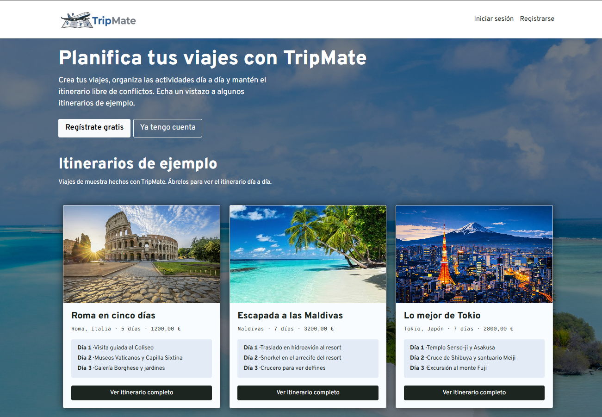
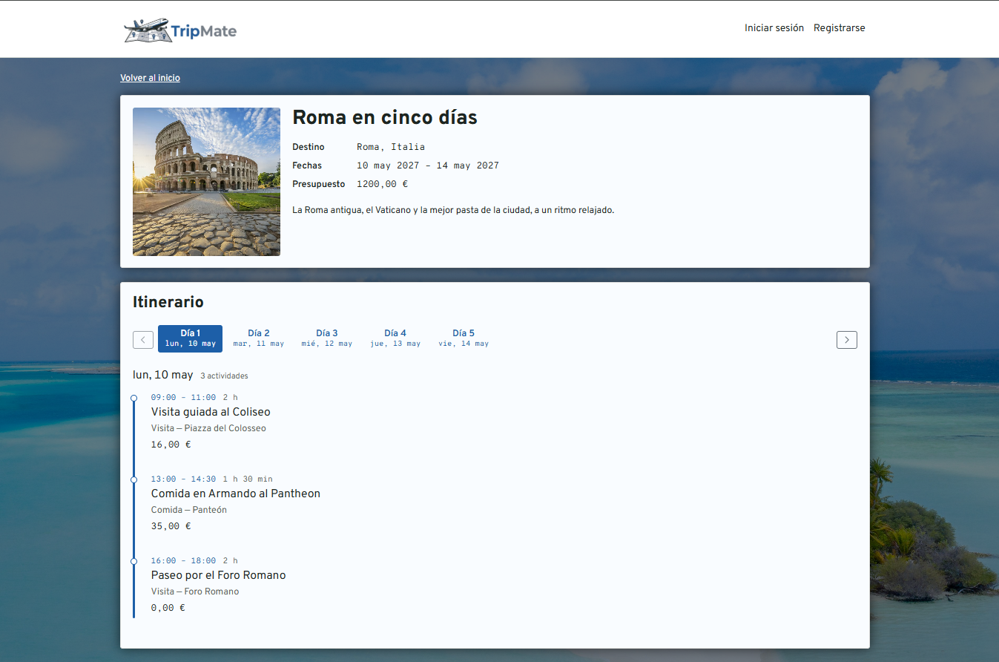

### Registration, login and profile (B2, B3)

A visitor registers with a name, an email and a password (with validation in the form and in the server) and is logged in at once. A registered user can log out, edit their name and email, change the password (the current one is required) and upload, replace or delete their avatar. The header always shows the avatar and the name.

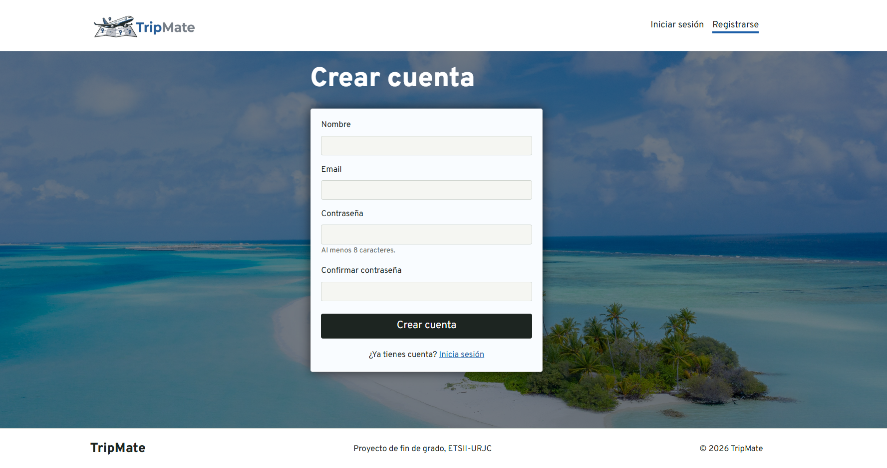
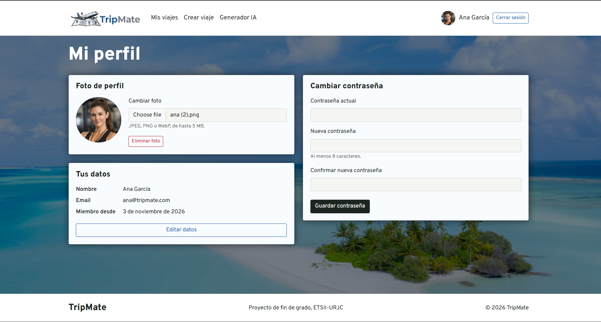

### My trips (B4)

"Mis viajes" lists the trips of the logged-in user, ten at a time, with a "Más resultados" button. A trip has a name, destination, dates, an optional budget and description, and an optional cover image (a default image is shown without one). Only its creator can edit or delete it, and deleting asks for confirmation.

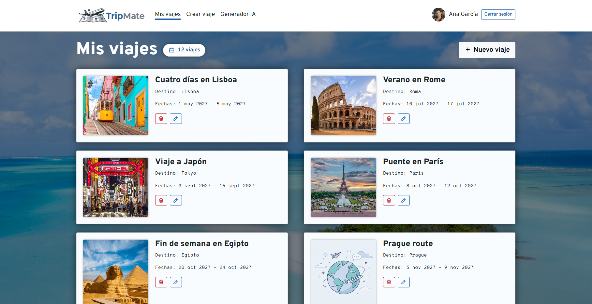
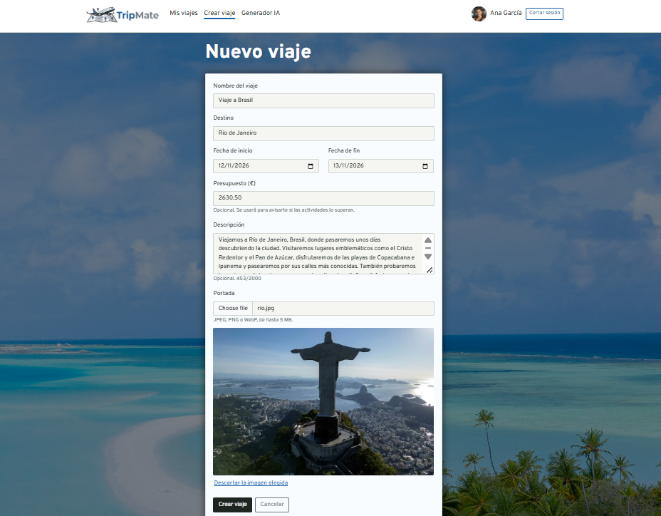

### Itinerary (B5)

The trip page shows the itinerary one day at a time, with a tab for every day of the trip and the activities of the selected day in time order. An activity has a name, a day inside the trip, optional start and end times, a location, a description, a cost, a category and an optional image. The page also shows the budget and what remains of it. The selected day is part of the URL.

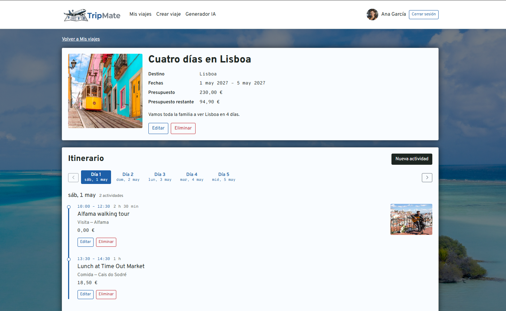
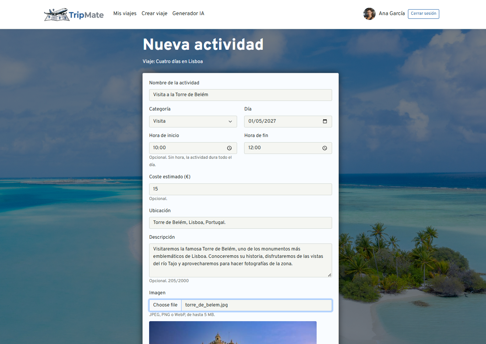

### Conflict detection (B6)

Above the itinerary, the creator sees a warning when activities of the same day overlap in time, when an activity is outside the dates of the trip, or when the total cost is above the budget. The warnings never prevent saving, and the activities outside the dates have an "Editar" link.

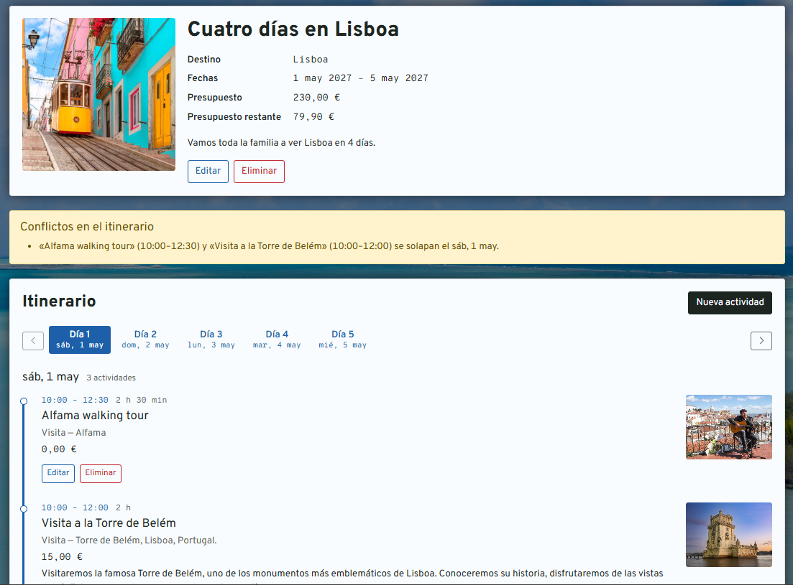

### Administrator: users and trips (B7, B8)

The administrator has two more pages. "Usuarios" lists and searches users, edits their name and email, and blocks or unblocks them; a blocked user cannot log in and loses the open session. "Viajes" lists and searches the trips of every user; the administrator opens any trip in read-only mode and can delete it, but not edit it.

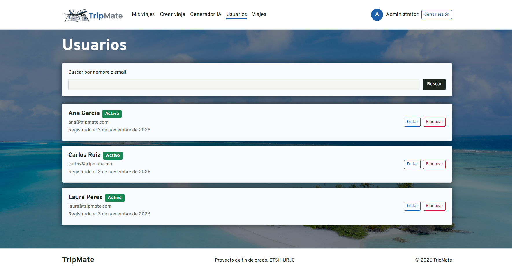
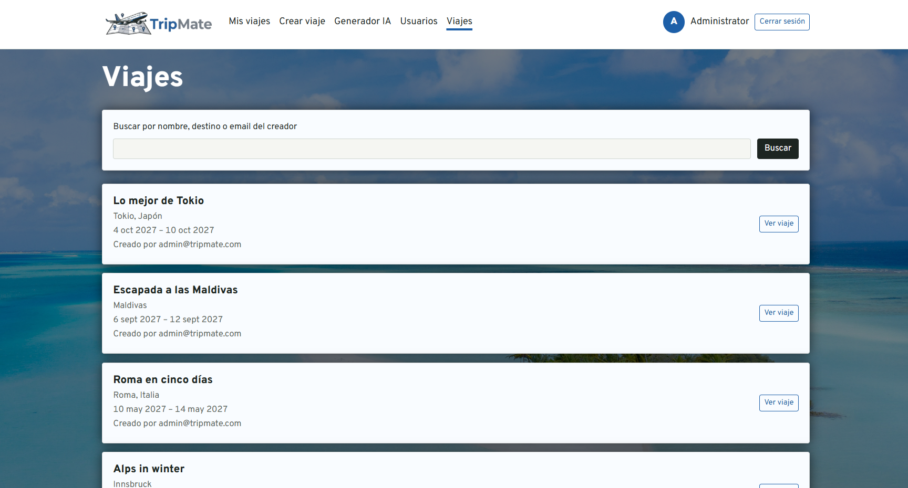

## Detailed features

Each feature has an identifier so that it can be traced to its automated tests (see the [traceability matrix](development-guide.md#traceability-between-tests-and-features)). The _Status_ column says whether it is implemented.

### Basic functionality (version 0.1)

| ID  | Feature                                                                                                                                                                                                                                                       | User type                 | Status         |
| --- | ------------------------------------------------------------------------------------------------------------------------------------------------------------------------------------------------------------------------------------------------------------- | ------------------------- | -------------- |
| B1  | Browse the public home page with example itineraries. The examples are the trips created by the administrator (three in the sample data); they are shown three at a time and opened in a read-only preview, day by day.                                       | Anonymous                 | ✅ Implemented |
| B2  | Register a new account and log in. The new user is always a regular user, and the administrator's email cannot be registered.                                                                                                                                 | Anonymous                 | ✅ Implemented |
| B3  | Log out, and view and edit one's own profile (name, email, password, avatar). The administrator can only change their avatar, because their data comes from the configuration.                                                                                  | Registered                | ✅ Implemented |
| B4  | Create, view, edit, and delete one's own trips, including a cover image.                                                                                                                                                                                      | Registered (trip creator) | ✅ Implemented |
| B5  | Create, view, edit, and delete activities in a trip's itinerary, including an image, and browse the itinerary day by day. The trip page also shows the remaining budget.                                                                                       | Registered (trip creator) | ✅ Implemented |
| B6  | Conflict detection: overlapping activities on the same day, activities outside the trip's date range, and total activity cost exceeding the trip budget. They are warnings shown to the trip creator and never block saving (until version 0.2 only the creator). | Registered (trip creator) | ✅ Implemented |
| B7  | User management: list and search users, edit their name and email, and block or unblock accounts. The administrator's own account cannot be edited or blocked here.                                                                                            | Administrator             | ✅ Implemented |
| B8  | Trip moderation: list and search all trips, view any trip in read-only mode (with its itinerary), and delete inappropriate trips. The administrator does not edit other users' trips.                                                                          | Administrator             | ✅ Implemented |

### Intermediate functionality (version 0.2)

| ID  | Feature                                                                                                                                        | User type                      | Status     |
| --- | ---------------------------------------------------------------------------------------------------------------------------------------------- | ------------------------------ | ---------- |
| I1  | Invite users to a trip by email; the invited person receives an email with a link to respond.                                                  | Trip creator                   | ⏳ Planned |
| I2  | Accept or reject an invitation, from the email link or from the pending invitations section in "My Trips".                                     | Registered (invited user)      | ⏳ Planned |
| I3  | Manage participants: the creator can view and remove participants; a participant can leave the trip.                                           | Trip creator, trip participant | ⏳ Planned |
| I4  | Collaborative itinerary: participants create activities and edit or delete their own; the creator can edit or delete any activity of the trip. | Trip creator, trip participant | ⏳ Planned |
| I5  | Spending charts on the trip page (spending by category against the budget, cumulative spending per day).                                       | Trip creator, trip participant | ⏳ Planned |
| I6  | Platform metrics dashboard (total users, trips, activities, and, from version 1.0, AI requests).                                               | Administrator                  | ⏳ Planned |

### Advanced functionality (version 1.0)

| ID  | Feature                                                                                                                                                                                                                                                                      | User type                      | Status     |
| --- | ---------------------------------------------------------------------------------------------------------------------------------------------------------------------------------------------------------------------------------------------------------------------------- | ------------------------------ | ---------- |
| A1  | Generation of itinerary proposals via AI, based on destination, dates, budget, and the group's preferences, with manual review and acceptance before the proposed activities are added.                                                                                      | Trip creator, trip participant | ⏳ Planned |
| A2  | Reorganization of an existing itinerary via AI, taking already-detected conflicts into account, with manual review and acceptance.                                                                                                                                           | Trip creator                   | ⏳ Planned |
| A3  | Connect a Telegram account from the user profile (through a one-time link to the TripMate bot) and disconnect it.                                                                                                                                                            | Registered                     | ⏳ Planned |
| A4  | Create the trip's Telegram group with a single button: Telegram opens to create the group with the TripMate bot as administrator, and the bot links the group to the trip.                                                                                                   | Trip creator                   | ⏳ Planned |
| A5  | Invitations through Telegram: invited users with a connected account receive a private message from the bot with the group invite link and a link to the trip. The bot approves join requests only from invited users or participants, and removes users who leave the trip. | Trip creator, invited user     | ⏳ Planned |
| A6  | Notifications in the trip's Telegram group when the dates, the itinerary, or the participants change.                                                                                                                                                                        | Trip participants              | ⏳ Planned |

The Telegram integration is optional for users: every feature of the trip works without a Telegram account.
