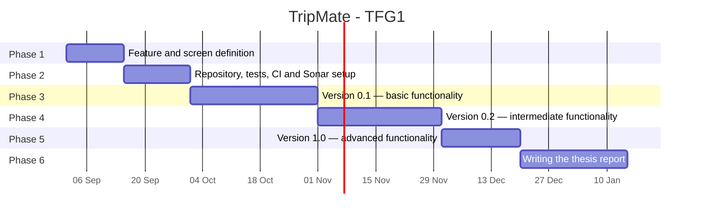

[← Back to README](../README.md)

# Methodology

The project follows an iterative and incremental process based on the principles of the Agile Manifesto, applying some Extreme Programming (XP) and Kanban practices. Tasks are managed as GitHub Issues on a GitHub Project Kanban board. The code is managed with Git following GitHub Flow: each feature or fix is developed in its own branch and merged into `main` through a pull request. A new version (release) is published at the end of each development phase.

- **Phase 1:** Definition of the application's features and screens, described in the [Detailed features](functionalities.md) and [Analysis](analysis.md) sections.
- **Phase 2:** Setup of the development technologies and tools, with quality controls that run periodically (automated tests, continuous integration, and static code analysis). Described in the [Development guide](development-guide.md).
- **Phases 3, 4, and 5:** Iterative and incremental development of the application. A release is published at the end of each phase (versions 0.1, 0.2, and 1.0).
- **Phase 6:** Writing the thesis report.
- **Phase 7:** Preparing and delivering the defense.

| Phase   | Content                                                                                        | Start        | End              |
| ------- | ---------------------------------------------------------------------------------------------- | ------------ | ---------------- |
| Phase 1 | Definition of features, screens, and analysis                                                  | Sep 1, 2026  | **Sep 15, 2026** |
| Phase 2 | Repository setup, minimum functionality, automated tests, continuous integration, and Sonar    | Sep 15, 2026 | **Oct 1, 2026**  |
| Phase 3 | Version 0.1 — basic functionality (B1–B8) + Docker and continuous delivery                     | Oct 1, 2026  | **Nov 1, 2026**  |
| Phase 4 | Version 0.2 — intermediate functionality (I1–I6) + deployment                                  | Nov 1, 2026  | **Dec 1, 2026**  |
| Phase 5 | Version 1.0 — advanced functionality (A1–A6: AI and Telegram integration) + database migration | Dec 1, 2026  | **Dec 20, 2026** |
| Phase 6 | Writing the thesis report                                                                      | Dec 20, 2026 | **Jan 15, 2027** |
| Phase 7 | Defense                                                                                        | TBD          | **TBD**          |

